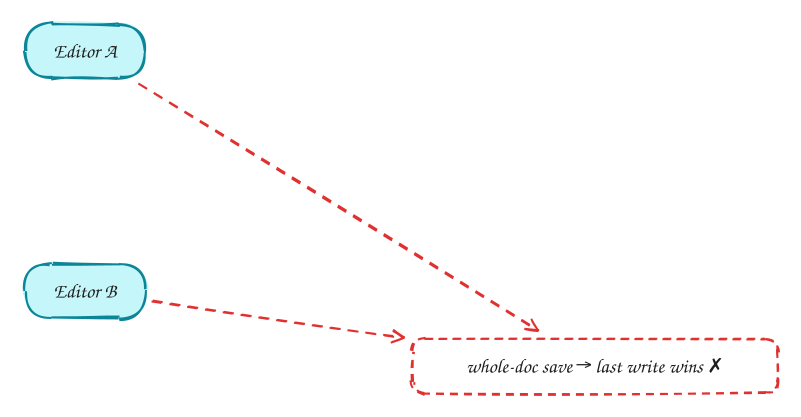
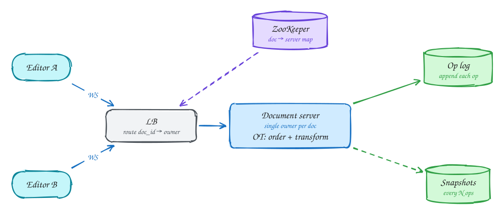

# Collaborative editor (Google Docs)

<span class="lvl lvl-a">Advanced</span>

**Difficulty:** Hard · **Patterns:** [Real-time updates](../patterns/real-time-updates.md) · **DDIA:** [Ch 5](../ddia/05-replication.md) conflict resolution · [Ch 9](../ddia/09-consistency-and-consensus.md) total order · [Ch 11](../ddia/11-stream-processing.md) event log

*The challenge is correctness, not scale: everyone must end up with the same document.*

> [!TIP]
> **One-page sketchnote:** [COLLABORATIVE EDITOR (GOOGLE DOCS) on a single page](../sketchnotes/problem-collaborative-editor.svg), for revision or printing.

## TL;DR

- Send small operations, not whole documents; last-write-wins on documents loses people's work.
- One server per document orders operations and transforms concurrent ones (OT); CRDTs are the serverless alternative.
- Append every operation to a log before acknowledging it, and snapshot periodically for fast loading.

## 1. Requirements

**Functional**

1. Create and open documents
2. Many users edit concurrently and see each other's changes live
3. See collaborators' cursors and presence

**Non-functional**

- Remote edits visible < 100ms
- All replicas converge to the same document
- No lost edits (durable)
- ~100 concurrent editors per doc; millions of docs

## 2. Back-of-envelope numbers

Each keystroke is an op (~100B). 100 editors × 5 ops/s = 500 ops/s per hot doc, which one server handles easily. The challenge is correctness, not scale.

## 3. Core entities and API

```text
doc_ops(doc_id, version, op) append-only
doc_snapshots(doc_id, version, content)
```

```http
WS /docs/{id}: send op {type, pos, char, base_version}; receive transformed ops
GET /docs/{id} (snapshot + version)
```

## 4. v1: the simplest design, and where it breaks



Naive: send the whole document on save. Last write wins, and someone's work disappears.

## 5. Evolving to the final design



Each step fixes one specific problem with the step before it:

1. Naive: send the whole document on save. Last write wins, and someone's work disappears.
2. Send **operations** (insert "x" at 5). Concurrent ops shift positions, so a single server per doc orders them and **transforms** each against concurrent ones (Operational Transformation), then broadcasts.
3. Every op is appended to the op log before it is acknowledged; periodic snapshots make loading fast (snapshot + tail).
4. All editors of a doc must reach the same owner server: consistent hashing on doc_id, with ownership coordinated through ZooKeeper.

## 6. Deep dives

### OT or CRDT?

**OT**: a central server orders and transforms; compact; needs one coordinator per doc (Google Docs). **CRDT**: ops commute, no server needed, good for offline and P2P; bigger metadata (Figma, Yjs).

### Why one server per doc?

OT needs a single total order of ops (DDIA Ch 9).

### Offline edits?

Client buffers ops tagged with a base version; on reconnect the server transforms them against everything since that version.

### Cursors?

Ephemeral presence over the same socket; not persisted.

## 7. Interview script (45 minutes)

| Time | What you do | Content |
|---|---|---|
| 0–5 | Functional requirements | Create and open documents; Many users edit concurrently and see each other's changes live; See collaborators' cursors and presence |
| 5–8 | Non-functional requirements | Remote edits visible < 100ms; All replicas converge to the same document; No lost edits (durable); ~100 concurrent editors per doc; millions of docs |
| 8–10 | Numbers that drive the design | Each keystroke is an op (~100B). 100 editors × 5 ops/s = 500 ops/s per hot doc, which one server handles easily. The challenge is correctness, not scale. |
| 10–13 | Entities and API | Keep it short: the endpoints in §3, idempotency keys on writes. |
| 13–25 | v1, then evolve it | Draw v1 and show where it breaks. Then add, in order: Document server → Op log → Snapshots → LB → ZooKeeper. Justify each addition with a number. |
| 25–40 | Deep dives | OT or CRDT? · Why one server per doc? · Offline edits? · Cursors? |
| 40–45 | Wrap-up | Remaining bottlenecks, failure modes, what you would monitor. |


## Staff-level lens

| Question | Staff answer |
|---|---|
| **The real problem** | Every client must converge to the same document. |
| **Deciding number** | ~500 ops/s on a hot document; correctness, not scale. |
| **Staff call and trade-off** | One owner server per document running OT, with an op log and snapshots. Accept a short pause when the owner fails over. |
| **Raise before you're asked** | Owner failover; merging offline edits; very large documents. |
| **Senior stops at** | Names OT or CRDT. |
| **Staff goes on to** | Chooses between them from requirements (offline, server cost), assigns ownership via a coordination service, plans version history. |
| **Run it** | Watch op latency, convergence errors, snapshot size. |

All 29 problems through this lens: [Staff-level answers](../playbook/staff-level.md).

## 8. Common mistakes

- Locking the document or paragraph, which defeats real-time collaboration.
- Adding components before showing which number makes them necessary.
- Skipping failure handling: what happens on timeouts, retries and crashes.

## Related

- **Patterns:** [Real-time updates](../patterns/real-time-updates.md)
- **DDIA:** [Ch 5](../ddia/05-replication.md) conflict resolution · [Ch 9](../ddia/09-consistency-and-consensus.md) total order · [Ch 11](../ddia/11-stream-processing.md) event log
- **Similar problems:** [Ride sharing (Uber)](ride-sharing.md) · [Live comments (Facebook Live)](live-comments.md) · [Stock trading (Robinhood)](stock-trading.md) · [Online auction](online-auction.md)
