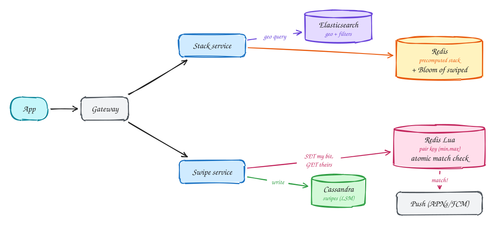

# Dating app (Tinder)

**Difficulty:** Medium · **Patterns:** [Scaling reads](../patterns/scaling-reads.md) · **DDIA:** [Ch 7](../ddia/07-transactions.md) write skew · [Ch 3](../ddia/03-storage-and-retrieval.md) Bloom filters, LSM

*Swipes are a firehose of writes, and two people swiping right at the same moment must never miss their match.*

> [!TIP]
> **One-page sketchnote:** [DATING APP (TINDER) on a single page](../sketchnotes/problem-dating-app.svg), for revision or printing.

## TL;DR

- Precompute each user's stack of nearby candidates and hide already-swiped profiles with a Bloom filter.
- Swipes are write-heavy and append-only, a good fit for an LSM store like Cassandra.
- Detect matches atomically on one key per pair of users, so simultaneous swipes can't both miss each other.

## 1. Requirements

**Functional**

1. Profile with preferences (age, distance)
2. Get a stack of nearby candidates
3. Swipe left/right; get notified on a mutual match

**Non-functional**

- Stack load p99 < 300ms
- No missed matches (strong consistency on swipes)
- Don't re-show swiped profiles
- 20M DAU × 100 swipes

## 2. Back-of-envelope numbers

2B swipes/day ≈ **25k/s avg, ~100k/s peak**, which is write-heavy. Stacks precomputed: 20M × 200 IDs × 8B ≈ 32GB.

## 3. Core entities and API

```text
profiles
swipes(swiper_id, swipee_id, decision) partitioned by swiper
matches(a, b, ts)
```

```http
GET /feed?lat&lng → [profiles]
POST /swipes {target_id, decision}
push: match notification
```

## 4. v1: the simplest design, and where it breaks

Build each stack with a geo + preferences query in Elasticsearch. That works, but is slow on every open.

## 5. Evolving to the final design



Each step fixes one specific problem with the step before it:

1. Build each stack with a geo + preferences query in Elasticsearch. That works, but is slow on every open.
2. Precompute the next ~200 candidates per user in Redis and refresh in the background. A per-user **Bloom filter** hides profiles already swiped.
3. Swipes are write-heavy (100k/s) and append-only, so an LSM store like Cassandra fits.
4. Match race: A and B swipe right at the same moment, and each check misses the other. Fix: one key per pair (min, max) and a Lua script that sets my decision and reads theirs atomically.

## 6. Deep dives

### Both swipe at once: why can a match be missed?

Two writes followed by two reads: each read runs before the other's write lands. That is write skew (Ch 7). An atomic op on a single pair key makes exactly one side see "both".

### Hide already-swiped profiles?

A Bloom filter per user. A false positive skips an unseen profile, which is acceptable; no false negatives.

### Location changes?

Invalidate and recompute the stack when the user moves more than X km.

## 7. Interview script (45 minutes)

| Time | What you do | Content |
|---|---|---|
| 0–5 | Functional requirements | Profile with preferences (age, distance); Get a stack of nearby candidates; Swipe left/right; get notified on a mutual match |
| 5–8 | Non-functional requirements | Stack load p99 < 300ms; No missed matches (strong consistency on swipes); Don't re-show swiped profiles; 20M DAU × 100 swipes |
| 8–10 | Numbers that drive the design | 2B swipes/day ≈ **25k/s avg, ~100k/s peak**, which is write-heavy. Stacks precomputed: 20M × 200 IDs × 8B ≈ 32GB. |
| 10–13 | Entities and API | Keep it short: the endpoints in §3, idempotency keys on writes. |
| 13–25 | v1, then evolve it | Draw v1 and show where it breaks. Then add, in order: Redis → Swipe service → Cassandra → Redis Lua → Push (APNs/FCM). Justify each addition with a number. |
| 25–40 | Deep dives | Both swipe at once: why can a match be missed? · Hide already-swiped profiles? · Location changes? |
| 40–45 | Wrap-up | Remaining bottlenecks, failure modes, what you would monitor. |


## Staff-level lens

| Question | Staff answer |
|---|---|
| **The real problem** | Write-heavy swipes, and a mutual match must never be missed. |
| **Deciding number** | ~100k swipes/s at peak; precomputed stacks ≈ 32 GB. |
| **Staff call and trade-off** | Precomputed stacks + Bloom filter of swiped profiles; one atomic operation per pair of users for matches. Accept rare skipped profiles from Bloom false positives. |
| **Raise before you're asked** | Two right-swipes at the same instant (write skew); stacks stale after the user moves; bots. |
| **Senior stops at** | Stores swipes. |
| **Staff goes on to** | Names the race precisely, uses a pair-keyed atomic op, sizes precomputation, weighs recommendation quality against cost. |
| **Run it** | Watch match detection latency, stack freshness, swipe write lag. |

All 29 problems through this lens: [Staff-level answers](../playbook/staff-level.md).

## 8. Common mistakes

- Separate "write swipe" and "check other swipe" calls without atomicity, so matches are lost.
- Adding components before showing which number makes them necessary.
- Skipping failure handling: what happens on timeouts, retries and crashes.

## Related

- **Patterns:** [Scaling reads](../patterns/scaling-reads.md)
- **DDIA:** [Ch 7](../ddia/07-transactions.md) write skew · [Ch 3](../ddia/03-storage-and-retrieval.md) Bloom filters, LSM
- **Similar problems:** [URL shortener (Bitly)](url-shortener.md) · [Rate limiter](rate-limiter.md) · [Business discovery (Yelp)](business-discovery.md) · [News feed (Facebook)](news-feed.md)
