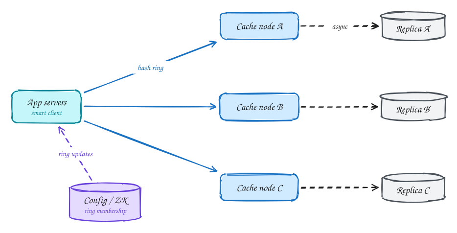

# Distributed cache

<span class="lvl lvl-i">Intermediate</span>

**Difficulty:** Medium · **Patterns:** [Scaling reads](../patterns/scaling-reads.md) · [Long-running tasks](../patterns/long-running-tasks.md) · **DDIA:** [Ch 6](../ddia/06-partitioning.md) consistent hashing · [Ch 5](../ddia/05-replication.md) async replication

*Design Redis itself: data structures inside one node, then distribution across many.*

> [!TIP]
> **One-page sketchnote:** [DISTRIBUTED CACHE on a single page](../sketchnotes/problem-distributed-cache.svg), for revision or printing.

## TL;DR

- One node is a hash map plus a doubly linked list for O(1) least-recently-used eviction.
- Spread keys with consistent hashing and virtual nodes, so adding a node moves only a small share of keys.
- Replicate asynchronously for failover, and spread hot keys over several nodes.

## 1. Requirements

**Functional**

1. get(key), set(key, value, ttl), delete(key)
2. LRU eviction when full

**Non-functional**

- p99 ~1ms
- ~1TB data, 100k+ ops/s
- Survive node failure
- Eventual consistency acceptable

## 2. Back-of-envelope numbers

1TB ÷ ~32GB usable per node ≈ **32+ nodes** (+ replicas). Each node handles ≫ 100k ops/s, so memory, not CPU, sets the node count.

## 3. Core entities and API

```text
per node: HashMap key → node in a doubly linked list (LRU order) + expiry
```

```http
GET /cache/{key}
PUT /cache/{key} {value, ttl}
DELETE /cache/{key}
```

## 4. v1: the simplest design, and where it breaks


Start with a cache on **one** machine. It needs two things: fast lookups, and a way to decide what to throw out when memory is full.

- **Lookup:** a **hash map** from key to entry gives O(1) `get` and `set`.
- **Eviction (LRU):** when memory is full, remove the **least recently used** entry, the one nobody has asked for in the longest time. To find it instantly, also keep all entries in a **doubly linked list** ordered by use. On every access, move that entry to the **head**. When space is needed, remove the entry at the **tail**. Each hash map value points straight to its list node, so both operations are O(1).
- **Expiry (TTL):** check the expiry time when a key is read (*lazy expiry*), and run a background sweep that samples keys and deletes expired ones, so unread keys don't sit in memory forever.

**Where it breaks:** the requirement is **about 1 TB** of data. One machine has maybe 32–64 GB of usable memory. And if that one machine dies, the whole cache is gone at once, and every request falls through to the database. We need many nodes, and a way to know which node holds which key.

## 5. Evolving to the final design



Each step fixes one specific problem with the step before it.

### Step 1: shard keys across nodes with consistent hashing

**Why:** 1 TB ÷ about 32 GB per node is **32+ nodes**. Every client must agree on which node owns a key, and adding or removing a node must not reshuffle everything.

**How:** place nodes on a **consistent-hash ring** with **virtual nodes**, about 100–200 points per server, so load is even. A key belongs to the first node clockwise from its hash. The **client library** computes this itself and talks directly to the owning node, with no extra network hop through a router. Adding a node moves only about 1/N of keys (see [Consistent hashing](../core-concepts/consistent-hashing.md)).

### Step 2: replicate each node for failover

**Why:** with 32 nodes, one failing is routine. Without copies, a node failure empties 1/32 of the cache instantly, and those requests all hit the database at once.

**How:** each primary node streams its writes **asynchronously** to a replica. If the primary dies, the replica is promoted and takes over its keys, still warm. Asynchronous replication means the last few writes may be lost in a failover. That's fine for a cache: a missing entry just causes a miss and a reload from the database.

### Step 3: track membership centrally, and protect hot keys

**Why:** clients need an up-to-date view of the ring as nodes join, leave or fail over. And one extremely popular key still lives on one node, however well the others are balanced.

**How:** keep the ring membership in a small coordination service such as etcd or ZooKeeper. Clients **watch** it and update their ring the moment it changes. For hot keys, see the deep dive below.

## 6. Deep dives

### LRU in O(1)?

**Why it's asked:** a naive LRU sorts entries by last access time, which is O(n log n), or scans for the oldest, which is O(n). That's far too slow for a cache answering in microseconds.

**How:** combine a **hash map** with a **doubly linked list**. The map gives O(1) lookup from key to list node. On `get`, unlink the node and move it to the head. Because the list is doubly linked, unlinking is O(1): you have pointers to both neighbours. On eviction, remove the tail node and delete its key from the map. Every operation touches a constant number of pointers.

### Add a node?

**Why it's hard:** a new node starts **empty**. Whatever keys move to it become misses until they're reloaded from the database.

**How:** consistent hashing limits the damage to about **1/N** of keys, and virtual nodes spread that small share evenly across all existing nodes. To soften it further, **warm the node gradually**: give it a small weight on the ring at first, so it owns few keys, and raise the weight over a few minutes as its cache fills.

### Hot key?

**Why it's hard:** sharding spreads **different** keys. One key read 500k times a second, such as a homepage config or a celebrity profile, always lands on **one** node, which overloads while the others sit idle.

**How:** two common fixes.

- **Replicate the key** under several names (`profile:7#0` … `profile:7#9`). These hash to different nodes, and readers pick one at random, so the load is split 10 ways. Writes must update all the copies.
- **A local cache in each client** (L1): keep the hottest keys in the application's own memory for a second or two. Most reads never leave the app server at all. The cost is a little staleness.

### Why not hash % N?

**Why it fails:** with `node = hash(key) % N`, changing N from 32 to 33 changes the answer for almost **every** key. Suddenly almost every lookup goes to the wrong node and misses.

**What happens next:** all those misses fall through to the database at the same moment, a **cold-cache stampede** that can take the database down exactly when you were trying to add capacity. Consistent hashing exists to prevent this.

## 7. Interview script (45 minutes)

| Time | What you do | Content |
|---|---|---|
| 0–5 | Functional requirements | get(key), set(key, value, ttl), delete(key); LRU eviction when full |
| 5–8 | Non-functional requirements | p99 ~1ms; ~1TB data, 100k+ ops/s; Survive node failure; Eventual consistency acceptable |
| 8–10 | Numbers that drive the design | 1TB ÷ ~32GB usable per node ≈ **32+ nodes** (+ replicas). Each node handles ≫ 100k ops/s, so memory, not CPU, sets the node count. |
| 10–13 | Entities and API | Keep it short: the endpoints in §3, idempotency keys on writes. |
| 13–25 | v1, then evolve it | Draw v1 and show where it breaks. Then add, in order: Cache node A → Cache node B → Cache node C → Replica A′ → Replica B′ → Replica C′ → Config / ZK. Justify each addition with a number. |
| 25–40 | Deep dives | LRU in O(1)? · Add a node? · Hot key? · Why not hash % N? |
| 40–45 | Wrap-up | Remaining bottlenecks, failure modes, what you would monitor. |


## Staff-level lens

| Question | Staff answer |
|---|---|
| **The real problem** | Build the cache itself: eviction, distribution, failover. |
| **Deciding number** | 1 TB ÷ ~32 GB per node ≈ 32+ nodes; each node ≫ 100k ops/s, so memory sets the count. |
| **Staff call and trade-off** | Consistent hashing with virtual nodes, async replica per primary. Accept losing a few writes on failover. |
| **Raise before you're asked** | Hot key overloading one node; scale-out causing cold misses and a DB stampede; split brain on promotion. |
| **Senior stops at** | LRU + consistent hashing. |
| **Staff goes on to** | Membership via a config service, gradual warm-up on scale-out, client routing vs proxy trade-off. |
| **Run it** | Watch hit ratio, evictions, per-node p99 and memory, rebalance traffic. |

All 29 problems through this lens: [Staff-level answers](../playbook/staff-level.md).

## 8. Common mistakes

- hash(key) % N sharding.
- Adding components before showing which number makes them necessary.
- Skipping failure handling: what happens on timeouts, retries and crashes.

## Self-check

Try to answer before you open each one.

<details class="question" markdown>
<summary>How do you get O(1) LRU eviction?</summary>

A hash map for lookup plus a doubly linked list ordered by recency; move to front on access, evict from the tail.

</details>

<details class="question" markdown>
<summary>Why consistent hashing instead of hash(key) % N?</summary>

With % N, adding a node remaps almost every key. Consistent hashing with virtual nodes moves only about 1/N of the keys.

</details>

<details class="question" markdown>
<summary>How do you handle a hot key?</summary>

Replicate it to several nodes (or add suffixes to spread it) and read from any copy, or cache it locally in the clients.

</details>

## Related

- **Patterns:** [Scaling reads](../patterns/scaling-reads.md) · [Long-running tasks](../patterns/long-running-tasks.md)
- **DDIA:** [Ch 6](../ddia/06-partitioning.md) consistent hashing · [Ch 5](../ddia/05-replication.md) async replication
- **Similar problems:** [URL shortener (Bitly)](url-shortener.md) · [Rate limiter](rate-limiter.md) · [Business discovery (Yelp)](business-discovery.md) · [News feed (Facebook)](news-feed.md)
