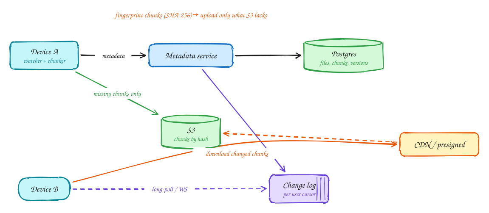

# File storage and sync (Dropbox)

**Difficulty:** Easy · **Patterns:** [Handling large blobs](../patterns/large-blobs.md) · **DDIA:** [Ch 5](../ddia/05-replication.md) conflicts · [Ch 11](../ddia/11-stream-processing.md) change log / cursor

*Syncing a 50 GB file after a one-byte edit should not mean uploading 50 GB again.*

## TL;DR

- Split files into chunks fingerprinted by hash, and upload only the chunks the server doesn't already have.
- Upload and download directly to object storage with presigned URLs.
- Other devices follow a per-user change log with a cursor and fetch only what changed.

## 1. Requirements

**Functional**

1. Upload and download files (up to 50GB)
2. Automatic sync across a user's devices
3. Share files and folders

**Non-functional**

- Resumable uploads
- Changes visible on other devices within seconds
- Durable (S3 11 nines)
- Bandwidth-efficient sync

## 2. Back-of-envelope numbers

Large files chunked at ~5MB: a 50GB file = 10k chunks. Only changed chunks are re-uploaded, so a 1-byte edit sends 5MB, not 50GB.

## 3. Core entities and API

```text
files(id, owner, path, version)
file_chunks(file_id, idx, sha256)
chunks(sha256, s3_key)
shares(file_id, user, perm)
```

```http
POST /files {name, size, chunk_hashes[]} → missing chunks + presigned URLs
GET /changes?cursor → file metadata diffs
GET /files/{id} → chunk list + presigned download URLs
```

## 4. v1: the simplest design, and where it breaks

Naive: upload the whole file through the API. A 50GB upload dies at 99% and starts over.

## 5. Evolving to the final design



Each step fixes one specific problem with the step before it:

1. Naive: upload the whole file through the API. A 50GB upload dies at 99% and starts over.
2. Split into ~5MB chunks; upload directly to S3 via presigned URLs, which is resumable and parallel.
3. Fingerprint each chunk, using **content-defined chunking** so an insert near the start doesn't shift every boundary. The server returns only missing chunks. Edits re-upload changed chunks, and identical chunks are stored once (dedupe).
4. Other devices follow a per-user change log with a cursor (long-poll or WebSocket), fetch the metadata diff, and download only the changed chunks.

## 6. Deep dives

### Resume after failure?

The server knows which chunk hashes exist; the client re-sends only missing ones.

### How do devices learn about changes?

Change log + cursor per device; long-poll or WebSocket notifications.

### Edits on two offline devices?

Upload carries a base version; if stale, save a "conflicted copy" (DDIA Ch 5 multi-leader conflict).

### Trust the client said "done"?

Verify via S3 event or ETags before marking the file version committed.

## 7. Interview script (45 minutes)

| Time | What you do | Content |
|---|---|---|
| 0–5 | Functional requirements | Upload and download files (up to 50GB); Automatic sync across a user's devices; Share files and folders |
| 5–8 | Non-functional requirements | Resumable uploads; Changes visible on other devices within seconds; Durable (S3 11 nines); Bandwidth-efficient sync |
| 8–10 | Numbers that drive the design | Large files chunked at ~5MB: a 50GB file = 10k chunks. Only changed chunks are re-uploaded, so a 1-byte edit sends 5MB, not 50GB. |
| 10–13 | Entities and API | Keep it short: the endpoints in §3, idempotency keys on writes. |
| 13–25 | v1, then evolve it | Draw v1 and show where it breaks. Then add, in order: S3 → Change log → CDN / presigned. Justify each addition with a number. |
| 25–40 | Deep dives | Resume after failure? · How do devices learn about changes? · Edits on two offline devices? · Trust the client said "done"? |
| 40–45 | Wrap-up | Remaining bottlenecks, failure modes, what you would monitor. |

## 8. Common mistakes

- Proxying file bytes through API servers, and re-uploading whole files on small edits.
- Adding components before showing which number makes them necessary.
- Skipping failure handling: what happens on timeouts, retries and crashes.

## Related

- **Patterns:** [Handling large blobs](../patterns/large-blobs.md)
- **DDIA:** [Ch 5](../ddia/05-replication.md) conflicts · [Ch 11](../ddia/11-stream-processing.md) change log / cursor
- **Similar problems:** [Video platform (YouTube)](video-platform.md) · [Photo sharing (Instagram)](photo-sharing.md)
