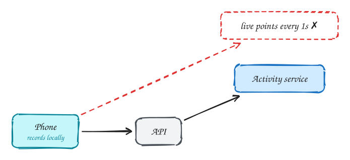
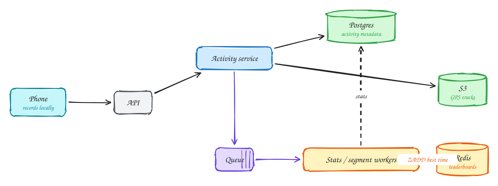

# Fitness tracking (Strava)

<span class="lvl lvl-i">Intermediate</span>

**Difficulty:** Medium · **Patterns:** [Scaling writes](../patterns/scaling-writes.md) · **DDIA:** [Ch 11](../ddia/11-stream-processing.md) event time · [Ch 12](../ddia/12-future-of-data-systems.md) idempotent upload

*The key insight is where the work happens: on the phone, not the server.*

> [!TIP]
> **One-page sketchnote:** [FITNESS TRACKING (STRAVA) on a single page](../sketchnotes/problem-fitness-tracking.svg), for revision or printing.

## TL;DR

- Record GPS on the device and upload the whole activity when it ends; no need to stream every point.
- Store the track in object storage and the metadata in a database, with an idempotent, resumable upload.
- Compute stats and leaderboards asynchronously from a queue; leaderboards are Redis sorted sets.

## 1. Requirements

**Functional**

1. Start/pause/stop recording an activity (GPS track)
2. View activity stats and maps
3. Share with friends; see friends' activities; leaderboards

**Non-functional**

- Works offline; never lose an activity
- 10M DAU
- Feed eventually consistent
- Uploads resumable

## 2. Back-of-envelope numbers

10M activities/day; 1hr at 1 point/5s = 720 points ≈ 15–100KB per track → **~1TB/day** of track blobs.

## 3. Core entities and API

```text
activities(id, user_id, type, start, distance, duration, track_s3_key)
follows
leaderboard:{segment} ZSET
```

```http
POST /activities (complete track, idempotency key)
GET /activities/{id}
GET /feed?cursor
```

## 4. v1: the simplest design, and where it breaks



Naive: stream every GPS point to the server in real time. 10M devices means millions of writes/sec, for no user value.

## 5. Evolving to the final design



Each step fixes one specific problem with the step before it:

1. Naive: stream every GPS point to the server in real time. 10M devices means millions of writes/sec, for no user value.
2. Record on the device (works in tunnels and mountains). Upload the whole activity when finished, with an idempotency key and resumable upload.
3. Track blob to S3, metadata to Postgres.
4. Heavy processing (stats, segment matching) runs asynchronously from a queue; leaderboards are Redis sorted sets per segment.

## 6. Deep dives

### Why device-first?

Signal is unreliable; users need it to work offline. Only optional live tracking sends periodic points (best effort).

### Upload reliability?

Idempotency key = activity_id; resumable chunks; retry until acked.

### Leaderboards?

ZADD segment:{id} with the time as score; ZRANGE for top N; snapshot to DB.

### Time correctness?

Use device timestamps (event time), not upload time.

## 7. Interview script (45 minutes)

| Time | What you do | Content |
|---|---|---|
| 0–5 | Functional requirements | Start/pause/stop recording an activity (GPS track); View activity stats and maps; Share with friends; see friends' activities; leaderboards |
| 5–8 | Non-functional requirements | Works offline; never lose an activity; 10M DAU; Feed eventually consistent; Uploads resumable |
| 8–10 | Numbers that drive the design | 10M activities/day; 1hr at 1 point/5s = 720 points ≈ 15–100KB per track → **~1TB/day** of track blobs. |
| 10–13 | Entities and API | Keep it short: the endpoints in §3, idempotency keys on writes. |
| 13–25 | v1, then evolve it | Draw v1 and show where it breaks. Then add, in order: Postgres → S3 → Queue → Stats / segment workers → Redis. Justify each addition with a number. |
| 25–40 | Deep dives | Why device-first? · Upload reliability? · Leaderboards? · Time correctness? |
| 40–45 | Wrap-up | Remaining bottlenecks, failure modes, what you would monitor. |


## Staff-level lens

| Question | Staff answer |
|---|---|
| **The real problem** | Do the work on the phone; make uploads reliable. |
| **Deciding number** | 10M activities/day; ~1 TB/day of tracks. |
| **Staff call and trade-off** | Record on device; idempotent, resumable upload; process asynchronously. Accept no live server view by default. |
| **Raise before you're asked** | Duplicate uploads; device clock and timezone errors; leaking home locations (privacy zones). |
| **Senior stops at** | Upload then process. |
| **Staff goes on to** | Rejects streaming every GPS point with numbers, adds privacy zones, considers leaderboard cheating. |
| **Run it** | Watch upload success, processing lag, leaderboard freshness. |

All 29 problems through this lens: [Staff-level answers](../playbook/staff-level.md).

## 8. Common mistakes

- Server-side real-time ingestion of every GPS point.
- Adding components before showing which number makes them necessary.
- Skipping failure handling: what happens on timeouts, retries and crashes.

## Related

- **Patterns:** [Scaling writes](../patterns/scaling-writes.md)
- **DDIA:** [Ch 11](../ddia/11-stream-processing.md) event time · [Ch 12](../ddia/12-future-of-data-systems.md) idempotent upload
- **Similar problems:** [Top-K videos (YouTube)](top-k-videos.md) · [Ad click aggregator](ad-click-aggregator.md) · [Web crawler](web-crawler.md) · [Metrics monitoring (Datadog)](metrics-monitoring.md)
