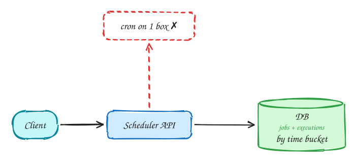
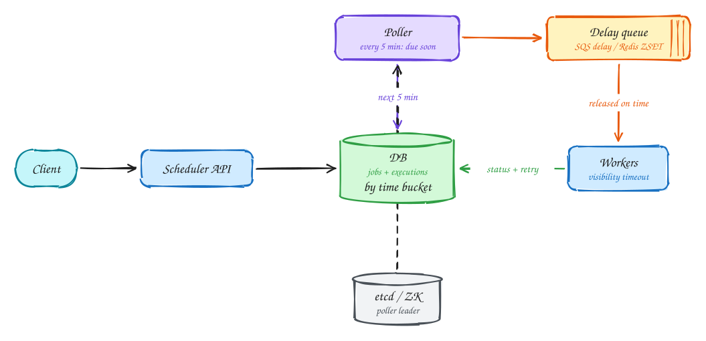

# Job scheduler

**Difficulty:** Hard · **Patterns:** [Multi-step processes](../patterns/multi-step-processes.md) · [Long-running tasks](../patterns/long-running-tasks.md) · **DDIA:** [Ch 9](../ddia/09-consistency-and-consensus.md) leader election · [Ch 8](../ddia/08-trouble-with-distributed-systems.md) leases / fencing · [Ch 6](../ddia/06-partitioning.md) time partitioning

*Ten thousand jobs per second, each within two seconds of its scheduled time.*

## TL;DR

- Cron on one machine is a single point of failure that can't scale.
- Store executions partitioned by time; a poller moves soon-due jobs into a delay queue that releases each on time.
- Workers lease jobs with a visibility timeout, so crashed jobs are retried; jobs must be idempotent.

## 1. Requirements

**Functional**

1. Schedule jobs: one-off at time T, or cron
2. Execute jobs with a retry policy
3. View job status and history

**Non-functional**

- 10k job executions/s
- Start within 2s of scheduled time
- At-least-once; jobs idempotent
- Never lose a job; billions of jobs stored

## 2. Back-of-envelope numbers

10k executions/s = 864M/day. A DB poll every second for "due now" across billions of rows will not hold, so use a two-layer design.

## 3. Core entities and API

```text
jobs(id, user, schedule, payload)
executions(time_bucket, execution_id, job_id, scheduled_at, status, attempt) partitioned by time bucket
```

```http
POST /jobs {schedule (cron | at), payload, retry_policy}
GET /jobs/{id}/executions
```

## 4. v1: the simplest design, and where it breaks



Naive: cron on one server. A single point of failure that can't scale.

## 5. Evolving to the final design



Each step fixes one specific problem with the step before it:

1. Naive: cron on one server. A single point of failure that can't scale.
2. Store executions in a DB partitioned by time bucket; a poller fetches executions due in the next few minutes.
3. Two layers: the poller hands near-due jobs to a **delay queue** that releases each one at its exact time, giving second-level precision without hammering the DB.
4. Workers take jobs with a visibility timeout (lease). A crash means the job reappears and is retried, so jobs must be idempotent. Pollers are partitioned or leader-elected via etcd/ZooKeeper.

## 6. Deep dives

### How do you hit 2s precision?

DB scan every few minutes → delay queue (SQS DelaySeconds ≤ 15 min, or a Redis ZSET by timestamp) releases on time.

### Worker dies mid-job?

Lease expires and the job is retried. Heartbeats extend leases for long jobs; fencing token on completion writes.

### Duplicate enqueues?

Dedupe by execution_id at the queue or worker.

### User history queries?

Secondary index on (user_id, scheduled_at).

## 7. Interview script (45 minutes)

| Time | What you do | Content |
|---|---|---|
| 0–5 | Functional requirements | Schedule jobs: one-off at time T, or cron; Execute jobs with a retry policy; View job status and history |
| 5–8 | Non-functional requirements | 10k job executions/s; Start within 2s of scheduled time; At-least-once; jobs idempotent; Never lose a job; billions of jobs stored |
| 8–10 | Numbers that drive the design | 10k executions/s = 864M/day. A DB poll every second for "due now" across billions of rows will not hold, so use a two-layer design. |
| 10–13 | Entities and API | Keep it short: the endpoints in §3, idempotency keys on writes. |
| 13–25 | v1, then evolve it | Draw v1 and show where it breaks. Then add, in order: Poller → Delay queue → Workers → etcd / ZK. Justify each addition with a number. |
| 25–40 | Deep dives | How do you hit 2s precision? · Worker dies mid-job? · Duplicate enqueues? · User history queries? |
| 40–45 | Wrap-up | Remaining bottlenecks, failure modes, what you would monitor. |

## 8. Common mistakes

- Polling the entire jobs table every second.
- Adding components before showing which number makes them necessary.
- Skipping failure handling: what happens on timeouts, retries and crashes.

## Related

- **Patterns:** [Multi-step processes](../patterns/multi-step-processes.md) · [Long-running tasks](../patterns/long-running-tasks.md)
- **DDIA:** [Ch 9](../ddia/09-consistency-and-consensus.md) leader election · [Ch 8](../ddia/08-trouble-with-distributed-systems.md) leases / fencing · [Ch 6](../ddia/06-partitioning.md) time partitioning
- **Similar problems:** [Payment system (Stripe)](payment-system.md) · [Online judge (LeetCode)](online-judge.md)
