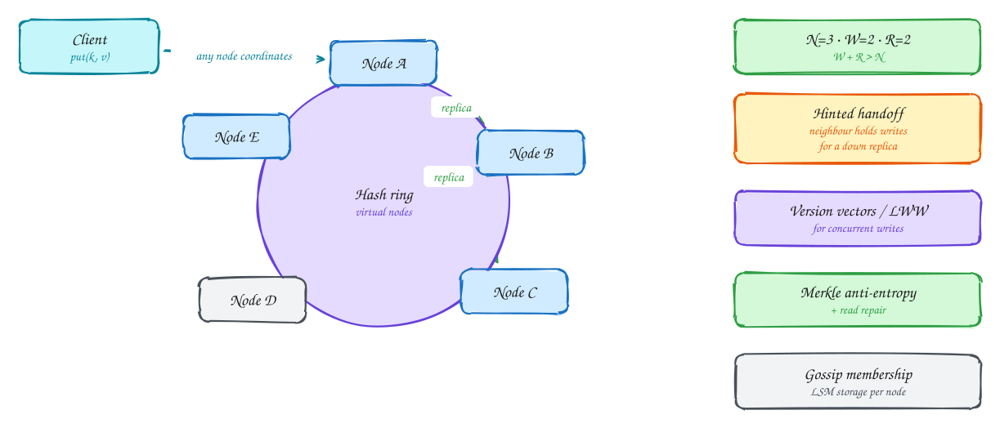

# Distributed key-value store (Dynamo)

<span class="lvl lvl-a">Advanced</span>

**Difficulty:** Hard · **Patterns:** [Scaling writes](../patterns/scaling-writes.md) · [Scaling reads](../patterns/scaling-reads.md) · **DDIA:** [Ch 6](../ddia/06-replication.md) leaderless replication · [Ch 7](../ddia/07-sharding.md) sharding · [Ch 4](../ddia/04-storage-and-retrieval.md) LSM-trees

*The problem that ties half of distributed systems together: every component exists because a specific failure would otherwise lose writes or availability.*

> [!TIP]
> **One-page sketchnote:** [DISTRIBUTED KEY-VALUE STORE on a single page](../sketchnotes/problem-key-value-store.svg), for revision or printing.

## TL;DR

- Spread keys over nodes with **consistent hashing and virtual nodes**; store each key on **N = 3** nodes.
- Any node can coordinate a request; **W = 2, R = 2** quorums give read-your-latest-write while tolerating one node down. **Hinted handoff** keeps writes flowing when a replica is unreachable.
- Replicas drift, so add **read repair**, **Merkle-tree anti-entropy** and a conflict policy (**version vectors** or last-write-wins); nodes learn about each other by **gossip**. Each node stores data in an **LSM-tree**.

## 1. Requirements

**Functional**

1. `put(key, value)`, `get(key)`, `delete(key)`; values up to ~1 MB
2. Optional per-request consistency level (fast and loose vs quorum)

**Non-functional**

- Always writable: a write succeeds even when some nodes are down (availability over consistency, like a shopping cart)
- p99 < 10 ms within a region
- 1M operations/s, 100 TB of data, growing
- Add or remove nodes without downtime

## 2. Back-of-envelope numbers

100 TB × 3 replicas = **300 TB**; at ~2 TB usable per node that's **~150 nodes** (plus headroom). 1M ops/s ÷ 150 nodes ≈ **7k ops/s per node**, comfortable for an LSM engine on SSDs. Consistent hashing with ~256 virtual nodes each spreads both data and load evenly.

## 3. Core entities and API

```text
key → (value, version vector or timestamp)
ring: token ranges → nodes (via virtual nodes)
```

```http
get(key, consistency=QUORUM) → {value(s), context}
put(key, value, context, consistency=QUORUM) → ok
```

The `context` carries the version the client last read, so the store can tell an update from a concurrent write.

## 4. v1: the simplest design, and where it breaks


One server keeps a hash map in memory and appends every write to a log on disk, replaying the log on restart.

**Where it breaks:** 100 TB doesn't fit on one machine, 1M ops/s exceeds one machine, and when it dies, nothing can be read or written until it restarts. We need to **partition** (for size and throughput) and **replicate** (for availability), and each of those creates new problems that the rest of the design solves.

## 5. Evolving to the final design



Each step fixes one specific problem with the step before it.

### Step 1: partition with consistent hashing

**Why:** `hash(key) % N` remaps almost every key when a node is added.

**How:** place nodes on a hash ring, each at ~256 positions (**virtual nodes**); a key belongs to the first node clockwise. Adding a node moves only ~1/N of the data, spread across all existing nodes. Bigger machines get more virtual nodes. See [Consistent hashing](../core-concepts/consistent-hashing.md).

### Step 2: replicate to N nodes, with tunable quorums

**Why:** each key must survive node failures.

**How:** store each key on the next **N = 3 distinct physical nodes** clockwise (its **preference list**), ideally in different availability zones. A client sends a request to any node (or a smart client picks a replica directly), which becomes the **coordinator**: it sends the write to all 3 and replies once **W = 2** acknowledge; a read asks the replicas and returns once **R = 2** answer. Because **W + R > N**, every read quorum overlaps the latest write quorum. Clients can choose `ONE` for speed when staleness is fine. See [DDIA Ch 6: leaderless replication](../ddia/06-replication.md).

### Step 3: stay writable when replicas are down: sloppy quorum and hinted handoff

**Why:** if two of a key's three replicas are unreachable, a strict quorum write fails, but the requirement is "always writable".

**How:** the coordinator writes to the next healthy nodes on the ring instead, with a **hint** saying "this belongs to node C". When C comes back (detected by gossip), the stand-in **hands the write off** and deletes its copy. This is a **sloppy quorum**: availability improves, but a read quorum may miss the latest write until handoff completes.

### Step 4: detect and resolve concurrent versions

**Why:** with no leader, two clients can update the same key at the same time on different replicas, or during a partition.

**How:** choose a policy per use case:

- **Last-write-wins** by timestamp: simple, but silently drops one of two concurrent writes, and clock skew can drop the newer one. Fine for caches and idempotent data.
- **Version vectors**: each replica counter in a small vector attached to the value. If one version's vector dominates, it's newer; if neither does, they're **concurrent siblings**, and both are returned for the application to merge (or use a CRDT). Amazon's cart merged siblings by union (watch out for deleted items reappearing).

### Step 5: repair drift: read repair, anti-entropy, gossip

**Why:** missed writes (node down, dropped hints) leave replicas inconsistent, and nodes need to know who's alive.

**How:**

- **Read repair:** when a read sees a stale replica, the coordinator writes the newest version back to it.
- **Anti-entropy:** in the background, replicas compare **Merkle trees** per token range and exchange only the ranges that differ ([Merkle trees](../core-concepts/merkle-trees.md)).
- **Gossip:** nodes exchange membership and ring ownership every second; a **phi-accrual** detector decides when to stop routing to a node ([Gossip and failure detection](../core-concepts/gossip-and-failure-detection.md)).
- **Deletes** are written as **tombstones** that replicate like writes and are purged after a grace period longer than any repair cycle; otherwise a replica that missed the delete would resurrect the value.

### Step 6: storage engine per node

**Why:** the workload is write-heavy with point reads.

**How:** an **LSM-tree** (memtable + commit log + SSTables with Bloom filters, compaction) gives fast sequential writes and acceptable reads ([DDIA Ch 4](../ddia/04-storage-and-retrieval.md)).

## 6. Deep dives

### Strong consistency instead?

**Why it matters:** some keys (account balances, uniqueness) can't tolerate siblings.

**How:** a quorum with W + R > N still isn't linearizable under sloppy quorums and concurrent writes. For strong consistency, run **a consensus group (Raft) per shard** with a leader, as etcd, TiKV and CockroachDB do: writes go through the leader and a majority, at the cost of availability during partitions and extra latency. State the choice explicitly ([DDIA Ch 10](../ddia/10-consistency-and-consensus.md)).

### Adding a node?

**Why it matters:** moving terabytes must not hurt live traffic.

**How:** the new node takes virtual-node positions, streams the corresponding ranges from current owners (throttled), and starts serving them once caught up; gossip spreads the new ring. Automatic rebalancing is throttled to avoid cascading overload ([DDIA Ch 7](../ddia/07-sharding.md)).

### Hot keys?

**Why it matters:** one key always maps to the same 3 replicas.

**How:** read from all replicas (spread reads), add a cache in front for hot reads, and for hot writes split the key (`counter#1..#16`) and sum on read.

### Multi-region?

**Why it matters:** cross-continent quorums add 100+ ms.

**How:** quorums **within the local region** (`LOCAL_QUORUM`) and asynchronous replication between regions, accepting cross-region conflicts resolved by the same version policy.

## 7. Interview script (45 minutes)

| Time | What you do | Content |
|---|---|---|
| 0–5 | Functional requirements | get/put/delete; optional consistency level |
| 5–8 | Non-functional requirements | Always writable; p99 < 10 ms; 1M ops/s; 100 TB; elastic |
| 8–10 | Numbers that drive the design | 300 TB with RF 3 ≈ 150 nodes; ~7k ops/s per node |
| 10–13 | Entities and API | Value + version context |
| 13–25 | v1, then evolve it | One node → consistent hashing → N=3 with W/R quorums → hinted handoff → version vectors/LWW → read repair, Merkle anti-entropy, gossip → LSM engine |
| 25–40 | Deep dives | Strong consistency (Raft per shard) · adding nodes · hot keys · multi-region |
| 40–45 | Wrap-up | Monitor p99 per node, hint backlog, repair progress, sibling rate, disk and compaction lag. |

## Staff-level lens

| Question | Staff answer |
|---|---|
| **The real problem** | Stay writable and fast through node failures and growth, and bound how inconsistent replicas can get. |
| **Deciding number** | 300 TB replicated ≈ 150 nodes; ~7k ops/s each; W + R > N with N = 3. |
| **Staff call and trade-off** | Leaderless, tunable quorums with hinted handoff; accept eventual consistency and sibling handling, or offer a Raft-per-shard mode for keys that need linearizability. |
| **Raise before you're asked** | Tombstones vs resurrection, repair scheduling cost, clock skew with LWW, hot keys, rebalancing throttles. |
| **Senior stops at** | Consistent hashing + replication + quorum. |
| **Staff goes on to** | Operability: repair SLAs, safe rolling upgrades, per-tenant quotas, and offering the right default consistency for each client. |
| **Run it** | Watch per-node p99, hint queues, Merkle repair duration, tombstone counts, compaction backlog. |

All problems through this lens: [Staff-level answers](../playbook/staff-level.md).

## 8. Common mistakes

- `hash % N` placement.
- Saying "quorum" without explaining W + R > N and what happens when replicas are down.
- Using last-write-wins without mentioning that it silently drops concurrent writes.
- Forgetting deletes (tombstones) and background repair.

## Self-check

Try to answer before you open each one.

<details class="question" markdown>
<summary>With N = 3, why does W = 2 and R = 2 return the latest acknowledged write?</summary>

W + R = 4 > 3, so the 2 replicas read must overlap with the 2 that acknowledged the write; at least one has the latest version.

</details>

<details class="question" markdown>
<summary>What does hinted handoff buy, and what does it cost?</summary>

Writes succeed even when the key's own replicas are down, because neighbours hold them temporarily. The cost: reads may miss those writes until they're handed back (a sloppy quorum isn't a strict quorum).

</details>

<details class="question" markdown>
<summary>Why are deletes written as tombstones?</summary>

If a replica missed the delete and the value were simply removed elsewhere, repair would see the old value on that replica and copy it back. A tombstone is a newer version that wins and replicates.

</details>

<details class="question" markdown>
<summary>When do version vectors report siblings instead of picking a winner?</summary>

When neither version's vector dominates the other: the writes were concurrent, so the store can't know which is "newer" and returns both for merging.

</details>

## Related

- **Concepts:** [Consistent hashing](../core-concepts/consistent-hashing.md) · [Merkle trees](../core-concepts/merkle-trees.md) · [Gossip and failure detection](../core-concepts/gossip-and-failure-detection.md) · [Probabilistic data structures](../core-concepts/probabilistic-data-structures.md)
- **DDIA:** [Ch 6](../ddia/06-replication.md) leaderless replication · [Ch 7](../ddia/07-sharding.md) sharding · [Ch 4](../ddia/04-storage-and-retrieval.md) LSM-trees · [Ch 10](../ddia/10-consistency-and-consensus.md) consensus
- **Similar problems:** [Distributed cache](distributed-cache.md) · [Distributed message queue](message-queue.md)
