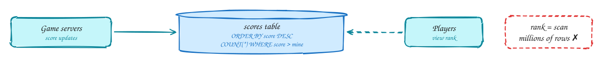
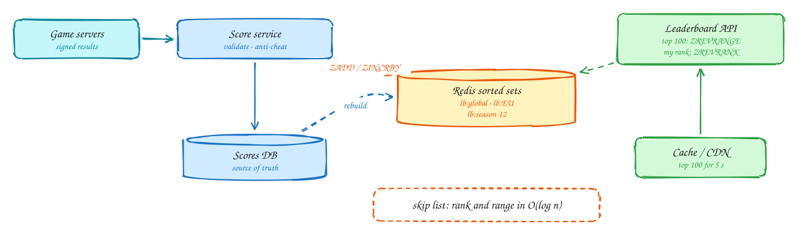

# Gaming leaderboard

<span class="lvl lvl-i">Intermediate</span>

**Difficulty:** Medium · **Patterns:** [Real-time updates](../patterns/real-time-updates.md) · [Scaling writes](../patterns/scaling-writes.md) · **DDIA:** [Ch 4](../ddia/04-storage-and-retrieval.md) in-memory and sorted indexes · [Ch 13](../ddia/13-philosophy-of-streaming-systems.md) derived views

*"What's my rank?" is easy for the top ten and surprisingly expensive for player 31,402,118, unless the data structure keeps ranks for you.*

> [!TIP]
> **One-page sketchnote:** [GAMING LEADERBOARD on a single page](../sketchnotes/problem-leaderboard.svg), for revision or printing.

## TL;DR

- Ranking with SQL means counting everyone above you on every request. Keep each leaderboard in a **Redis sorted set**: top-N and "my rank" are **O(log n)**.
- The database stays the **source of truth**; the sorted set is a **derived view** that can be rebuilt. Score updates flow through a validating score service.
- Cache the top 100 for a few seconds, shard very large or many boards, and treat **cheating** as a first-class requirement.

## 1. Requirements

**Functional**

1. Update a player's score when a match ends
2. Show the top 100 for a board (global, per region, per season)
3. Show a player's own rank and the players just above and below them
4. Friends leaderboard

**Non-functional**

- Ranks reflect a new score within a second or two
- 50M players on the global board; ~5k score updates/s, ~50k/s peak
- ~100k leaderboard reads/s at peak
- Scores can't be forged by clients

## 2. Back-of-envelope numbers

A sorted set entry costs roughly 100 bytes with overhead, so **50M players ≈ 5 GB** per board: fits in one Redis node's memory, with replicas. `ZADD`/`ZINCRBY` and `ZREVRANK` are O(log n): about 26 steps for 50M, microseconds each. One Redis node does ~100k simple ops/s, so 50k writes plus 100k reads at peak needs **read replicas plus a cache** for the top 100, or a few shards.

## 3. Core entities and API

```text
scores(player_id, board_id, score, updated_at)      -- source of truth
lb:{board_id} → sorted set of (player_id, score)    -- derived, in Redis
```

```http
POST /scores {match_id, player_id, score, signature}   (from game servers)
GET  /boards/{id}/top?n=100
GET  /boards/{id}/players/{pid}/rank → {rank, score, neighbours[]}
```

## 4. v1: the simplest design, and where it breaks



Store scores in a table. Top 100 is `SELECT … ORDER BY score DESC LIMIT 100`; a player's rank is `SELECT COUNT(*) FROM scores WHERE score > :mine`.

**Where it breaks:** with an index on score, the top 100 is cheap. But the rank query counts every player above you: for a mid-table player that's tens of millions of index entries **per request**, at thousands of requests a second, while 50k score updates a second rewrite the same index. B-tree indexes don't keep counts of how many entries lie before a position, so rank is a scan.

## 5. Evolving to the final design



Each step fixes one specific problem with the step before it.

### Step 1: keep each board in a sorted set

**Why:** we need rank lookups that don't scan.

**How:** Redis **sorted sets** keep members ordered by score using a **skip list** (layered linked lists with express lanes) that also records how many elements each link jumps over, so the position of any element is computed while searching for it. That makes `ZADD`/`ZINCRBY` (update), `ZREVRANGE 0 99` (top 100) and `ZREVRANK` (my rank) all **O(log n)**, plus `ZREVRANGE rank-5 rank+5` for the neighbours around a player. One sorted set per board: `lb:global`, `lb:EU`, `lb:season-12`.

### Step 2: the database is the source of truth; Redis is derived

**Why:** Redis is memory-first; losing a node shouldn't lose scores, and season resets or bug fixes need a correct rebuild.

**How:** the score service writes each result to the database first (idempotently by `match_id`), then updates the sorted sets. If Redis is lost or a bug corrupts a board, **rebuild it** by streaming scores from the database (or from a Kafka topic of score events). Redis replicas plus persistence shorten recovery, but correctness comes from the source of truth ([DDIA Ch 13](../ddia/13-philosophy-of-streaming-systems.md)).

### Step 3: validate scores on the server

**Why:** if clients post their own scores, the top of the board fills with impossible numbers within hours.

**How:** only **game servers** (which run the match) report results, signed and tied to a `match_id`. The score service checks signatures, rejects duplicates, applies sanity limits (maximum points per minute), and flags outliers for review; flagged players can be hidden from public boards without losing data.

### Step 4: scale reads and many boards

**Why:** 100k reads/s mostly ask for the same top 100, and there may be thousands of boards (per region, per mode, per week).

**How:** cache each board's top 100 in the API layer or CDN for a few seconds; nobody notices a 5-second-old top list. Serve rank lookups from Redis replicas. Spread different boards across a Redis Cluster by board ID. Push live rank changes to players currently viewing a board over WebSockets if the product needs it ([Real-time updates](../patterns/real-time-updates.md)).

## 6. Deep dives

### One board too big for a node?

**Why it matters:** a board with a billion entries, or more writes than one node can take.

**How:** shard **by score range** (shard 1 holds scores 0–999, shard 2 1,000–4,999, …): a player's rank = their rank in their shard + the sizes of all higher shards (kept as counters). Rebalance ranges as the distribution shifts. Or relax precision below the top: exact ranks for the top 10,000, and a **percentile** ("top 3%") for everyone else, computed from a histogram of scores, which is far cheaper and usually what players care about.

### Ties?

**Why it matters:** two players with 9,000 points need a stable order.

**How:** encode a tie-breaker in the score, for example `score × 10¹⁰ + (MAX_TS − achieved_at)`, so the one who reached it first ranks higher, keeping it a single sortable number.

### Friends leaderboard?

**Why it matters:** a sorted set per player of their friends would be huge and constantly updated.

**How:** compute on read: fetch the player's friends (usually a few hundred), get their scores in one batched call (`ZMSCORE`), sort in memory, cache briefly.

### Season resets and time windows?

**Why it matters:** "this week" boards must start empty every Monday.

**How:** make the time window part of the key (`lb:weekly:2026-W47`), set an expiry on old keys, and archive final standings to the database at the close.

## 7. Interview script (45 minutes)

| Time | What you do | Content |
|---|---|---|
| 0–5 | Functional requirements | Update score; top 100; my rank and neighbours; friends |
| 5–8 | Non-functional requirements | Ranks fresh within ~1 s; 50M players; 50k writes/s, 100k reads/s; anti-cheat |
| 8–10 | Numbers that drive the design | 50M × 100 B ≈ 5 GB per board in RAM; O(log n) ≈ 26 steps |
| 10–13 | Entities and API | Scores table (truth) and sorted set per board (derived) |
| 13–25 | v1, then evolve it | SQL COUNT for rank → Redis sorted sets → DB as source of truth with rebuild → server-side validation → caching, replicas, cluster by board |
| 25–40 | Deep dives | Sharding by score range or percentiles · ties · friends boards · time windows |
| 40–45 | Wrap-up | Monitor update-to-visible lag, Redis memory and CPU, cache hit rate, flagged scores. |

## Staff-level lens

| Question | Staff answer |
|---|---|
| **The real problem** | Rank lookups for anyone among tens of millions under constant updates, while staying trustworthy. |
| **Deciding number** | 50M entries ≈ 5 GB per board; O(log n) updates and ranks; 100k reads/s mostly for one hot top-100. |
| **Staff call and trade-off** | Sorted sets as a rebuildable view over a durable score store; accept seconds of staleness on cached top lists; percentiles instead of exact ranks for the long tail if scale demands. |
| **Raise before you're asked** | Cheating and score validation, ties, season resets, rebuild time after a Redis loss. |
| **Senior stops at** | Redis sorted set. |
| **Staff goes on to** | Anti-cheat pipeline and moderation, sharding strategy for huge boards, cost of thousands of boards, and what players actually value (percentiles, friends). |
| **Run it** | Watch score-to-board lag, Redis memory, rejected or flagged scores, and rebuild duration drills. |

All problems through this lens: [Staff-level answers](../playbook/staff-level.md).

## 8. Common mistakes

- Computing rank with `COUNT(*)` per request.
- Treating Redis as the only copy of scores.
- Trusting scores posted by game clients.
- Recomputing the whole board on every update.

## Self-check

Try to answer before you open each one.

<details class="question" markdown>
<summary>Why is "my rank" expensive in SQL but cheap in a Redis sorted set?</summary>

SQL must count all rows with a higher score (a scan of the index range). A sorted set's skip list tracks how many elements each link spans, so the rank falls out of an O(log n) search.

</details>

<details class="question" markdown>
<summary>Redis loses the global board. How do you recover?</summary>

Rebuild the sorted set from the source of truth (the scores table or the score-event log); replicas and persistence only shorten the outage.

</details>

<details class="question" markdown>
<summary>How can you break ties so earlier achievers rank higher without a second sort key?</summary>

Combine them into one number: score × a large factor plus (max timestamp − time achieved), so higher score wins and, for equal scores, the earlier time is larger.

</details>

<details class="question" markdown>
<summary>A board grows to a billion players. Name two strategies.</summary>

Shard by score range and compute global rank as local rank plus the counts of higher shards; or keep exact ranks only for the top and show percentiles from a score histogram for everyone else.

</details>

## Related

- **Patterns:** [Real-time updates](../patterns/real-time-updates.md) · [Scaling writes](../patterns/scaling-writes.md)
- **Concepts:** [Caching](../core-concepts/caching.md) · [Sharding](../core-concepts/sharding.md)
- **DDIA:** [Ch 4](../ddia/04-storage-and-retrieval.md) in-memory and sorted indexes · [Ch 13](../ddia/13-philosophy-of-streaming-systems.md) derived views
- **Similar problems:** [Top-K videos](top-k-videos.md) · [Distributed cache](distributed-cache.md) · [Live comments](live-comments.md)
