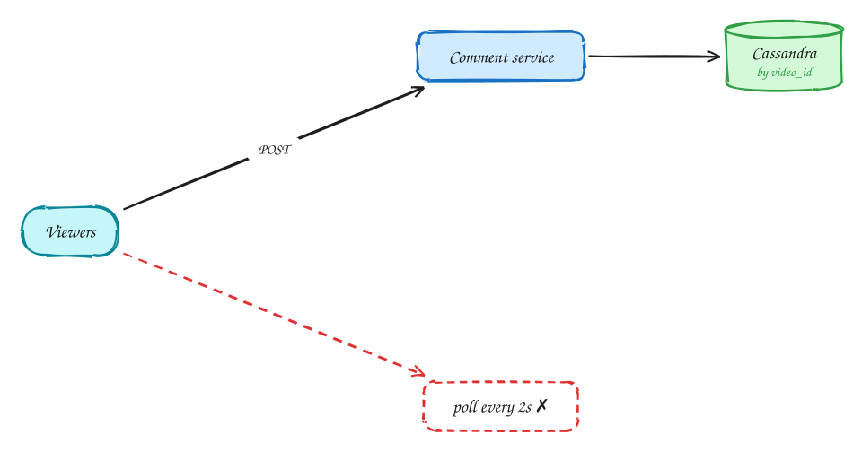
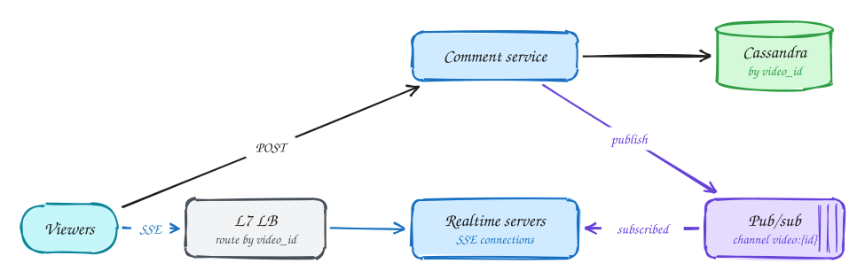

# Live comments (Facebook Live)

**Difficulty:** Medium · **Patterns:** [Real-time updates](../patterns/real-time-updates.md) · **DDIA:** [Ch 11](../ddia/11-stream-processing.md) pub/sub · [Ch 6](../ddia/06-partitioning.md) partition by video

*One popular stream can mean a million viewers each expecting new comments within a fraction of a second.*

## TL;DR

- Polling at this scale is a self-inflicted denial of service; push with Server-Sent Events.
- Write each comment once and publish it once; pub/sub fans it out to every server holding viewers of that video.
- Route viewers of the same video to the same servers so each server subscribes to few channels.

## 1. Requirements

**Functional**

1. Post a comment on a live video
2. Viewers see new comments in near real time
3. Late joiners can scroll back through earlier comments

**Non-functional**

- Delivery p99 < 200ms
- Millions of concurrent viewers; mega-streams with 1M+ viewers
- Eventual consistency and ordering are acceptable

## 2. Back-of-envelope numbers

Hot stream: 1M viewers × 1k comments/s = **1B deliveries/s** for one video. Polling every 2s = 500k req/s from that one stream.

## 3. Core entities and API

```text
comments(video_id, comment_id, user_id, text, ts) partitioned by video_id, clustered by ts
```

```http
POST /videos/{id}/comments
GET /videos/{id}/comments?cursor (history)
GET /videos/{id}/comments/stream (SSE)
```

## 4. v1: the simplest design, and where it breaks



Naive: viewers poll for new comments. Latency = poll interval, and 1M viewers create a self-inflicted DDoS.

## 5. Evolving to the final design



Each step fixes one specific problem with the step before it:

1. Naive: viewers poll for new comments. Latency = poll interval, and 1M viewers create a self-inflicted DDoS.
2. Server push over **SSE**: one long-lived HTTP connection per viewer. Posting a comment stays a normal POST.
3. A comment is written once to Cassandra and published once to a pub/sub channel for that video. Every realtime server subscribed to the channel pushes it to its local viewers.
4. An L7 load balancer routes viewers of the same video to the same servers (consistent hashing on video_id), so each server subscribes to few channels.

## 6. Deep dives

### SSE or WebSocket?

Traffic is server→client. SSE is plain HTTP with auto-reconnect; WebSocket is only needed for heavy bidirectional traffic.

### How does one comment reach 1,000 servers?

Pub/sub fan-out: publish once; each server is subscribed to the channels of videos its viewers watch.

### Mega-streams?

Sample or rate-limit the comment stream per viewer (nobody can read 1k/s); prioritize friends' comments.

### Late join?

Page the last N from Cassandra by cursor, then attach to the stream.

## 7. Interview script (45 minutes)

| Time | What you do | Content |
|---|---|---|
| 0–5 | Functional requirements | Post a comment on a live video; Viewers see new comments in near real time; Late joiners can scroll back through earlier comments |
| 5–8 | Non-functional requirements | Delivery p99 < 200ms; Millions of concurrent viewers; mega-streams with 1M+ viewers; Eventual consistency and ordering are acceptable |
| 8–10 | Numbers that drive the design | Hot stream: 1M viewers × 1k comments/s = **1B deliveries/s** for one video. Polling every 2s = 500k req/s from that one stream. |
| 10–13 | Entities and API | Keep it short: the endpoints in §3, idempotency keys on writes. |
| 13–25 | v1, then evolve it | Draw v1 and show where it breaks. Then add, in order: Realtime servers → Pub/sub → L7 LB. Justify each addition with a number. |
| 25–40 | Deep dives | SSE or WebSocket? · How does one comment reach 1,000 servers? · Mega-streams? · Late join? |
| 40–45 | Wrap-up | Remaining bottlenecks, failure modes, what you would monitor. |

## 8. Common mistakes

- Polling, which gives high latency and huge wasted load.
- Adding components before showing which number makes them necessary.
- Skipping failure handling: what happens on timeouts, retries and crashes.

## Related

- **Patterns:** [Real-time updates](../patterns/real-time-updates.md)
- **DDIA:** [Ch 11](../ddia/11-stream-processing.md) pub/sub · [Ch 6](../ddia/06-partitioning.md) partition by video
- **Similar problems:** [Ride sharing (Uber)](ride-sharing.md) · [Collaborative editor (Google Docs)](collaborative-editor.md) · [Stock trading (Robinhood)](stock-trading.md) · [Online auction](online-auction.md)
