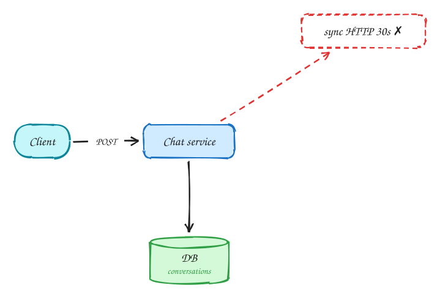
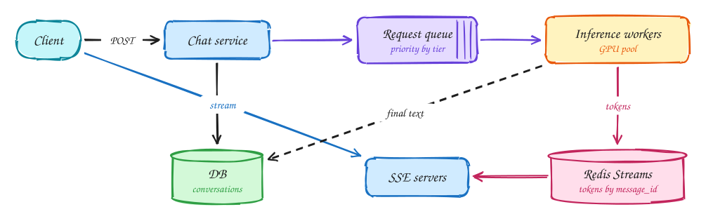

# LLM chat (ChatGPT)

**Difficulty:** Hard · **Patterns:** [Real-time updates](../patterns/real-time-updates.md) · **DDIA:** [Ch 11](../ddia/11-stream-processing.md) logs and streams · [Ch 1](../ddia/01-reliability-scalability-maintainability.md) tail latency

*GPUs are the scarce resource, so every queueing decision is really a cost decision.*

## TL;DR

- Stream tokens to the client as they are generated so the first words appear in under a second.
- Put a queue with priorities in front of the GPU pool for backpressure, fairness and batching.
- Buffer tokens per message so a client that reconnects can resume where it left off.

## 1. Requirements

**Functional**

1. Send a message in a conversation
2. Stream the model's answer token by token
3. View conversation history

**Non-functional**

- Time to first token < 1s
- GPU capacity is the scarce resource
- Conversations durable
- 100M DAU; bursty

## 2. Back-of-envelope numbers

100M DAU × 10 msgs = 1B/day ≈ **12k/s** generations. Each holds a GPU for seconds, so GPUs are the bottleneck and every queueing decision is about them.

## 3. Core entities and API

```text
conversations(id, user_id)
messages(conversation_id, id, role, content, status)
```

```http
POST /conversations/{id}/messages → message_id
GET /messages/{id}/stream (SSE, Last-Event-ID resume)
GET /conversations/{id}
```

## 4. v1: the simplest design, and where it breaks



Naive: one synchronous request waits ~30s for the full answer. Timeouts, no progress shown, no backpressure.

## 5. Evolving to the final design



Each step fixes one specific problem with the step before it:

1. Naive: one synchronous request waits ~30s for the full answer. Timeouts, no progress shown, no backpressure.
2. Stream tokens to the client over **SSE** as they are generated, so time-to-first-token stays low.
3. Put a **queue** in front of the GPU pool: absorbs bursts, enables priority for paid tiers, batching, and admission control (429 when full).
4. Workers write tokens into a Redis Stream keyed by message_id; SSE servers read from it. A client that reconnects resumes from its last token; the final text is persisted.

## 6. Deep dives

### Why a queue before GPUs?

Scarce and expensive capacity: queueing gives backpressure, priority, fairness, and batching.

### Client disconnects?

Generation continues; tokens are buffered in the stream; resume with Last-Event-ID.

### Long context?

Load recent messages; summarize or truncate to fit the window; cache hot conversations.

### Cost control?

Per-user rate limits and token quotas at the gateway.

## 7. Interview script (45 minutes)

| Time | What you do | Content |
|---|---|---|
| 0–5 | Functional requirements | Send a message in a conversation; Stream the model's answer token by token; View conversation history |
| 5–8 | Non-functional requirements | Time to first token < 1s; GPU capacity is the scarce resource; Conversations durable; 100M DAU; bursty |
| 8–10 | Numbers that drive the design | 100M DAU × 10 msgs = 1B/day ≈ **12k/s** generations. Each holds a GPU for seconds, so GPUs are the bottleneck and every queueing decision is about them. |
| 10–13 | Entities and API | Keep it short: the endpoints in §3, idempotency keys on writes. |
| 13–25 | v1, then evolve it | Draw v1 and show where it breaks. Then add, in order: SSE servers → Request queue → Inference workers → Redis Streams. Justify each addition with a number. |
| 25–40 | Deep dives | Why a queue before GPUs? · Client disconnects? · Long context? · Cost control? |
| 40–45 | Wrap-up | Remaining bottlenecks, failure modes, what you would monitor. |

## 8. Common mistakes

- Holding a synchronous connection through the load balancer straight to a GPU.
- Adding components before showing which number makes them necessary.
- Skipping failure handling: what happens on timeouts, retries and crashes.

## Related

- **Patterns:** [Real-time updates](../patterns/real-time-updates.md)
- **DDIA:** [Ch 11](../ddia/11-stream-processing.md) logs and streams · [Ch 1](../ddia/01-reliability-scalability-maintainability.md) tail latency
- **Similar problems:** [Ride sharing (Uber)](ride-sharing.md) · [Live comments (Facebook Live)](live-comments.md) · [Collaborative editor (Google Docs)](collaborative-editor.md) · [Stock trading (Robinhood)](stock-trading.md)
