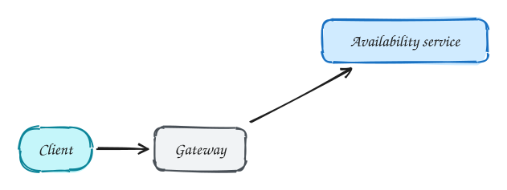
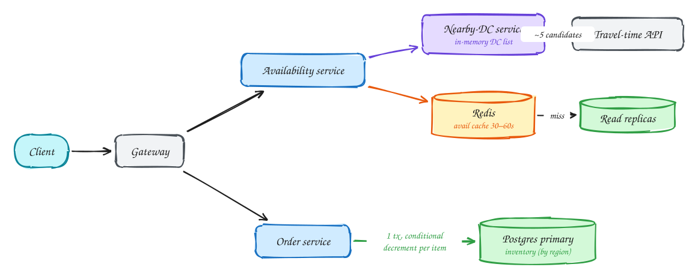

# Local delivery (Gopuff)

**Difficulty:** Easy · **Patterns:** [Scaling reads](../patterns/scaling-reads.md) · **DDIA:** [Ch 7](../ddia/07-transactions.md) conditional updates · [Ch 5](../ddia/05-replication.md) replica lag

*It looks like an ordering system, but most of the load is people checking what is available near them.*

## TL;DR

- Browsing availability is far more frequent than ordering, so cache it and serve it from replicas.
- Find nearby warehouses with an in-memory list and a cheap distance filter before calling any travel-time API.
- Prevent overselling with conditional stock decrements for every item in one transaction.

## 1. Requirements

**Functional**

1. Check availability of items deliverable to a location (DCs within 1 hour)
2. Order multiple items; never sell stock you don't have

**Non-functional**

- Availability p99 < 100ms
- Orders strongly consistent (no overselling)
- 10k distribution centres (DCs), ~100k SKUs
- Browse load ≫ order load

## 2. Back-of-envelope numbers

Browse ~10M × 10 / 86,400 ≈ **1.2k/s, ~10k/s peak**. Orders ~1M/day ≈ 12/s. The DC list (10k rows) fits in memory.

## 3. Core entities and API

```text
dcs(id, lat, lng, region)
inventory(dc_id, item_id, qty) PK(dc_id, item_id)
orders, order_items
```

```http
GET /availability?lat&lng&item_ids
POST /orders {items:[{id, qty}], lat, lng}
```

## 4. v1: the simplest design, and where it breaks



Naive: call a travel-time API for every DC. 10k calls per page view is far too slow.

## 5. Evolving to the final design



Each step fixes one specific problem with the step before it:

1. Naive: call a travel-time API for every DC. 10k calls per page view is far too slow.
2. Keep the small DC list in memory, prefilter by straight-line distance, then ask travel time for only a handful of candidates.
3. Browse reads come from a short-TTL cache and read replicas. Slightly stale is fine here (AP).
4. Ordering hits the primary: one transaction with UPDATE … SET qty = qty − n WHERE qty ≥ n per item. Any zero-row update means ROLLBACK, so there is no overselling (CP).

## 6. Deep dives

### How do you prevent overselling?

A conditional decrement per item inside one transaction; row locks serialize concurrent buyers. 0 rows updated means rollback and out of stock.

### Stale availability vs orders?

Different consistency per path: browse is cached and eventually consistent; checkout reads and writes the primary.

### Scale orders?

Partition inventory by region; an order only touches nearby DCs, so there are no cross-shard transactions.

### Hot item (flash sale)?

Row contention on one inventory row: queue orders per item, or split stock into sub-buckets.

## 7. Interview script (45 minutes)

| Time | What you do | Content |
|---|---|---|
| 0–5 | Functional requirements | Check availability of items deliverable to a location (DCs within 1 hour); Order multiple items; never sell stock you don't have |
| 5–8 | Non-functional requirements | Availability p99 < 100ms; Orders strongly consistent (no overselling); 10k distribution centres (DCs), ~100k SKUs; Browse load ≫ order load |
| 8–10 | Numbers that drive the design | Browse ~10M × 10 / 86,400 ≈ **1.2k/s, ~10k/s peak**. Orders ~1M/day ≈ 12/s. The DC list (10k rows) fits in memory. |
| 10–13 | Entities and API | Keep it short: the endpoints in §3, idempotency keys on writes. |
| 13–25 | v1, then evolve it | Draw v1 and show where it breaks. Then add, in order: Nearby-DC service → Travel-time API → Redis → Read replicas → Order service → Postgres primary. Justify each addition with a number. |
| 25–40 | Deep dives | How do you prevent overselling? · Stale availability vs orders? · Scale orders? · Hot item (flash sale)? |
| 40–45 | Wrap-up | Remaining bottlenecks, failure modes, what you would monitor. |

## 8. Common mistakes

- Redis as the inventory source of truth, with no multi-item transaction or durability.
- Adding components before showing which number makes them necessary.
- Skipping failure handling: what happens on timeouts, retries and crashes.

## Related

- **Patterns:** [Scaling reads](../patterns/scaling-reads.md)
- **DDIA:** [Ch 7](../ddia/07-transactions.md) conditional updates · [Ch 5](../ddia/05-replication.md) replica lag
- **Similar problems:** [URL shortener (Bitly)](url-shortener.md) · [Rate limiter](rate-limiter.md) · [Business discovery (Yelp)](business-discovery.md) · [News feed (Facebook)](news-feed.md)
