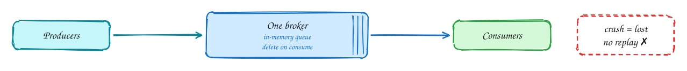
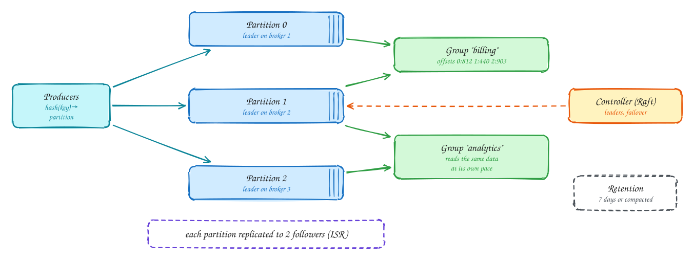

# Distributed message queue (Kafka)

<span class="lvl lvl-a">Advanced</span>

**Difficulty:** Hard · **Patterns:** [Scaling writes](../patterns/scaling-writes.md) · [Long-running tasks](../patterns/long-running-tasks.md) · **DDIA:** [Ch 12](../ddia/12-stream-processing.md) log-based brokers · [Ch 6](../ddia/06-replication.md) replication · [Ch 10](../ddia/10-consistency-and-consensus.md) consensus

*The insight that makes Kafka fast and replayable: don't delete messages when they're read. Keep an append-only log and let each consumer remember where it is.*

> [!TIP]
> **One-page sketchnote:** [DISTRIBUTED MESSAGE QUEUE on a single page](../sketchnotes/problem-message-queue.svg), for revision or printing.

## TL;DR

- Store each topic as **partitions**: append-only logs on disk, written sequentially and read by offset. Throughput scales with partitions; order holds **within** a partition.
- **Replicate** each partition to followers; acknowledge a write once the **in-sync replicas** have it. A controller (Raft) picks leaders and handles failures.
- Consumers in a **group** split the partitions and **commit offsets**; other groups read the same data independently. Data stays for a retention period, so anyone can **replay**.

## 1. Requirements

**Functional**

1. Producers publish messages to named topics; consumers subscribe
2. Many independent consumer groups read the same topic; within a group, each message is processed by one consumer
3. Messages with the same key are delivered in order
4. Replay from any point within retention (e.g. 7 days)

**Non-functional**

- 200k messages/s in (~1 KB each), several times that out
- No acknowledged message lost if a broker dies
- p99 publish latency < 50 ms
- Scale by adding brokers

## 2. Back-of-envelope numbers

200k msg/s × 1 KB = **200 MB/s in**; with replication factor 3 the cluster writes **600 MB/s** to disk. Seven days of retention: 200 MB/s × 604,800 s ≈ **121 TB**, ×3 ≈ **363 TB** stored. With ~10 TB of disk per broker, that's **~40 brokers**. A partition comfortably handles ~10 MB/s, so ≥ 20 partitions for the main topic; more partitions also allow more parallel consumers.

## 3. Core entities and API

```text
topic → partitions[0..P-1]
partition: append-only segments (offset, key, value, timestamp)
consumer group: committed offset per partition
```

```http
produce(topic, key, value, acks=all) → {partition, offset}
poll(group, topics) → batch of (partition, offset, key, value)
commit(group, partition, offset)
```

## 4. v1: the simplest design, and where it breaks



One broker process holds an in-memory queue. Producers push, consumers pop, and a message is deleted once it's consumed.

**Where it breaks:** one machine caps throughput at a fraction of 200 MB/s, a crash loses everything in memory, and once a message is consumed nobody can read it again: a second team that wants the same events (analytics, search indexing) needs its own copy, and a bug in a consumer can't be fixed by reprocessing. These three problems point to the log-based design ([DDIA Ch 12](../ddia/12-stream-processing.md)).

## 5. Evolving to the final design



Each step fixes one specific problem with the step before it.

### Step 1: an append-only log on disk, read by offset

**Why:** memory is small and volatile, and deleting on read prevents replay.

**How:** each message is **appended** to a file and given a sequential **offset**. Consumers read from an offset forward. Appends are sequential disk writes, which are fast even on spinning disks, and reads of recent data come straight from the OS page cache; brokers can send file data to the network without copying it through the application (zero-copy). The log is split into **segment files** (say 1 GB each) so old data can be deleted a whole file at a time. An index file maps offsets to file positions.

### Step 2: partition topics across brokers

**Why:** one log on one machine can't take 200 MB/s or 363 TB.

**How:** each topic is split into **partitions**, each its own log, spread across brokers. Producers choose the partition by `hash(key) % partitions` (or round robin when there's no key). All messages for a key land in one partition, so **order is guaranteed per key**, while different keys proceed in parallel. There is no total order across partitions, and adding partitions later changes where keys map, so pick a generous count up front.

### Step 3: replicate each partition, acknowledge at the in-sync replicas

**Why:** a broker's disk can die, and acknowledged messages must survive.

**How:** each partition has a **leader** and, say, two **followers** on other brokers (different racks or zones). Followers fetch from the leader. The leader tracks the **in-sync replica set (ISR)**: followers that are caught up. With `acks=all`, a write is acknowledged once every ISR member has it, and with `min.insync.replicas=2` the leader refuses writes if fewer than two copies would exist. Consumers only see messages up to the **high-water mark** (replicated to all ISR), so a failover never shows them data that then disappears.

### Step 4: a controller for leadership and membership

**Why:** someone must decide which replica leads each partition when a broker dies, and two brokers must never both think they lead.

**How:** a controller, itself replicated with **Raft** (Kafka's KRaft; older versions used ZooKeeper), stores cluster metadata, detects broker failure, and elects a new leader for each affected partition **from the ISR**, with an increased **leader epoch** so the old leader's late writes are fenced ([DDIA Ch 9](../ddia/09-trouble-with-distributed-systems.md)). Electing an out-of-sync replica ("unclean leader election") restores availability but loses data, so it's off by default.

### Step 5: consumer groups and offsets

**Why:** a single consumer can't keep up, and different teams need independent progress.

**How:** consumers that share a **group ID** divide the partitions among themselves: each partition is read by exactly one consumer in the group, so a group can scale up to the number of partitions. Each consumer **commits** the offset it has processed (stored in an internal, replicated topic). After a crash or rebalance, a consumer resumes from the last committed offset. Different groups have separate offsets, so analytics can read the same data as billing, at its own pace, or rewind to reprocess.

### Step 6: retention and compaction

**Why:** disks are finite, but some topics should keep the latest value forever.

**How:** **time or size retention** deletes whole old segments (7 days, or 1 TB per partition). **Log compaction** instead keeps the latest message per key and discards older ones, so a topic can act as a durable table of current state (used for changelogs and CDC).

## 6. Deep dives

### Delivery guarantees?

**Why it matters:** where you commit the offset decides what a crash does.

**How:** commit **after** processing → at-least-once (a crash replays some messages, so consumers must be idempotent). Commit **before** → at-most-once (a crash can skip messages). For exactly-once *effects*, use idempotent producers (the broker dedupes by producer ID and sequence number) plus transactions that write output and commit offsets atomically, or store the offset in the same database transaction as the result ([DDIA Ch 8](../ddia/08-transactions.md#exactly-once-message-processing)). See [Delivery guarantees](../101/delivery-guarantees.md).

### Slow or poison messages?

**Why it matters:** one message that always fails blocks its whole partition, because order must be preserved.

**How:** retry a few times, then publish it to a **dead-letter topic** and move on (accepting that per-key order is broken for that message), or route it to a retry topic with a delay. See [Dead-letter queues](../101/dead-letter-queues.md).

### Queue vs log?

**Why it matters:** sometimes you want per-message acknowledgment and no ordering (a work queue of jobs).

**How:** classic queues (RabbitMQ, SQS) track each message individually and redeliver on failure, which suits independent tasks; logs suit ordered streams and replay. See [Message queue vs event stream](../101/queue-vs-stream.md).

### Tiered storage?

**Why it matters:** keeping months of data on broker disks is expensive.

**How:** move older segments to object storage and keep only recent ones locally; some newer systems go further and keep everything in object storage ([DDIA Ch 6: databases on object storage](../ddia/06-replication.md)).

## 7. Interview script (45 minutes)

| Time | What you do | Content |
|---|---|---|
| 0–5 | Functional requirements | Topics, consumer groups, per-key order, replay |
| 5–8 | Non-functional requirements | 200k msg/s; no acked loss; p99 < 50 ms; elastic |
| 8–10 | Numbers that drive the design | 200 MB/s in, 600 MB/s replicated, ~363 TB for 7 days ≈ 40 brokers |
| 10–13 | Entities and API | produce with key/acks; poll; commit offset |
| 13–25 | v1, then evolve it | In-memory queue → append-only segments by offset → partitions → leader/follower with ISR and acks=all → Raft controller with epochs → consumer groups and offsets → retention and compaction |
| 25–40 | Deep dives | Delivery semantics · poison messages · queue vs log · tiered storage |
| 40–45 | Wrap-up | Monitor consumer lag, under-replicated partitions, ISR shrinks, produce p99, disk usage. |

## Staff-level lens

| Question | Staff answer |
|---|---|
| **The real problem** | Durable, ordered, replayable streams at hundreds of MB/s, without per-message bookkeeping. |
| **Deciding number** | 200 MB/s in ×3 replicas; ~363 TB for 7 days ≈ 40 brokers; partitions sized for ~10 MB/s each and for consumer parallelism. |
| **Staff call and trade-off** | Partitioned append-only logs with ISR replication and acks=all; accept order only per partition, and pick partition counts up front. |
| **Raise before you're asked** | Consumer lag and back-pressure, poison messages, rebalancing pauses, unclean leader election, choosing keys to avoid hot partitions. |
| **Senior stops at** | Partitions + replication + consumer groups. |
| **Staff goes on to** | Multi-tenant quotas, schema registry and compatibility rules, tiered storage cost, cross-region mirroring, and capacity planning by partition. |
| **Run it** | Watch consumer lag per group, under-replicated partitions, produce p99, request queue time, disk headroom. |

All problems through this lens: [Staff-level answers](../playbook/staff-level.md).

## 8. Common mistakes

- Deleting messages on read, which rules out replay and multiple consumer groups.
- Promising global ordering across a topic.
- Forgetting that offsets must be committed after processing, and consumers made idempotent.
- Too few partitions, capping consumer parallelism.

## Self-check

Try to answer before you open each one.

<details class="question" markdown>
<summary>Why is appending to a log on disk fast enough for hundreds of MB/s?</summary>

Appends are sequential writes, which disks and SSDs do at full bandwidth; recent data is read from the page cache, and brokers can send file data to sockets without copying it through the application.

</details>

<details class="question" markdown>
<summary>How does Kafka guarantee order for one user's events but not for the whole topic?</summary>

Messages are partitioned by key, and each partition is an ordered log read by one consumer per group. Different partitions are independent, so there's no order between them.

</details>

<details class="question" markdown>
<summary>What do acks=all and min.insync.replicas=2 protect against?</summary>

A write is acknowledged only after all in-sync replicas have it, and refused if fewer than two replicas are in sync, so losing a single broker never loses an acknowledged message.

</details>

<details class="question" markdown>
<summary>What determines whether consumers get at-least-once or at-most-once delivery?</summary>

Whether they commit the offset after processing (at-least-once: replays after a crash) or before (at-most-once: may skip).

</details>

## Related

- **101:** [Message queue vs event stream](../101/queue-vs-stream.md) · [Delivery guarantees](../101/delivery-guarantees.md) · [Dead-letter queues](../101/dead-letter-queues.md) · [Transactional outbox](../101/outbox.md)
- **DDIA:** [Ch 12](../ddia/12-stream-processing.md) log-based brokers · [Ch 6](../ddia/06-replication.md) replication · [Ch 10](../ddia/10-consistency-and-consensus.md) consensus
- **Similar problems:** [Distributed key-value store](key-value-store.md) · [Ad click aggregator](ad-click-aggregator.md) · [Notification system](notification-system.md)
