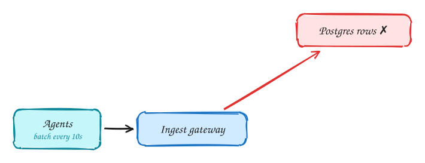
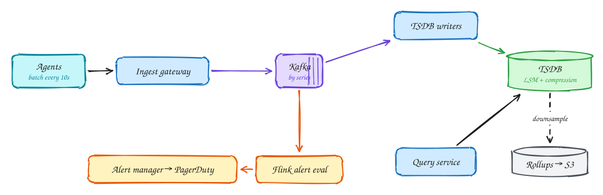

# Metrics monitoring (Datadog)

**Difficulty:** Hard · **Patterns:** [Scaling writes](../patterns/scaling-writes.md) · **DDIA:** [Ch 3](../ddia/03-storage-and-retrieval.md) LSM, compression · [Ch 11](../ddia/11-stream-processing.md) stream alerting

*Millions of data points per second arrive, and alerts must fire within a minute.*

## TL;DR

- Buffer the write firehose through Kafka into a time-series database built for appends and compression.
- Downsample old data and move it to cheap storage; dashboards read rollups.
- Evaluate alert rules on the stream itself instead of polling the database.

## 1. Requirements

**Functional**

1. Ingest metrics from 500k servers
2. Query dashboards over time ranges
3. Alert rules with notifications

**Non-functional**

- 5M datapoints/s ingest
- Recent-data queries < 1s
- Alerts within ~1 minute
- Late/out-of-order tolerant, durable

## 2. Back-of-envelope numbers

500k hosts × 100 metrics ÷ 10s = **5M points/s**. Gorilla compression ≈ 1.4B/point → ~600GB/day; downsample after 7 days.

## 3. Core entities and API

```text
series(metric, tags) → (ts, value) blocks
rollups 1m / 1h
alert_rules
```

```http
POST /ingest (batched points from agents)
GET /query?metric&tags&from&to&step
POST /alerts {rule, threshold, channel}
```

## 4. v1: the simplest design, and where it breaks



Naive: one Postgres row per datapoint with a B-tree index. It falls over around ~50k inserts/sec.

## 5. Evolving to the final design



Each step fixes one specific problem with the step before it:

1. Naive: one Postgres row per datapoint with a B-tree index. It falls over around ~50k inserts/sec.
2. Buffer through Kafka into a **time-series DB**: append-only LSM writes, series-by-time blocks, delta-of-delta + XOR compression.
3. Queries hit recent blocks; older data is downsampled (1s → 1m → 1h) and tiered to S3. Dashboards use rollups.
4. Alerts are evaluated **on the stream** (Flink windows over Kafka), not by polling the TSDB with thousands of queries.

## 6. Deep dives

### Why a TSDB?

Time-ordered appends suit LSM; compression gives ~10×; queries are range scans per series.

### High cardinality?

A user_id tag explodes series count. Cap or reject high-cardinality labels.

### Late data?

Event-time windows with watermarks; allowed lateness for corrections.

### Alert flapping?

Require N consecutive windows; dedupe and group in the alert manager.

## 7. Interview script (45 minutes)

| Time | What you do | Content |
|---|---|---|
| 0–5 | Functional requirements | Ingest metrics from 500k servers; Query dashboards over time ranges; Alert rules with notifications |
| 5–8 | Non-functional requirements | 5M datapoints/s ingest; Recent-data queries < 1s; Alerts within ~1 minute; Late/out-of-order tolerant, durable |
| 8–10 | Numbers that drive the design | 500k hosts × 100 metrics ÷ 10s = **5M points/s**. Gorilla compression ≈ 1.4B/point → ~600GB/day; downsample after 7 days. |
| 10–13 | Entities and API | Keep it short: the endpoints in §3, idempotency keys on writes. |
| 13–25 | v1, then evolve it | Draw v1 and show where it breaks. Then add, in order: Kafka → TSDB writers → TSDB → Query service → Rollups → S3 → Flink alert eval → Alert manager → PagerDuty. Justify each addition with a number. |
| 25–40 | Deep dives | Why a TSDB? · High cardinality? · Late data? · Alert flapping? |
| 40–45 | Wrap-up | Remaining bottlenecks, failure modes, what you would monitor. |

## 8. Common mistakes

- Row-per-point in Postgres, and alerting by polling queries.
- Adding components before showing which number makes them necessary.
- Skipping failure handling: what happens on timeouts, retries and crashes.

## Related

- **Patterns:** [Scaling writes](../patterns/scaling-writes.md)
- **DDIA:** [Ch 3](../ddia/03-storage-and-retrieval.md) LSM, compression · [Ch 11](../ddia/11-stream-processing.md) stream alerting
- **Similar problems:** [Top-K videos (YouTube)](top-k-videos.md) · [Ad click aggregator](ad-click-aggregator.md) · [Web crawler](web-crawler.md) · [Fitness tracking (Strava)](fitness-tracking.md)
