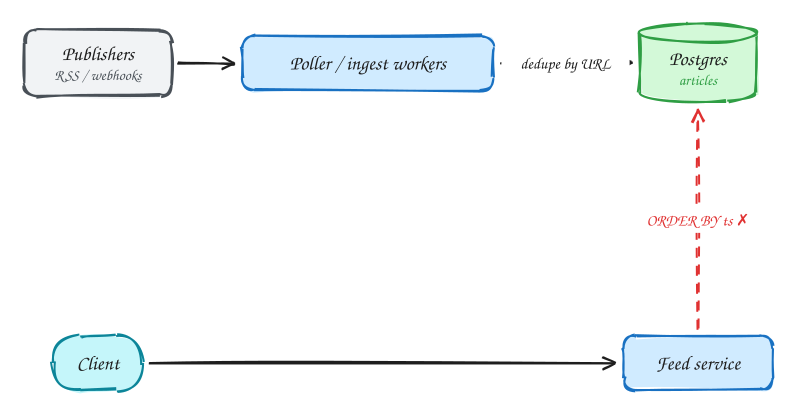
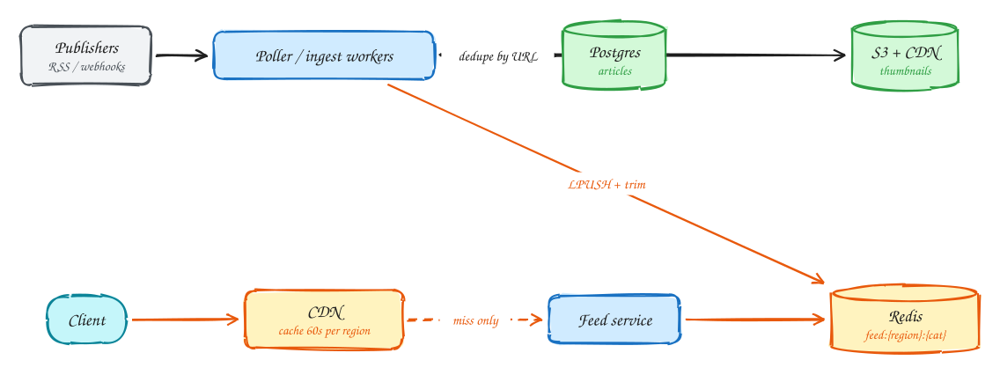

# News aggregator (Google News)

**Difficulty:** Easy · **Patterns:** [Scaling reads](../patterns/scaling-reads.md) · **DDIA:** [Ch 1](../ddia/01-reliability-scalability-maintainability.md) load parameters · [Ch 10](../ddia/10-batch-processing.md) ingest pipelines

*A feed problem where the feed is the same for everyone in a region, which changes everything.*

> [!TIP]
> **One-page sketchnote:** [NEWS AGGREGATOR (GOOGLE NEWS) on a single page](../sketchnotes/problem-news-aggregator.svg), for revision or printing.

## TL;DR

- Writes are tiny (new articles); reads spike hard when big news breaks.
- Precompute one list per region and category at ingest time instead of querying on every request.
- Because the feed is not per-user, a CDN can cache it for a minute and absorb almost all traffic.

## 1. Requirements

**Functional**

1. Feed of recent articles from thousands of publishers, by region and category
2. Click through to the publisher; infinite scroll

**Non-functional**

- Feed p99 < 200ms
- 100M DAU with breaking-news spikes
- New articles visible within ~30 min
- Availability over consistency

## 2. Back-of-envelope numbers

100M × 10 = 1B feed reads/day ≈ **12k/s, 50k+/s spikes**. Writes: ~100k articles/day ≈ 1/s.

## 3. Core entities and API

```text
articles(id, canonical_url UNIQUE, title, summary, thumbnail_url, publisher_id, region, category, published_at)
```

```http
GET /feed?region&category&cursor → [{title, summary, thumbnail, url, publisher}]
```

## 4. v1: the simplest design, and where it breaks



Pull articles from publishers on a schedule and query Postgres for each feed. Fine at low traffic.

## 5. Evolving to the final design



Each step fixes one specific problem with the step before it:

1. Pull articles from publishers on a schedule and query Postgres for each feed. Fine at low traffic.
2. Precompute one list per (region, category) in Redis at ingest time. Reads become a single list read.
3. The feed is **not personalized**, so a CDN can cache it for 60s per region. A 50k/s spike becomes a few origin requests.
4. Thumbnails are copied to S3 and served by CDN; publishers that support webhooks push instead of being polled.

## 6. Deep dives

### Why can a CDN cache the feed?

Everyone in a region gets the same response. 60s of staleness is fine for news (AP).

### Polling cost vs freshness?

Adaptive polling: busy publishers every few minutes, quiet ones hourly. Use webhooks where offered.

### Duplicate stories?

Unique canonical URL; near-duplicates clustered with SimHash/MinHash on title and body.

### Pagination?

Cursor on (published_at, id). Offsets break when new articles arrive.

## 7. Interview script (45 minutes)

| Time | What you do | Content |
|---|---|---|
| 0–5 | Functional requirements | Feed of recent articles from thousands of publishers, by region and category; Click through to the publisher; infinite scroll |
| 5–8 | Non-functional requirements | Feed p99 < 200ms; 100M DAU with breaking-news spikes; New articles visible within ~30 min; Availability over consistency |
| 8–10 | Numbers that drive the design | 100M × 10 = 1B feed reads/day ≈ **12k/s, 50k+/s spikes**. Writes: ~100k articles/day ≈ 1/s. |
| 10–13 | Entities and API | Keep it short: the endpoints in §3, idempotency keys on writes. |
| 13–25 | v1, then evolve it | Draw v1 and show where it breaks. Then add, in order: Redis → CDN → S3 + CDN. Justify each addition with a number. |
| 25–40 | Deep dives | Why can a CDN cache the feed? · Polling cost vs freshness? · Duplicate stories? · Pagination? |
| 40–45 | Wrap-up | Remaining bottlenecks, failure modes, what you would monitor. |


## Staff-level lens

| Question | Staff answer |
|---|---|
| **The real problem** | The feed is the same for everyone in a region, so the edge can serve it. |
| **Deciding number** | ~12k reads/s, 50k+/s on breaking news; ~1 new article/s. |
| **Staff call and trade-off** | Precompute per region and category, cache at the CDN for ~60 s. Accept a minute of staleness. |
| **Raise before you're asked** | Many CDN entries expiring at once (serve stale, stagger TTLs); publisher outages; duplicate stories. |
| **Senior stops at** | Adds a cache. |
| **Staff goes on to** | Spots that the response is not personalised, calculates origin load after the CDN, sets an adaptive crawl budget. |
| **Run it** | Watch CDN hit ratio, origin QPS, ingest-to-visible lag. |

All 29 problems through this lens: [Staff-level answers](../playbook/staff-level.md).

## 8. Common mistakes

- Per-user fan-out like a social feed when the feed is per region and category: build it once per region and let the CDN cache it.
- Adding components before showing which number makes them necessary.
- Skipping failure handling: what happens on timeouts, retries and crashes.

## Related

- **Patterns:** [Scaling reads](../patterns/scaling-reads.md)
- **DDIA:** [Ch 1](../ddia/01-reliability-scalability-maintainability.md) load parameters · [Ch 10](../ddia/10-batch-processing.md) ingest pipelines
- **Similar problems:** [URL shortener (Bitly)](url-shortener.md) · [Rate limiter](rate-limiter.md) · [Business discovery (Yelp)](business-discovery.md) · [News feed (Facebook)](news-feed.md)
