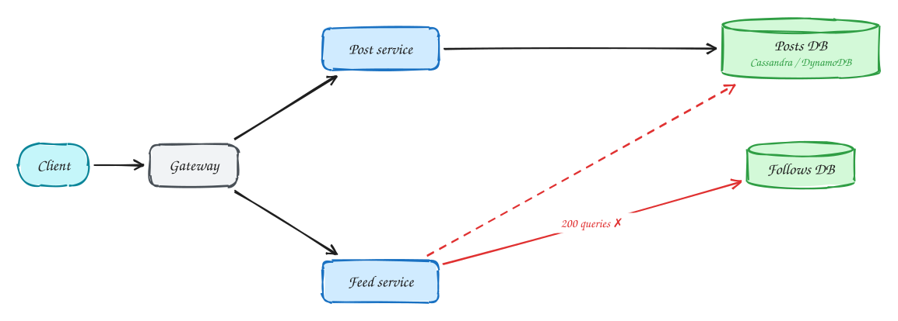
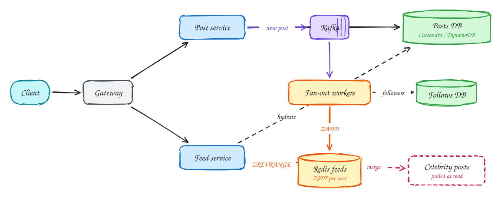

# News feed (Facebook)

<span class="lvl lvl-i">Intermediate</span>

**Difficulty:** Medium · **Patterns:** [Scaling reads](../patterns/scaling-reads.md) · **DDIA:** [Ch 1](../ddia/01-reliability-scalability-maintainability.md) Twitter load · [Ch 11](../ddia/11-stream-processing.md) materialized views · [Ch 6](../ddia/06-partitioning.md) hot keys

*The canonical fan-out problem: build a personalised feed for billions of users in a few hundred milliseconds.*

> [!TIP]
> **One-page sketchnote:** [NEWS FEED (FACEBOOK) on a single page](../sketchnotes/problem-news-feed.svg), for revision or printing.

## TL;DR

- Computing the feed on every read means hundreds of queries per page view, so precompute it when people post.
- Push new post IDs into each follower's feed list in Redis (fan-out on write); a feed read becomes one lookup.
- Accounts with millions of followers break fan-out on write, so pull their posts at read time instead (hybrid).

## 1. Requirements

**Functional**

1. Create posts
2. Follow users
3. View feed of followed users' posts, newest first, paginated

**Non-functional**

- Feed p99 < 500ms
- 2B users; eventual consistency (post appears within ~1 min)
- Handle accounts with millions of followers
- Highly available

## 2. Back-of-envelope numbers

1B DAU × 10 feed loads = **~115k feed reads/s**. ~500M posts/day ≈ 6k/s. With ~200 followers each, fan-out on write ≈ **1.2M feed inserts/s**.

## 3. Core entities and API

```text
posts(id, author_id, content, ts) partitioned by author
follows(follower_id, followee_id) + reverse index
feed:{user} = Redis ZSET(ts, post_id), capped at 500
```

```http
POST /posts {content}
PUT /users/{id}/followers
GET /feed?cursor=(ts,post_id)
```

## 4. v1: the simplest design, and where it breaks



The simplest feed is computed **when the user opens it** (fan-out on read). Look up the ~200 people they follow, fetch each one's recent posts, merge them by time, and return the newest 20. Posting is just one insert into `posts`.

**Where it breaks:** reads. There are about **115k feed loads a second**, and each needs the follow list plus recent posts from ~200 authors, spread across many database partitions. That's **tens of millions of lookups a second**, plus merging and sorting, on every page view. The p99 under 500 ms can't be met, and the database spends nearly all its time rebuilding the same feeds over and over.

## 5. Evolving to the final design



Each step fixes one specific problem with the step before it.

### Step 1: precompute feeds when people post (fan-out on write)

**Why:** feeds are read far more often than posts are written (115k reads a second vs about 6k posts a second). It's cheaper to do the work **once per post** than **once per feed view**.

**How:** when someone posts, save the post, then put a "new post" event on **Kafka**. Fan-out workers look up the author's followers and push the post ID into each follower's **feed list** in Redis: a sorted set ordered by timestamp, capped at about 500 entries. Opening the feed is now **one Redis read** (`ZREVRANGE feed:{user} 0 19`), which returns in a millisecond or two. The cost moved to write time: 6k posts a second × ~200 followers ≈ **1.2M feed inserts a second**, done asynchronously by workers. A post appearing in feeds a few seconds later is fine (eventual consistency).

### Step 2: handle celebrities differently (hybrid)

**Why:** fan-out on write assumes ~200 followers. An account with **100 million** followers would trigger 100M Redis writes for one post, taking minutes and swamping the workers, while everyone else's posts wait behind it.

**How:** **don't fan out** for accounts above a threshold (say 100k–1M followers). Their posts are stored normally. When a user opens their feed, read their precomputed list, **plus** the recent posts of the few celebrities they follow, and merge the two by time. Most users follow only a handful of celebrities, so the extra work per read is small.

### Step 3: turn IDs into posts, and paginate

**Why:** the feed list holds only post IDs (to keep memory small), but the app needs text, images and author names. And scrolling must work while new posts keep arriving.

**How:** **hydrate** the 20 IDs with one batch read from the posts store, with a post cache in front, because popular posts appear in millions of feeds. Paginate with a **cursor**, the `(timestamp, post_id)` of the last item shown, rather than page numbers.

## 6. Deep dives

### Celebrity with 100M followers?

**Why it's hard:** fan-out on write costs one write per follower. For a celebrity that's 100M writes per post: a huge delay before followers see it, and a backlog that delays everyone else's posts.

**How:** the **hybrid** model. Fan out on write for normal accounts; for accounts above a follower threshold, skip fan-out and **pull** their recent posts at read time, merging them into the precomputed feed. Tune the threshold (roughly 100k–1M followers) by measuring the cost of each path. Keep celebrities' recent posts heavily cached, since many readers fetch the same ones.

### How much memory for feeds?

**Why it matters:** storing a feed for 2 billion users in Redis could be enormous.

**How to keep it small:** store **only post IDs** (about 8 bytes each), **cap** each feed at about 500 entries, and keep feeds only for **active** users, say 300M. That's 300M × 500 × ~8 B ≈ **1.2 TB**, which spreads comfortably over a Redis cluster. When an inactive user returns, rebuild their feed on demand with fan-out on read, once, then keep it updated.

### Pagination?

**Why offsets fail:** with `?page=2`, if 5 new posts arrive while you're reading page 1, page 2 now starts 5 items earlier, and you see duplicates.

**How:** use a **cursor**: "give me 20 items older than `(ts, post_id)` of the last item I saw". The post ID breaks ties when two posts share a timestamp. New posts at the top don't affect it, and the sorted set supports it directly with a score range query.

### User follows someone new?

**Why it matters:** fan-out on write only pushes **future** posts. Right after following someone, their existing posts aren't in your feed, and it looks broken.

**How:** an **asynchronous backfill**: when a follow happens, a job fetches the new followee's recent posts (say the last 20) and inserts them into the follower's feed list. On unfollow, a similar job removes them, or the read path filters them out. It doesn't need to be instant, just within seconds.

## 7. Interview script (45 minutes)

| Time | What you do | Content |
|---|---|---|
| 0–5 | Functional requirements | Create posts; Follow users; View feed of followed users' posts, newest first, paginated |
| 5–8 | Non-functional requirements | Feed p99 < 500ms; 2B users; eventual consistency (post appears within ~1 min); Handle accounts with millions of followers; Highly available |
| 8–10 | Numbers that drive the design | 1B DAU × 10 feed loads = **~115k feed reads/s**. ~500M posts/day ≈ 6k/s. With ~200 followers each, fan-out on write ≈ **1.2M feed inserts/s**. |
| 10–13 | Entities and API | Keep it short: the endpoints in §3, idempotency keys on writes. |
| 13–25 | v1, then evolve it | Draw v1 and show where it breaks. Then add, in order: Kafka → Fan-out workers → Redis feeds → Celebrity posts. Justify each addition with a number. |
| 25–40 | Deep dives | Celebrity with 100M followers? · How much memory for feeds? · Pagination? · User follows someone new? |
| 40–45 | Wrap-up | Remaining bottlenecks, failure modes, what you would monitor. |


## Staff-level lens

| Question | Staff answer |
|---|---|
| **The real problem** | Fan-out cost at write time vs latency at read time. |
| **Deciding number** | 115k feed reads/s; ~1.2M feed inserts/s with fan-out on write; celebrities with 100M followers. |
| **Staff call and trade-off** | Hybrid: push to followers below a threshold (~100k), pull celebrity posts at read. Accept a merge step at read and feeds up to a minute stale. |
| **Raise before you're asked** | Fan-out backlog after a celebrity post; Redis memory (only active users, capped lists); deletes and unfollows propagating. |
| **Senior stops at** | Fan-out on write. |
| **Staff goes on to** | Picks the threshold from numbers, rebuilds feeds for inactive users on demand, separates ranking into its own service, counts memory cost. |
| **Run it** | Watch feed p99, fan-out lag, worker queue depth, Redis memory. Next: candidate generation + ranking model. |

All 29 problems through this lens: [Staff-level answers](../playbook/staff-level.md).

## 8. Common mistakes

- Fan-out on write for everyone: one celebrity post means 100M writes and workers hours behind.
- Adding components before showing which number makes them necessary.
- Skipping failure handling: what happens on timeouts, retries and crashes.

## Self-check

Try to answer before you open each one.

<details class="question" markdown>
<summary>What is fan-out on write?</summary>

When someone posts, push the post ID into every follower's precomputed feed list, so reading a feed is one lookup.

</details>

<details class="question" markdown>
<summary>Why does fan-out on write break for celebrities?</summary>

One post would mean millions of writes. Instead, their posts are pulled at read time and merged in (the hybrid approach).

</details>

<details class="question" markdown>
<summary>Why store only post IDs in the feed lists?</summary>

IDs are small, so feeds for many users fit in Redis memory; post bodies are fetched and cached separately.

</details>

## Related

- **Patterns:** [Scaling reads](../patterns/scaling-reads.md)
- **DDIA:** [Ch 1](../ddia/01-reliability-scalability-maintainability.md) Twitter load · [Ch 11](../ddia/11-stream-processing.md) materialized views · [Ch 6](../ddia/06-partitioning.md) hot keys
- **Similar problems:** [URL shortener (Bitly)](url-shortener.md) · [Rate limiter](rate-limiter.md) · [Business discovery (Yelp)](business-discovery.md) · [News aggregator (Google News)](news-aggregator.md)
