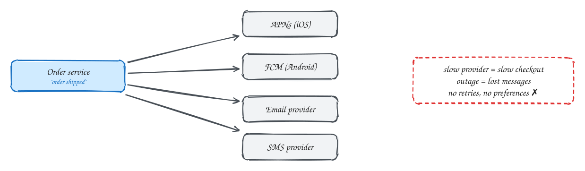
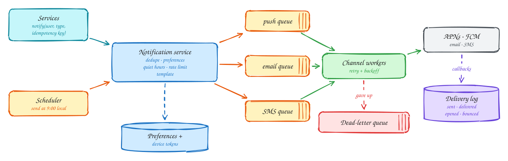

# Notification system

<span class="lvl lvl-i">Intermediate</span>

**Difficulty:** Medium · **Patterns:** [Long-running tasks](../patterns/long-running-tasks.md) · [Scaling writes](../patterns/scaling-writes.md) · **DDIA:** [Ch 5](../ddia/05-encoding-and-evolution.md) event-driven messaging · [Ch 13](../ddia/13-philosophy-of-streaming-systems.md) end-to-end idempotency

*Every service wants to tell users something. The hard parts are the slow external providers and the user who must not get the same message three times.*

> [!TIP]
> **One-page sketchnote:** [NOTIFICATION SYSTEM on a single page](../sketchnotes/problem-notification-system.svg), for revision or printing.

## TL;DR

- Never call Apple, Google, email or SMS providers inside a user request: accept the notification, **queue it per channel**, and let workers send it with retries.
- One central notification service applies **idempotency keys, user preferences, quiet hours and rate limits** before anything is queued.
- Broadcasts to millions are a **fan-out** problem: expand in batches, prioritise urgent messages (one-time passwords) over marketing, and record every attempt in a **delivery log**.

## 1. Requirements

**Functional**

1. Services send a notification to a user (or a segment) by type: order shipped, new message, password reset
2. Deliver by push (iOS, Android), email and SMS according to user preferences
3. Support scheduled sends and quiet hours (no marketing pushes at 3 a.m. local time)
4. Track sent, delivered, opened, bounced; let users unsubscribe per category

**Non-functional**

- Transactional messages (OTPs, security alerts) delivered within seconds
- At-least-once delivery with deduplication: no duplicates visible to the user
- Survive provider outages and slowdowns
- 1B notifications/day; broadcasts to 50M users in minutes

## 2. Back-of-envelope numbers

1B/day ≈ **12k/s average**. A breaking-news broadcast to 50M users within 5 minutes is **~170k/s** for that period. Push providers accept thousands of messages per second per connection, so the sender needs **many parallel connections and workers**. SMS costs money per message (a few cents), so a duplicate or runaway loop costs real money. Delivery log: 1B rows/day × ~200 B ≈ **200 GB/day**, kept 30–90 days.

## 3. Core entities and API

```text
notifications(id, idempotency_key, user_id, type, payload, priority, send_at)
preferences(user_id, category, channel, enabled, quiet_hours, timezone)
devices(user_id, platform, token, last_seen)
deliveries(notification_id, channel, status, provider_id, attempt, ts)
```

```http
POST /notify {user_id | segment, type, data, idempotency_key, send_at?} → 202 {notification_id}
```

## 4. v1: the simplest design, and where it breaks



Each service calls the providers directly when something happens: the order service calls APNs, FCM, the email API and the SMS API inside its own request.

**Where it breaks:** providers are external and sometimes slow or down. A 3-second email API makes checkout take 3 seconds; an outage loses the notification entirely, with no retry. Every service re-implements templates, device lookup and preferences, and nothing stops two services from both notifying the user about the same event, or from texting someone who opted out.

## 5. Evolving to the final design



Each step fixes one specific problem with the step before it.

### Step 1: one notification service, accept fast and queue

**Why:** callers shouldn't wait for providers, and the logic belongs in one place.

**How:** services call `POST /notify` and get `202 Accepted` in milliseconds. The notification service stores the request and writes one message per channel to **separate queues** (push, email, SMS). Separate queues mean a slow SMS provider can't hold up push notifications. Services that publish domain events anyway ("order shipped") can have a consumer translate events into notifications instead of calling the API.

### Step 2: apply idempotency, preferences and limits before queueing

**Why:** the same event can be published twice (retries are everywhere), users opt out, and some messages must not go out at night.

**How:** before queueing, the service:

1. **Deduplicates** on the caller's `idempotency_key` (a unique constraint), so a retried request doesn't create a second notification.
2. Checks **preferences** per category and channel, and **unsubscribes**.
3. Applies **quiet hours** in the user's time zone: non-urgent messages are delayed by putting them in the **scheduler** instead.
4. Applies per-user **rate limits** ("at most 3 marketing pushes a day") and collapses bursts ("5 new messages" instead of five pushes).
5. Looks up **device tokens** and renders the **template** in the user's language.

### Step 3: channel workers with retries, backoff and a dead-letter queue

**Why:** providers fail transiently (timeouts, 5xx, throttling) and permanently (invalid token, bounced address).

**How:** workers pull from each channel queue, call the provider, and on transient failure **retry with exponential backoff and jitter** up to a limit; then the message goes to a **dead-letter queue** for inspection. Permanent failures are handled, not retried: an invalid device token is deleted, a hard-bounced email address is suppressed. Every attempt is written to the **delivery log**. Workers send each message with the notification ID as the provider's idempotency/collapse key where supported, so a retry after an unknown outcome doesn't show twice on the device.

### Step 4: priorities and broadcast fan-out

**Why:** a 50M-user broadcast must not delay a password-reset code sitting behind it in the queue.

**How:** separate **high-priority** queues and workers for transactional messages (OTPs, security alerts) that marketing can never starve. Broadcasts are expanded in **batches**: a job pages through the segment (10k users per batch), applies preferences per batch, and enqueues at a controlled rate so providers and our own workers aren't overwhelmed. Provider callbacks (delivered, opened, bounced) flow back into the delivery log for analytics and for suppressing bad addresses.

## 6. Deep dives

### Exactly once?

**Why it matters:** queues deliver at least once, and a worker can crash after the provider accepted the message but before recording it.

**How:** true exactly-once to a phone isn't possible across an external provider, so make duplicates harmless: dedupe at intake by idempotency key, record "sent" in the delivery log keyed by `(notification_id, channel)` before acking the queue, and use provider collapse keys so a duplicate replaces rather than adds. See [Delivery guarantees](../101/delivery-guarantees.md).

### A provider is down?

**Why it matters:** an SMS outage shouldn't lose OTPs.

**How:** circuit breaker per provider; fail over to a secondary SMS or email provider for critical categories; queues absorb the backlog for the rest, and messages expire if they're no longer useful ("your ride is arriving" after an hour is noise).

### Scheduled and time-zone sends?

**Why it matters:** "9 a.m. local time" means 24 different send times.

**How:** store `send_at` per user in UTC; a scheduler (a time-bucketed table or a delay queue, see [Job scheduler](job-scheduler.md)) releases due notifications into the normal pipeline.

### In-app notifications?

**Why it matters:** the bell icon list in the app is a feed, not a push.

**How:** write each notification to a per-user inbox table (newest first, paginated) and push a real-time update over the app's WebSocket if the user is online ([Real-time updates](../patterns/real-time-updates.md)).

## 7. Interview script (45 minutes)

| Time | What you do | Content |
|---|---|---|
| 0–5 | Functional requirements | Push/email/SMS by type; preferences; scheduling; tracking |
| 5–8 | Non-functional requirements | OTPs in seconds; no visible duplicates; survive provider outages; 1B/day, 50M broadcasts |
| 8–10 | Numbers that drive the design | 12k/s average, ~170k/s during broadcasts; SMS cost per message |
| 10–13 | Entities and API | `POST /notify` with idempotency key; preferences; devices; delivery log |
| 13–25 | v1, then evolve it | Direct provider calls → notification service + per-channel queues → dedupe/preferences/quiet hours/rate limits → workers with retries + DLQ → priorities and batched broadcasts |
| 25–40 | Deep dives | Duplicates · provider outage · time-zone scheduling · in-app inbox |
| 40–45 | Wrap-up | Monitor queue age per channel, provider error rates, delivery and open rates, DLQ size. |

## Staff-level lens

| Question | Staff answer |
|---|---|
| **The real problem** | Turn unreliable, slow, rate-limited external providers into a reliable internal API without spamming or duplicating. |
| **Deciding number** | 12k/s steady but ~170k/s during broadcasts; OTPs must not wait behind them. |
| **Staff call and trade-off** | Central service with intake dedupe and per-channel, per-priority queues; accept seconds of delay for marketing to protect transactional latency. |
| **Raise before you're asked** | Cost of SMS duplicates, user trust (frequency caps, quiet hours), provider failover, invalid-token cleanup, legal opt-out rules. |
| **Senior stops at** | Queues and workers. |
| **Staff goes on to** | A platform other teams self-serve (templates, categories, quotas per team), notification fatigue metrics, and cost controls. |
| **Run it** | Queue age by priority, provider error and throttle rates, opt-out rate per category, DLQ volume. |

All problems through this lens: [Staff-level answers](../playbook/staff-level.md).

## 8. Common mistakes

- Calling providers synchronously in the user's request.
- One queue for everything, so broadcasts delay OTPs.
- Retrying permanent failures forever (invalid tokens, bounced emails).
- No idempotency key at intake, so retries send duplicates.

## Self-check

Try to answer before you open each one.

<details class="question" markdown>
<summary>Why separate queues per channel and per priority?</summary>

A slow or failing provider (say SMS) shouldn't block push, and a huge marketing broadcast shouldn't delay password-reset codes.

</details>

<details class="question" markdown>
<summary>A service retries POST /notify after a timeout. How do you avoid sending twice?</summary>

The caller sends an idempotency key; the notification service stores it with a unique constraint and returns the existing notification for repeats.

</details>

<details class="question" markdown>
<summary>Which provider errors should be retried and which shouldn't?</summary>

Retry transient ones (timeouts, 5xx, throttling) with backoff; don't retry permanent ones (invalid device token, hard bounce): remove the token or suppress the address.

</details>

<details class="question" markdown>
<summary>How do you send a broadcast to 50M users without overwhelming anything?</summary>

Expand the segment in batches, apply preferences per batch, enqueue at a controlled rate on low-priority queues, and let many workers send in parallel within provider limits.

</details>

## Related

- **Patterns:** [Long-running tasks](../patterns/long-running-tasks.md) · [Scaling writes](../patterns/scaling-writes.md) · [Real-time updates](../patterns/real-time-updates.md)
- **101:** [Delivery guarantees](../101/delivery-guarantees.md) · [Dead-letter queues](../101/dead-letter-queues.md) · [Timeouts and retries](../101/timeouts-and-retries.md) · [Webhooks vs polling](../101/webhooks-vs-polling.md)
- **DDIA:** [Ch 5](../ddia/05-encoding-and-evolution.md) event-driven messaging · [Ch 13](../ddia/13-philosophy-of-streaming-systems.md) end-to-end idempotency
- **Similar problems:** [Chat app](chat-app.md) · [Job scheduler](job-scheduler.md) · [Payment system](payment-system.md)
