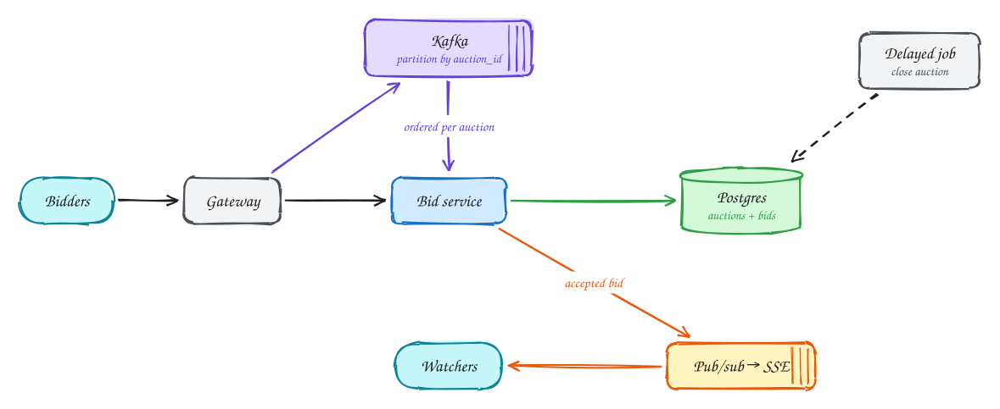

# Online auction

**Difficulty:** Medium · **Patterns:** [Real-time updates](../patterns/real-time-updates.md) · [Dealing with contention](../patterns/contention.md) · **DDIA:** [Ch 7](../ddia/07-transactions.md) lost update · [Ch 11](../ddia/11-stream-processing.md) partitioned log · [Ch 8](../ddia/08-trouble-with-distributed-systems.md) clocks

*Many people bid on one row at the same time, and exactly one of them must win each race.*

## TL;DR

- Comparing bids in application code loses updates under concurrency.
- Accept a bid with one conditional update: set the new maximum only if it beats the current one and the auction is open.
- Push accepted bids to watchers in real time; for very hot auctions, serialize bids through a partitioned log.

## 1. Requirements

**Functional**

1. Create an auction (item, starting price, end time)
2. Place bids that must beat the current highest
3. Watch the highest bid update live; winner decided at the end

**Non-functional**

- Bids strongly consistent (never accept a stale "highest")
- Live updates < 1s
- No lost bids
- Hot auctions spike in the final seconds

## 2. Back-of-envelope numbers

10M auctions, ~100 bids each over a week ≈ low average QPS, but a hot auction can see **~1k bids/s** on one row near the end.

## 3. Core entities and API

```text
auctions(id, max_bid, max_bidder, end_time, status)
bids(auction_id, bid_id, user_id, amount, ts) append-only
```

```http
POST /auctions
POST /auctions/{id}/bids {amount} + Idempotency-Key
GET /auctions/{id}/stream (SSE)
```

## 4. v1: the simplest design, and where it breaks


Naive: read max_bid, compare in application code, insert. Two concurrent bids both "win", a lost update.

## 5. Evolving to the final design



Each step fixes one specific problem with the step before it:

1. Naive: read max_bid, compare in application code, insert. Two concurrent bids both "win", a lost update.
2. Make it atomic in the DB: UPDATE auctions SET max_bid=:amt, max_bidder=:u WHERE id=:a AND max_bid < :amt AND end_time > now(). 1 row = accepted, 0 = outbid. Bids are also appended for history.
3. Accepted bids are published to pub/sub and pushed over SSE to everyone watching.
4. For very hot auctions, a Kafka partition per auction_id serializes bids before the DB (durable and ordered). A delayed job closes the auction at end time.

## 6. Deep dives

### Two bids at the same instant?

Conditional update (or SELECT FOR UPDATE) on the auction row. That is the lost-update fix from DDIA Ch 7.

### Clock fairness at the deadline?

Use the DB server time inside the same conditional update, never client time.

### Durability?

Acknowledge only after commit (or Kafka acks=all).

### Anti-sniping?

Extend end_time by N seconds on late bids, inside the same update.

## 7. Interview script (45 minutes)

| Time | What you do | Content |
|---|---|---|
| 0–5 | Functional requirements | Create an auction (item, starting price, end time); Place bids that must beat the current highest; Watch the highest bid update live; winner decided at the end |
| 5–8 | Non-functional requirements | Bids strongly consistent (never accept a stale "highest"); Live updates < 1s; No lost bids; Hot auctions spike in the final seconds |
| 8–10 | Numbers that drive the design | 10M auctions, ~100 bids each over a week ≈ low average QPS, but a hot auction can see **~1k bids/s** on one row near the end. |
| 10–13 | Entities and API | Keep it short: the endpoints in §3, idempotency keys on writes. |
| 13–25 | v1, then evolve it | Draw v1 and show where it breaks. Then add, in order: Pub/sub → SSE → Watchers → Kafka → Delayed job. Justify each addition with a number. |
| 25–40 | Deep dives | Two bids at the same instant? · Clock fairness at the deadline? · Durability? · Anti-sniping? |
| 40–45 | Wrap-up | Remaining bottlenecks, failure modes, what you would monitor. |

## 8. Common mistakes

- Comparing bids in a Redis cache without atomicity.
- Adding components before showing which number makes them necessary.
- Skipping failure handling: what happens on timeouts, retries and crashes.

## Related

- **Patterns:** [Real-time updates](../patterns/real-time-updates.md) · [Dealing with contention](../patterns/contention.md)
- **DDIA:** [Ch 7](../ddia/07-transactions.md) lost update · [Ch 11](../ddia/11-stream-processing.md) partitioned log · [Ch 8](../ddia/08-trouble-with-distributed-systems.md) clocks
- **Similar problems:** [Ride sharing (Uber)](ride-sharing.md) · [Live comments (Facebook Live)](live-comments.md) · [Collaborative editor (Google Docs)](collaborative-editor.md) · [Stock trading (Robinhood)](stock-trading.md)
