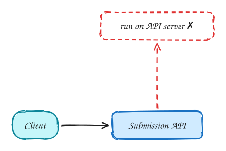
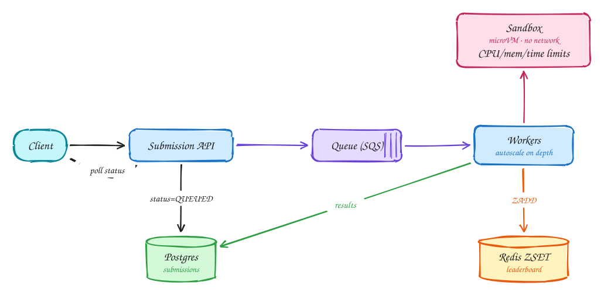

# Online judge (LeetCode)

**Difficulty:** Medium · **Patterns:** [Multi-step processes](../patterns/multi-step-processes.md) · [Long-running tasks](../patterns/long-running-tasks.md) · **DDIA:** [Ch 11](../ddia/11-stream-processing.md) queues · [Ch 1](../ddia/01-reliability-scalability-maintainability.md) bursty load

*You are running strangers' code on your servers, so isolation comes first.*

> [!TIP]
> **One-page sketchnote:** [ONLINE JUDGE (LEETCODE) on a single page](../sketchnotes/problem-online-judge.svg), for revision or printing.

## TL;DR

- Run every submission in a locked-down sandbox: no network, read-only filesystem, strict CPU, memory and time limits.
- Queue submissions and return immediately; workers autoscale on queue depth and the client polls for results.
- Keep contest leaderboards in a Redis sorted set.

## 1. Requirements

**Functional**

1. Browse problems
2. Submit code in several languages; get pass/fail per test
3. Contest leaderboard

**Non-functional**

- Untrusted code fully isolated
- Result within ~5s
- Contest spikes (100k users submitting)
- Scalable

## 2. Back-of-envelope numbers

Contest: 100k users × ~5 submissions in 90 min ≈ **~100 submissions/s** peak; each run takes 1–5s of sandbox CPU, so ~500 concurrent sandboxes.

## 3. Core entities and API

```text
problems
test_cases (S3)
submissions(id, user, problem, status, results)
leaderboard:{contest} ZSET
```

```http
POST /problems/{id}/submissions {lang, code} → submission_id
GET /submissions/{id} (poll status)
GET /contests/{id}/leaderboard
```

## 4. v1: the simplest design, and where it breaks



Naive: run user code on the API servers. It is a security hole, and slow code blocks everything.

## 5. Evolving to the final design



Each step fixes one specific problem with the step before it:

1. Naive: run user code on the API servers. It is a security hole, and slow code blocks everything.
2. Run every submission in an isolated sandbox (Firecracker/gVisor): read-only filesystem, no network, seccomp, strict CPU/memory/time limits.
3. Decouple with a queue: the API records QUEUED and returns immediately; autoscaled workers run tests and write results; the client polls status every second (the long-running-task pattern).
4. Contest leaderboard in a Redis sorted set; the score encodes points and time penalty.

## 6. Deep dives

### Security layers?

MicroVM or gVisor, no network, read-only FS, seccomp filters, resource limits, kill on timeout.

### Contest spike?

The queue absorbs it; scale workers on queue depth; pre-warm containers per language.

### Polling vs push?

Polling every 1s is simple and fine at this scale; SSE is optional.

### Leaderboard ties?

score = points × 1e6 − penalty_seconds.

## 7. Interview script (45 minutes)

| Time | What you do | Content |
|---|---|---|
| 0–5 | Functional requirements | Browse problems; Submit code in several languages; get pass/fail per test; Contest leaderboard |
| 5–8 | Non-functional requirements | Untrusted code fully isolated; Result within ~5s; Contest spikes (100k users submitting); Scalable |
| 8–10 | Numbers that drive the design | Contest: 100k users × ~5 submissions in 90 min ≈ **~100 submissions/s** peak; each run takes 1–5s of sandbox CPU, so ~500 concurrent sandboxes. |
| 10–13 | Entities and API | Keep it short: the endpoints in §3, idempotency keys on writes. |
| 13–25 | v1, then evolve it | Draw v1 and show where it breaks. Then add, in order: Sandbox → Postgres → Queue (SQS) → Workers → Redis ZSET. Justify each addition with a number. |
| 25–40 | Deep dives | Security layers? · Contest spike? · Polling vs push? · Leaderboard ties? |
| 40–45 | Wrap-up | Remaining bottlenecks, failure modes, what you would monitor. |


## Staff-level lens

| Question | Staff answer |
|---|---|
| **The real problem** | Run untrusted code safely, through contest spikes. |
| **Deciding number** | ~100 submissions/s at peak; ~500 sandboxes running at once. |
| **Staff call and trade-off** | Queue + microVM sandboxes + autoscaling workers. Accept a few seconds of latency. |
| **Raise before you're asked** | Sandbox escape; noisy neighbours; contest start spike (pre-warm capacity). |
| **Senior stops at** | Queue + containers. |
| **Staff goes on to** | Defence in depth for isolation, pre-warming before contests, fairness between users. |
| **Run it** | Watch queue wait, sandbox start time, verdict latency. |

All 29 problems through this lens: [Staff-level answers](../playbook/staff-level.md).

## 8. Common mistakes

- Executing user code with network access or on shared API hosts.
- Adding components before showing which number makes them necessary.
- Skipping failure handling: what happens on timeouts, retries and crashes.

## Related

- **Patterns:** [Multi-step processes](../patterns/multi-step-processes.md) · [Long-running tasks](../patterns/long-running-tasks.md)
- **DDIA:** [Ch 11](../ddia/11-stream-processing.md) queues · [Ch 1](../ddia/01-reliability-scalability-maintainability.md) bursty load
- **Similar problems:** [Payment system (Stripe)](payment-system.md) · [Job scheduler](job-scheduler.md)
