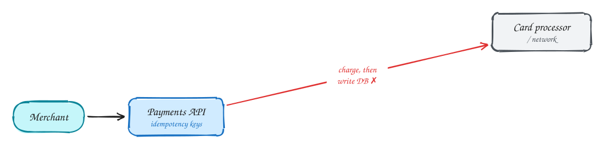
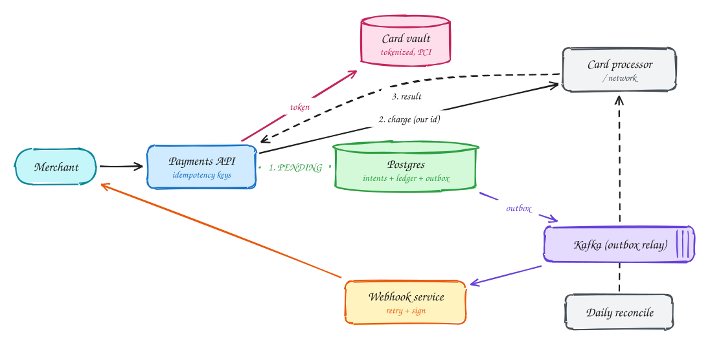

# Payment system (Stripe)

<span class="lvl lvl-a">Advanced</span>

**Difficulty:** Hard · **Patterns:** [Multi-step processes](../patterns/multi-step-processes.md) · **DDIA:** [Ch 8](../ddia/08-trouble-with-distributed-systems.md) unknown outcomes · [Ch 12](../ddia/12-future-of-data-systems.md) end-to-end idempotency, integrity · [Ch 11](../ddia/11-stream-processing.md) outbox

*Throughput is moderate. The hard part is staying correct when a call to the bank has an unknown outcome.*

> [!TIP]
> **One-page sketchnote:** [PAYMENT SYSTEM (STRIPE) on a single page](../sketchnotes/problem-payment-system.svg), for revision or printing.

## TL;DR

- Record the payment as pending before calling the processor, and pass your ID as the idempotency key.
- On a timeout, query by that key or retry it; never create a second charge.
- Publish status changes through an outbox, keep an append-only double-entry ledger, and reconcile daily.

## 1. Requirements

**Functional**

1. Merchants create payment intents; customers pay by card
2. Merchants receive status via webhooks
3. Refunds

**Non-functional**

- Never double-charge (exactly-once effect)
- Durable and auditable; strongly consistent ledger
- ~10k TPS
- PCI: raw card data isolated

## 2. Back-of-envelope numbers

10k TPS is moderate for a well-indexed Postgres cluster. The hard part is **correctness under unknown outcomes**, not throughput.

## 3. Core entities and API

```text
payment_intents(id, merchant, amount, status state machine)
ledger_entries(id, txn_id, account, debit, credit) append-only
outbox
```

```http
POST /payment_intents {amount, currency} + Idempotency-Key
POST /payment_intents/{id}/confirm {payment_method_token}
webhook → merchant: payment.succeeded / failed
```

## 4. v1: the simplest design, and where it breaks



When a customer pays, the API calls the card processor ("charge this card $50"), waits for the result, and then writes a `payments` row with the outcome.

**Where it breaks:** look at what happens if anything fails **between** the processor call and the database write.

- The server **crashes** after the processor charged the card but before the row was written. The customer has been charged, and **we have no record of it**.
- The processor call **times out**. Did it charge or not? We don't know (see [DDIA Ch 8](../ddia/08-trouble-with-distributed-systems.md)). If we retry, we may **charge twice**. If we don't, we may lose a real payment.
- The merchant's own server retries its request after a network blip, and we create a **second payment**.

Throughput (about 10k transactions a second) isn't the hard part. **Correctness when outcomes are unknown** is.

## 5. Evolving to the final design



Each step fixes one specific problem with the step before it.

### Step 1: record intent first, call the processor with our ID

**Why:** we need a record that exists **before** money can move, so after any crash or timeout we can find out what happened instead of guessing.

**How:** create the payment intent in our database with status **PENDING** first. Then call the processor, passing **our intent ID as the processor's idempotency key**. Then record the result (SUCCEEDED or FAILED). If we crash or time out, the PENDING row remains. A recovery job retries the call with the **same** idempotency key, which the processor treats as the same request and never charges twice, or **queries the processor** for that ID's status. We never create a fresh charge for an existing intent.

### Step 2: protect against client retries, and isolate card data

**Why:** merchants' servers retry too, and each retry mustn't become a new payment. And raw card numbers are dangerous to store: any system that touches them falls under strict PCI rules.

**How:** every mutating API call requires an **Idempotency-Key** from the merchant, stored with a **unique index**. A repeated key returns the original response instead of doing the work again. Card numbers go straight into an isolated, tightly controlled **vault** that returns a **token**. The rest of the system only ever sees tokens, which keeps most of it out of PCI scope.

### Step 3: reliable events, a ledger, and reconciliation

**Why:** merchants must be told reliably when a payment's status changes. The record of money must be correct and auditable forever. And bugs or processor errors must be caught.

**How:**

- Every status change writes an **outbox** row **in the same transaction**. A relay publishes it, and **webhooks** go to the merchant, signed and retried with backoff (see [Transactional outbox](../101/outbox.md)).
- Money movements are recorded as append-only **double-entry ledger** rows (see deep dive).
- A daily **reconciliation** job compares our ledger with the processor's **settlement files** and flags every difference.

## 6. Deep dives

### Processor times out?

**Why it's hard:** a timeout doesn't mean failure. The charge may have succeeded and only the reply was lost. Assuming failure and retrying with a new request double-charges. Assuming success loses money if it actually failed.

**How:** treat it as **unknown**. Keep the intent **PENDING**, and resolve it by either **retrying with the same idempotency key** (the processor returns the original result if it already charged) or **querying the processor's status** for our reference. The user sees "processing" until it's resolved. Reconciliation is the final safety net.

### Webhook delivery?

**Why it's hard:** we must notify the merchant of every status change, but their server may be down, slow or failing. And sending the webhook separately from the database update risks one without the other (the dual-write problem).

**How:** write the event to an **outbox** table in the **same transaction** as the status change, so the event exists if and only if the change does. A relay delivers webhooks with **exponential backoff** for hours or days, **signs** each one (HMAC) so merchants can verify it came from us, and includes an `event_id` so merchants can **deduplicate** the inevitable repeats.

### Why double-entry?

**Why not just a balance column:** updating `balance = balance - 50` overwrites history. If a bug or race corrupts it, you can't tell what happened or fix it reliably.

**How:** record every movement of money as **entries that sum to zero**: debit the customer $50, credit the merchant $48.50, credit fees $1.50. Entries are **appended, never updated or deleted**. A mistake is fixed by adding correcting entries. Any account's balance is the sum of its entries, and the books must always balance across all accounts. Any imbalance immediately reveals a bug, and you have a complete audit trail.

### Distributed transaction with the bank?

**Why you can't have one:** the processor and the banks are separate companies. They won't hold locks or take part in a two-phase commit with your database, and their operations can't be rolled back like a database transaction.

**How:** design the payment as a **state machine** (created → pending → succeeded / failed → refunded), where every transition is recorded durably and every external call is idempotent. When something must be undone, use a **compensating action**, a refund, rather than a rollback. Use **reconciliation** against the processor's records to catch anything that slipped through.

## 7. Interview script (45 minutes)

| Time | What you do | Content |
|---|---|---|
| 0–5 | Functional requirements | Merchants create payment intents; customers pay by card; Merchants receive status via webhooks; Refunds |
| 5–8 | Non-functional requirements | Never double-charge (exactly-once effect); Durable and auditable; strongly consistent ledger; ~10k TPS; PCI: raw card data isolated |
| 8–10 | Numbers that drive the design | 10k TPS is moderate for a well-indexed Postgres cluster. The hard part is **correctness under unknown outcomes**, not throughput. |
| 10–13 | Entities and API | Keep it short: the endpoints in §3, idempotency keys on writes. |
| 13–25 | v1, then evolve it | Draw v1 and show where it breaks. Then add, in order: Postgres → Card vault → Kafka (outbox relay) → Webhook service → Daily reconcile. Justify each addition with a number. |
| 25–40 | Deep dives | Processor times out? · Webhook delivery? · Why double-entry? · Distributed transaction with the bank? |
| 40–45 | Wrap-up | Remaining bottlenecks, failure modes, what you would monitor. |


## Staff-level lens

| Question | Staff answer |
|---|---|
| **The real problem** | Stay correct when a call to the bank has an unknown outcome. |
| **Deciding number** | ~10k TPS: moderate. Correctness is the problem. |
| **Staff call and trade-off** | Pending record first, idempotency keys, outbox, double-entry ledger, daily reconciliation. Accept extra writes for auditability. |
| **Raise before you're asked** | Processor timeouts; duplicate webhooks; partial refunds; PCI scope creep. |
| **Senior stops at** | Idempotency keys. |
| **Staff goes on to** | Ledger design, reconciliation, isolating card data to shrink compliance scope. |
| **Run it** | Watch reconciliation breaks, age of pending payments, webhook delivery success. |

All 29 problems through this lens: [Staff-level answers](../playbook/staff-level.md).

## 8. Common mistakes

- Using 2PC or assuming the processor call succeeds or fails cleanly.
- Adding components before showing which number makes them necessary.
- Skipping failure handling: what happens on timeouts, retries and crashes.

## Self-check

Try to answer before you open each one.

<details class="question" markdown>
<summary>Why record the payment as pending before calling the processor?</summary>

If you crash or time out you still have a record and an ID to reconcile with; nothing exists only at the processor.

</details>

<details class="question" markdown>
<summary>The processor call times out. What do you do?</summary>

Query by your idempotency key, or retry with the same key. Never create a second charge.

</details>

<details class="question" markdown>
<summary>Why a double-entry ledger?</summary>

Every movement is two balancing entries, so money is never created or lost and errors show up when sums don't match.

</details>

## Related

- **Patterns:** [Multi-step processes](../patterns/multi-step-processes.md)
- **DDIA:** [Ch 8](../ddia/08-trouble-with-distributed-systems.md) unknown outcomes · [Ch 12](../ddia/12-future-of-data-systems.md) end-to-end idempotency, integrity · [Ch 11](../ddia/11-stream-processing.md) outbox
- **Similar problems:** [Online judge (LeetCode)](online-judge.md) · [Job scheduler](job-scheduler.md)
