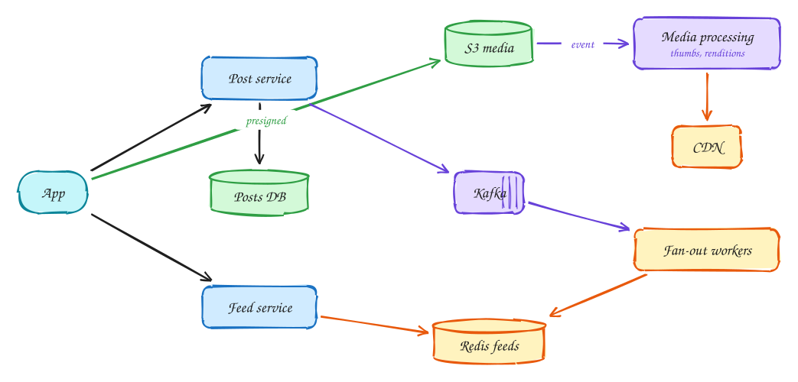

# Photo sharing (Instagram)

<span class="lvl lvl-i">Intermediate</span>

**Difficulty:** Medium · **Patterns:** [Handling large blobs](../patterns/large-blobs.md) · [Scaling reads](../patterns/scaling-reads.md) · **DDIA:** [Ch 1](../ddia/01-reliability-scalability-maintainability.md) fan-out · [Ch 11](../ddia/11-stream-processing.md) async pipelines

*A news feed plus a media pipeline: two well-known problems combined.*

> [!TIP]
> **One-page sketchnote:** [PHOTO SHARING (INSTAGRAM) on a single page](../sketchnotes/problem-photo-sharing.svg), for revision or printing.

## TL;DR

- Upload media straight to object storage; process thumbnails and sizes asynchronously; serve them from a CDN.
- Build feeds with fan-out on write into Redis, and pull celebrity posts at read time.
- Show a post only once its media has finished processing.

## 1. Requirements

**Functional**

1. Post photos and videos with captions
2. Follow users
3. View a feed of followed users' posts

**Non-functional**

- Feed p99 < 500ms
- Media upload and delivery fast globally
- 500M DAU
- Eventual consistency for the feed

## 2. Back-of-envelope numbers

500M DAU × 20 feed loads ≈ **~115k feed reads/s**. 100M posts/day; media ~2MB avg → 200TB/day to S3, served by CDN.

## 3. Core entities and API

```text
posts(id, author, caption, media_keys, status)
follows
feed:{user} ZSET
```

```http
POST /posts {caption} → {post_id, presigned upload URL}
GET /feed?cursor
POST /users/{id}/follow
```

## 4. v1: the simplest design, and where it breaks

Naive: media through the API and a fan-out-on-read feed. Both break at this scale.

## 5. Evolving to the final design



Each step fixes one specific problem with the step before it:

1. Naive: media through the API and a fan-out-on-read feed. Both break at this scale.
2. Media: the client uploads directly to S3 with a presigned URL; an S3 event triggers thumbnails and renditions; the CDN serves them.
3. Feed: same as News Feed. New posts go to Kafka, workers push post IDs into followers' Redis feeds, and celebrities are pulled at read time (hybrid).

## 6. Deep dives

### Post visible before media is processed?

Keep status PROCESSING; show it once renditions are ready (or show to the author only).

### Celebrities?

Hybrid fan-out as in News Feed.

### Like counts?

Redis INCR or sharded counters, flushed asynchronously to the DB.

### Global latency?

CDN for media; regional read replicas or caches for the feed.

## 7. Interview script (45 minutes)

| Time | What you do | Content |
|---|---|---|
| 0–5 | Functional requirements | Post photos and videos with captions; Follow users; View a feed of followed users' posts |
| 5–8 | Non-functional requirements | Feed p99 < 500ms; Media upload and delivery fast globally; 500M DAU; Eventual consistency for the feed |
| 8–10 | Numbers that drive the design | 500M DAU × 20 feed loads ≈ **~115k feed reads/s**. 100M posts/day; media ~2MB avg → 200TB/day to S3, served by CDN. |
| 10–13 | Entities and API | Keep it short: the endpoints in §3, idempotency keys on writes. |
| 13–25 | v1, then evolve it | Draw v1 and show where it breaks. Then add, in order: S3 media → Media processing → CDN → Kafka → Fan-out workers → Redis feeds. Justify each addition with a number. |
| 25–40 | Deep dives | Post visible before media is processed? · Celebrities? · Like counts? · Global latency? |
| 40–45 | Wrap-up | Remaining bottlenecks, failure modes, what you would monitor. |


## Staff-level lens

| Question | Staff answer |
|---|---|
| **The real problem** | A feed plus a media pipeline. |
| **Deciding number** | ~115k feed reads/s; ~200 TB/day of media. |
| **Staff call and trade-off** | Presigned uploads, async processing, CDN; hybrid fan-out. Accept a post appearing only after processing. |
| **Raise before you're asked** | Processing backlog; celebrity fan-out; storage cost. |
| **Senior stops at** | Feed + S3. |
| **Staff goes on to** | Storage tiering and cost, processing SLOs, regional reads. |
| **Run it** | Watch time to visible, feed p99, CDN hit ratio. |

All 29 problems through this lens: [Staff-level answers](../playbook/staff-level.md).

## 8. Common mistakes

- Serving images from app servers or storing blobs in the database.
- Adding components before showing which number makes them necessary.
- Skipping failure handling: what happens on timeouts, retries and crashes.

## Related

- **Patterns:** [Handling large blobs](../patterns/large-blobs.md) · [Scaling reads](../patterns/scaling-reads.md)
- **DDIA:** [Ch 1](../ddia/01-reliability-scalability-maintainability.md) fan-out · [Ch 11](../ddia/11-stream-processing.md) async pipelines
- **Similar problems:** [Video platform (YouTube)](video-platform.md) · [File storage and sync (Dropbox)](file-sync.md)
