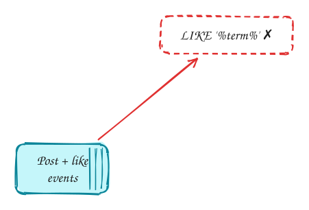
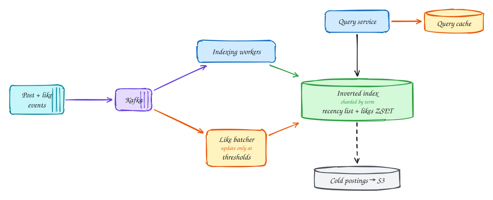

# Post search (Facebook)

<span class="lvl lvl-i">Intermediate</span>

**Difficulty:** Medium · **Patterns:** [Scaling writes](../patterns/scaling-writes.md) · [Scaling reads](../patterns/scaling-reads.md) · **DDIA:** [Ch 3](../ddia/03-storage-and-retrieval.md) inverted index · [Ch 6](../ddia/06-partitioning.md) term-partitioned index · [Ch 11](../ddia/11-stream-processing.md) stream indexing

*Search over billions of posts, where like counts change constantly.*

> [!TIP]
> **One-page sketchnote:** [POST SEARCH (FACEBOOK) on a single page](../sketchnotes/problem-post-search.svg), for revision or printing.

## TL;DR

- Build an inverted index (term → post IDs) from the stream of new posts, sharded by term.
- Keep two orderings per term, recency and likes, and update like-based ranking only at thresholds or in batches.
- Keep hot postings in memory, move old ones to cheaper storage, and cache popular queries.

## 1. Requirements

**Functional**

1. Search posts by keyword
2. Sort results by recency or by likes
3. (Inputs: create posts, like posts)

**Non-functional**

- Search < 500ms
- New posts searchable within ~1 minute
- Huge write volume (posts and likes)
- Read volume ~10k searches/s

## 2. Back-of-envelope numbers

~1B posts/day ≈ 12k/s and ~10× that in likes. Indexing every like individually is far too much write load, so batch it.

## 3. Core entities and API

```text
inverted index: term → post IDs (recency list) and term → ZSET(post_id, like_bucket)
```

```http
GET /search?q&sort=recency|likes&cursor
```

## 4. v1: the simplest design, and where it breaks



Search the posts table directly: `SELECT … FROM posts WHERE content LIKE '%term%' ORDER BY created_at DESC LIMIT 20`.

**Where it breaks:** a `LIKE '%term%'` with a leading wildcard **can't use a normal index**, because the database doesn't know where in the text the word starts. So every search reads **every post**. With about a billion new posts a day, the table holds hundreds of billions of rows. One search would take hours, and we need **10k searches a second** under 500 ms. Sorting by likes makes it worse: like counts change constantly, about 10× more often than posts are created.

## 5. Evolving to the final design



Each step fixes one specific problem with the step before it.

### Step 1: build an inverted index

**Why:** we need to go from a **word** to the posts containing it without reading every post.

**How:** an **inverted index** maps each **term** to its list of post IDs (its *posting list*): `"marathon" → [post 981, post 4410, …]`, like the index at the back of a book. New posts flow from an event stream (Kafka). An indexer splits each post into terms and **appends** its ID to each term's posting list. New posts become searchable within seconds. The index is **sharded by term**, so all of one term's postings live on one shard, and a single-word search reads one list from one shard.

### Step 2: keep two orderings, and don't re-index on every like

**Why:** users sort by **recency** or by **likes**. Recency is easy: posts arrive in time order, so appending keeps each list sorted. Likes are hard. There are about **10× more likes than posts**, and re-sorting a posting list on every like is far too much write load.

**How:** for each term, keep a **recency list** (append-only) and a separate **likes-sorted set** (`term → sorted set of (post_id, like_score)`). Don't update the like score on every like. Update it only when a post's count **crosses a threshold** (1, 2, 4, 8… likes, powers of two), or in **per-minute batches**. Ranking only needs to be roughly right, and exact like counts live in the posts store.

### Step 3: tier storage, cache popular queries, handle multiple words

**Why:** posting lists for common terms grow huge, and most searches are for recent content. Some queries ("world cup") are repeated by millions of people.

**How:** keep the **recent, hot** part of each posting list in memory and move older parts to cheaper storage (blob storage), fetched only when someone scrolls far back. **Cache** results for popular queries for a short time. For multi-word queries, fetch each term's list and **intersect** them (see deep dive).

## 6. Deep dives

### Why not just Elasticsearch?

**The honest answer:** in a real system, Elasticsearch (or OpenSearch) is a perfectly good choice, and it's built on exactly this inverted index. Know how it scales: it partitions **by document**, so each shard indexes its own subset of posts, and a search asks **every** shard and merges (scatter-gather). New documents become searchable after a **refresh interval** (about 1 second by default).

**Why the interviewer asks:** this problem tests whether you understand **what's underneath**: posting lists, partitioning by term vs by document, and how to handle a ranking signal that changes constantly. Say you'd use Elasticsearch, then show you could reason about its internals.

### Likes change constantly?

**Why it's hard:** a viral post can get thousands of likes a second, and each would move it in the likes-sorted set of every term it contains: dozens of index writes per like.

**How:** decouple ranking from exact counts. The index stores a **coarse like score** that changes only when the count crosses a threshold (powers of two means a post with a million likes has changed score only about 20 times), or that is refreshed in **batches** every minute. Exact counts live in a separate counter store. Search ranking doesn't need to know whether it's 10,341 or 10,342 likes.

### Multi-keyword?

**Why it's tricky:** "marathon training plan" needs posts containing **all three** words. Each posting list may have millions of entries.

**How:** **intersect** the posting lists, starting with the **shortest** one ("marathon" is rarer than "plan"). Walk through the short list and check membership in the longer ones, which is fast if the lists are sorted by post ID or have skip pointers. For common phrases, a **bigram index** (pairs of adjacent words, such as `"training plan"`) gives a short list directly.

### Hot term?

**Why it's a problem:** with a term-partitioned index, **all** searches for one term go to **one** shard. During a big event, millions of people search the same word, and that shard is overwhelmed while others are idle.

**How:** **replicate hot terms** across several shards and spread reads among the copies. Combine that with **query result caching**: when millions search "world cup", most get a cached result a few seconds old, and the index barely notices.

## 7. Interview script (45 minutes)

| Time | What you do | Content |
|---|---|---|
| 0–5 | Functional requirements | Search posts by keyword; Sort results by recency or by likes; (Inputs: create posts, like posts) |
| 5–8 | Non-functional requirements | Search < 500ms; New posts searchable within ~1 minute; Huge write volume (posts and likes); Read volume ~10k searches/s |
| 8–10 | Numbers that drive the design | ~1B posts/day ≈ 12k/s and ~10× that in likes. Indexing every like individually is far too much write load, so batch it. |
| 10–13 | Entities and API | Keep it short: the endpoints in §3, idempotency keys on writes. |
| 13–25 | v1, then evolve it | Draw v1 and show where it breaks. Then add, in order: Kafka → Indexing workers → Inverted index → Query service → Like batcher → Cold postings → S3 → Query cache. Justify each addition with a number. |
| 25–40 | Deep dives | Why not just Elasticsearch? · Likes change constantly? · Multi-keyword? · Hot term? |
| 40–45 | Wrap-up | Remaining bottlenecks, failure modes, what you would monitor. |


## Staff-level lens

| Question | Staff answer |
|---|---|
| **The real problem** | Index a firehose whose ranking signals change constantly. |
| **Deciding number** | ~12k posts/s and ~10× that in likes. |
| **Staff call and trade-off** | Inverted index built from the stream, sharded by term; like-based ranking updated in batches or at thresholds. Accept slightly stale like ranking. |
| **Raise before you're asked** | Hot terms overloading one shard; privacy (who may see a post) enforced at query time; reindexing. |
| **Senior stops at** | "use Elasticsearch". |
| **Staff goes on to** | Explains the inverted index, term vs document partitioning, and privacy-aware retrieval. |
| **Run it** | Watch index lag, query p99, shard skew. |

All 29 problems through this lens: [Staff-level answers](../playbook/staff-level.md).

## 8. Common mistakes

- A Postgres LIKE scan, or re-indexing on every like.
- Adding components before showing which number makes them necessary.
- Skipping failure handling: what happens on timeouts, retries and crashes.

## Self-check

Try to answer before you open each one.

<details class="question" markdown>
<summary>What is an inverted index?</summary>

A map from each term to the list of post IDs that contain it, built as posts arrive.

</details>

<details class="question" markdown>
<summary>Why keep two orderings per term?</summary>

Queries sort by recency or by likes; keeping both avoids sorting huge posting lists at query time.

</details>

<details class="question" markdown>
<summary>Likes change constantly. How do you avoid rewriting the index each time?</summary>

Update like-based ranking only when a post crosses thresholds, or in periodic batches.

</details>

## Related

- **Patterns:** [Scaling writes](../patterns/scaling-writes.md) · [Scaling reads](../patterns/scaling-reads.md)
- **DDIA:** [Ch 3](../ddia/03-storage-and-retrieval.md) inverted index · [Ch 6](../ddia/06-partitioning.md) term-partitioned index · [Ch 11](../ddia/11-stream-processing.md) stream indexing
- **Similar problems:** [Top-K videos (YouTube)](top-k-videos.md) · [Ad click aggregator](ad-click-aggregator.md) · [Web crawler](web-crawler.md) · [Metrics monitoring (Datadog)](metrics-monitoring.md)
