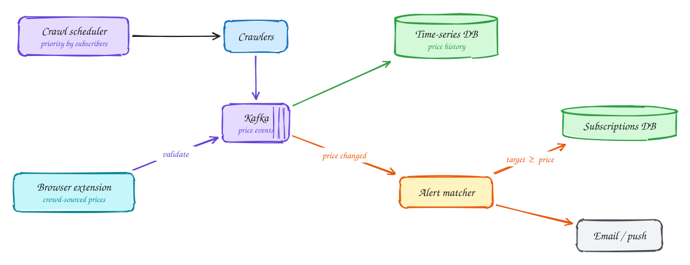

# Price tracker (CamelCamelCamel)

<span class="lvl lvl-i">Intermediate</span>

**Difficulty:** Medium · **Patterns:** [Scaling writes](../patterns/scaling-writes.md) · [Scaling reads](../patterns/scaling-reads.md) · **DDIA:** [Ch 11](../ddia/11-stream-processing.md) event-driven · [Ch 3](../ddia/03-storage-and-retrieval.md) time-series storage

*Five hundred million products can't all be crawled often, so decide what is worth checking.*

> [!TIP]
> **One-page sketchnote:** [PRICE TRACKER (CAMELCAMELCAMEL) on a single page](../sketchnotes/problem-price-tracker.svg), for revision or printing.

## TL;DR

- Prioritise crawling by how many people track a product and how often its price changes.
- Add crowd-sourced prices from a browser extension, validated before they trigger alerts.
- Make alerts event-driven: when a price drops, look up subscriptions for that product only.

## 1. Requirements

**Functional**

1. Track price history for products
2. Users subscribe to alerts at a target price
3. View price charts

**Non-functional**

- 500M products
- Alert within ~1 hour of a drop
- Respect site rate limits (crawl budget)
- Charts load fast

## 2. Back-of-envelope numbers

500M products crawled daily = **~6k pages/s**, which runs into rate limits. Subscriptions are concentrated on a small fraction of products, so prioritize those.

## 3. Core entities and API

```text
price_history(product_id, ts, price) time-series
subscriptions(product_id, user_id, target_price) indexed (product_id, target_price)
```

```http
POST /subscriptions {product_id, target_price}
GET /products/{id}/history?range
```

## 4. v1: the simplest design, and where it breaks

Crawl every one of the 500 million tracked product pages once a day, store each price, and once a day run a job that compares every subscription's target price with the latest price.

**Where it breaks:**

- **Crawl budget:** 500M pages a day is about **6k page fetches a second**, all against a handful of retailer sites. Retailers rate-limit and block crawlers long before that. Even if allowed, once a day is too slow: the requirement is an alert within **an hour** of a price drop.
- **Wasted effort:** most of those 500M products have **no subscribers**, and their prices rarely change. Meanwhile, products people actually care about are checked only once a day.
- **Alert matching:** scanning all subscriptions every day to find matches is slow and mostly finds nothing.

## 5. Evolving to the final design



Each step fixes one specific problem with the step before it.

### Step 1: prioritize what to crawl

**Why:** the crawl budget is limited by retailers' rate limits, so spend it where it matters. Subscriptions are concentrated on a small fraction of products.

**How:** a **scheduler** gives each product a crawl frequency based on **how many people track it** and **how often its price changes**. A popular, volatile product (a TV during sales season) is checked every hour or so; a product with no subscribers and a stable price might be checked weekly. The scheduler puts due products into the crawl queue, and crawlers respect each retailer's robots rules and rate limits.

### Step 2: add crowd-sourced prices from a browser extension

**Why:** even prioritized crawling can't check everything often. But users already visit these product pages constantly.

**How:** a **browser extension** reports the price a user sees when they view a product page. That's extra coverage, for free, exactly on the products people are looking at. This data can be wrong (a regional price, a logged-in discount, a malicious report), so **validate** it: require several agreeing reports, or trigger a **crawler re-check** before trusting a price drop enough to send alerts.

### Step 3: record price changes, alert on events

**Why:** checking every subscription every day is wasteful when most prices didn't change.

**How:** whenever a crawl or validated report shows a **different** price, emit a **price-change event** and append it to the price history, a time-series table. Each event triggers the alert check for **that product only**: `SELECT … FROM subscriptions WHERE product_id = ? AND target_price >= :new_price`, served by an index on `(product_id, target_price)`. Matching users are notified, deduplicated so a user isn't alerted twice for the same drop.

## 6. Deep dives

### Crawl budget?

**Why it's the core constraint:** retailers limit how fast you can fetch, and ignoring that gets you blocked entirely. You can't check 500M products often, so the design is really about choosing **which** to check **when**.

**How:** score each product by subscriber count and observed price volatility, and turn the score into a check interval. Adapt continuously: if a product's price just changed, check it again sooner; if it hasn't changed in weeks, back off. Respect `robots.txt` and per-retailer rate limits with a per-domain token bucket, and use retailers' official product APIs where they exist.

### Bad extension data?

**Why it's a risk:** extension reports come from users' browsers. They might show a member-only price, a different country's price, a temporary cart discount, or be deliberately faked. A false "price dropped!" alert sends thousands of users to a deal that doesn't exist.

**How:** treat extension data as a **hint**, not the truth. Trigger alerts only when **N independent reports agree** (from different users and IPs), or when a **crawler re-check** confirms the new price. Track each reporter's reliability over time and down-weight or ignore those who are often wrong.

### Matching efficiently?

**Why it's hard:** there can be hundreds of millions of subscriptions. Comparing all of them against all prices on a schedule is a massive, mostly pointless job.

**How:** invert the direction: **react to price changes** instead of scanning subscriptions. A price change for product P runs one query, "subscriptions for P with a target at or above the new price", which an index on `(product_id, target_price)` answers by reading only the matching rows. Work is proportional to actual price drops, not to the number of subscriptions.

### Charts?

**Why they need care:** a product's full history can be thousands of price points, and popular products' charts are viewed constantly.

**How:** precompute **daily aggregates** (minimum, maximum, closing price per day) from the price history, and render charts from those. A year is just 365 points. Cache the chart data per product and refresh it when a new price change arrives.

## 7. Interview script (45 minutes)

| Time | What you do | Content |
|---|---|---|
| 0–5 | Functional requirements | Track price history for products; Users subscribe to alerts at a target price; View price charts |
| 5–8 | Non-functional requirements | 500M products; Alert within ~1 hour of a drop; Respect site rate limits (crawl budget); Charts load fast |
| 8–10 | Numbers that drive the design | 500M products crawled daily = **~6k pages/s**, which runs into rate limits. Subscriptions are concentrated on a small fraction of products, so prioritize those. |
| 10–13 | Entities and API | Keep it short: the endpoints in §3, idempotency keys on writes. |
| 13–25 | v1, then evolve it | Draw v1 and show where it breaks. Then add, in order: Browser extension → Kafka → Time-series DB → Alert matcher → Subscriptions DB → Email / push. Justify each addition with a number. |
| 25–40 | Deep dives | Crawl budget? · Bad extension data? · Matching efficiently? · Charts? |
| 40–45 | Wrap-up | Remaining bottlenecks, failure modes, what you would monitor. |


## Staff-level lens

| Question | Staff answer |
|---|---|
| **The real problem** | Too many products to crawl often, so spend the crawl budget where it matters. |
| **Deciding number** | 500M products; ~6k pages/s to crawl each one daily. |
| **Staff call and trade-off** | Crawl by priority (trackers, volatility) + validated crowd-sourced prices + event-driven alerts. Accept staler prices on the long tail. |
| **Raise before you're asked** | Being blocked by the site; poisoned extension data; alert spam. |
| **Senior stops at** | A cron crawl and a scan of subscriptions. |
| **Staff goes on to** | Prioritises by value, validates crowd data, reacts to price events instead of scanning. |
| **Run it** | Watch freshness of tracked products, alert latency, crawl budget used. |

All 29 problems through this lens: [Staff-level answers](../playbook/staff-level.md).

## 8. Common mistakes

- Re-scanning all subscriptions on a schedule instead of reacting to price changes.
- Adding components before showing which number makes them necessary.
- Skipping failure handling: what happens on timeouts, retries and crashes.

## Self-check

Try to answer before you open each one.

<details class="question" markdown>
<summary>How do you decide which product pages to crawl most often?</summary>

Prioritise by how many users track the product and how often its price changes.

</details>

<details class="question" markdown>
<summary>Why validate crowd-sourced prices from the browser extension?</summary>

Bad or malicious data would trigger false alerts; check against recent crawls or multiple reports first.

</details>

<details class="question" markdown>
<summary>How do you match a price drop to alerts efficiently?</summary>

Event-driven: on a drop, look up only that product's subscriptions rather than scanning all alerts.

</details>

## Related

- **Patterns:** [Scaling writes](../patterns/scaling-writes.md) · [Scaling reads](../patterns/scaling-reads.md)
- **DDIA:** [Ch 11](../ddia/11-stream-processing.md) event-driven · [Ch 3](../ddia/03-storage-and-retrieval.md) time-series storage
- **Similar problems:** [Top-K videos (YouTube)](top-k-videos.md) · [Ad click aggregator](ad-click-aggregator.md) · [Web crawler](web-crawler.md) · [Metrics monitoring (Datadog)](metrics-monitoring.md)
