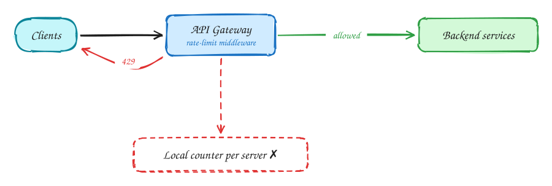
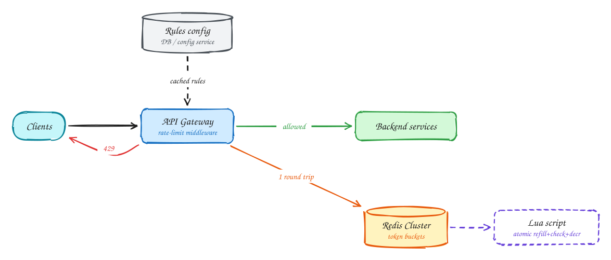

# Rate limiter

**Difficulty:** Medium · **Patterns:** [Scaling reads](../patterns/scaling-reads.md) · [Dealing with contention](../patterns/contention.md) · **DDIA:** [Ch 7](../ddia/07-transactions.md) lost update · [Ch 6](../ddia/06-partitioning.md) shard by key

*Every public API needs one, and the obvious implementation has a race condition.*

> [!TIP]
> **One-page sketchnote:** [RATE LIMITER on a single page](../sketchnotes/problem-rate-limiter.svg), for revision or printing.

## TL;DR

- Counting per server gives each client N times its limit; the counter must be shared, usually in Redis.
- Read-then-write on a shared counter races. Do the refill, check and decrement atomically in one Lua script.
- Decide what happens when Redis is down: allow traffic (fail-open) or block it (fail-closed), per endpoint.

## 1. Requirements

**Functional**

1. Limit requests per client (user, IP, API key) by configurable rules
2. Return 429 with Retry-After and rate-limit headers

**Non-functional**

- Adds < 10ms latency
- Accurate across many API servers
- Highly available (choose fail-open vs fail-closed)
- 1M requests/sec total

## 2. Back-of-envelope numbers

1M req/s = 1M Redis ops/s; one Redis node does ~100k ops/s, so a **~10–20 shard Redis Cluster** keyed by client. 10M active keys × 100B ≈ **1GB** of memory.

## 3. Core entities and API

```text
rules(endpoint, limit, window)
bucket:{client}:{rule} → {tokens, last_refill}
```

```http
isAllowed(client_key, rule) → {allowed, remaining, reset_at}
Response headers: X-RateLimit-Limit / Remaining / Reset
```

## 4. v1: the simplest design, and where it breaks



Naive: each API server counts in local memory. With 50 servers, a client gets 50× the limit.

## 5. Evolving to the final design



Each step fixes one specific problem with the step before it:

1. Naive: each API server counts in local memory. With 50 servers, a client gets 50× the limit.
2. Centralize counters in Redis. But GET then SET from two servers races: both see 99/100 and both allow.
3. A Lua script runs refill + check + decrement atomically inside single-threaded Redis, in one round trip, with no race.
4. Rules come from a config store cached in each gateway. Decide failure mode: fail-open for normal APIs, fail-closed for login and payments.

## 6. Deep dives

### Which algorithm?

**Token bucket** (capacity = burst, refill = sustained rate) is the industry default. Fixed window allows 2× bursts at boundaries; a sliding-window log is exact but stores every timestamp; a sliding-window counter is a good approximation.

### Race between servers?

Read-modify-write is a lost update (DDIA Ch 7). Atomic Lua or INCR + EXPIRE inside Redis fixes it.

### Redis is down?

Fall back to local limits (limit ÷ N servers). Fail-open vs fail-closed is a product decision per endpoint.

### Very hot client?

One key lands on one shard. Give each server a local allowance and sync periodically, trading accuracy for load.

## 7. Interview script (45 minutes)

| Time | What you do | Content |
|---|---|---|
| 0–5 | Functional requirements | Limit requests per client (user, IP, API key) by configurable rules; Return 429 with Retry-After and rate-limit headers |
| 5–8 | Non-functional requirements | Adds < 10ms latency; Accurate across many API servers; Highly available (choose fail-open vs fail-closed); 1M requests/sec total |
| 8–10 | Numbers that drive the design | 1M req/s = 1M Redis ops/s; one Redis node does ~100k ops/s, so a **~10–20 shard Redis Cluster** keyed by client. 10M active keys × 100B ≈ **1GB** of memory. |
| 10–13 | Entities and API | Keep it short: the endpoints in §3, idempotency keys on writes. |
| 13–25 | v1, then evolve it | Draw v1 and show where it breaks. Then add, in order: Redis Cluster → Lua script → Rules config. Justify each addition with a number. |
| 25–40 | Deep dives | Which algorithm? · Race between servers? · Redis is down? · Very hot client? |
| 40–45 | Wrap-up | Remaining bottlenecks, failure modes, what you would monitor. |


## Staff-level lens

| Question | Staff answer |
|---|---|
| **The real problem** | Count requests atomically across many gateways while adding under 10 ms. |
| **Deciding number** | 1M checks/s ≈ 10–20 Redis shards; ~1 GB of bucket state. |
| **Staff call and trade-off** | Token bucket in a Redis Lua script. Accept approximate limits for very hot tenants (local allowances synced periodically). |
| **Raise before you're asked** | Redis outage: fail-open or fail-closed, decided per endpoint; clock skew in refill (use Redis time); one tenant overloading a shard. |
| **Senior stops at** | Algorithm + Redis. |
| **Staff goes on to** | Plan tiers, global vs regional limits, rules as versioned config with shadow mode, and protecting the limiter itself. |
| **Run it** | Watch rejection rate per rule, limiter p99, Redis CPU. Roll out new rules in shadow (log-only) first. |

All 29 problems through this lens: [Staff-level answers](../playbook/staff-level.md).

## 8. Common mistakes

- Counters in Postgres: 1M writes/sec of throwaway data.
- Adding components before showing which number makes them necessary.
- Skipping failure handling: what happens on timeouts, retries and crashes.

## Related

- **Patterns:** [Scaling reads](../patterns/scaling-reads.md) · [Dealing with contention](../patterns/contention.md)
- **DDIA:** [Ch 7](../ddia/07-transactions.md) lost update · [Ch 6](../ddia/06-partitioning.md) shard by key
- **Similar problems:** [URL shortener (Bitly)](url-shortener.md) · [Business discovery (Yelp)](business-discovery.md) · [News feed (Facebook)](news-feed.md) · [News aggregator (Google News)](news-aggregator.md)
