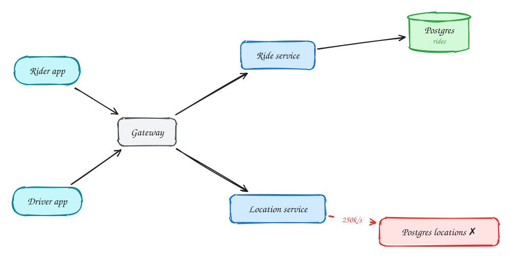
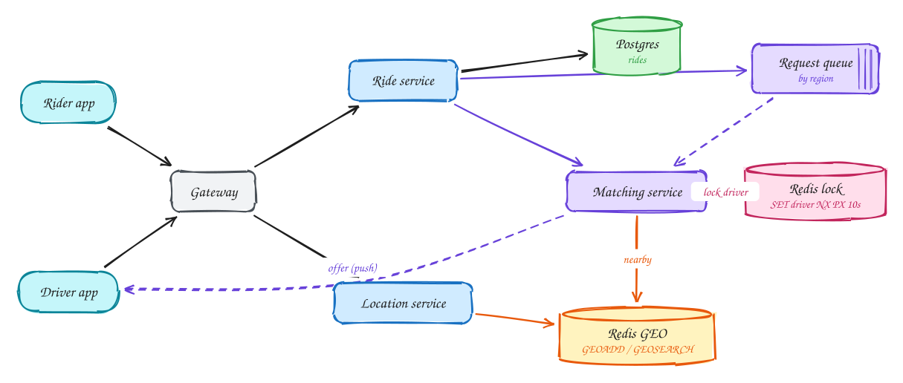

# Ride sharing (Uber)

**Difficulty:** Hard · **Patterns:** [Real-time updates](../patterns/real-time-updates.md) · **DDIA:** [Ch 8](../ddia/08-trouble-with-distributed-systems.md) leases · [Ch 3](../ddia/03-storage-and-retrieval.md) geo index · [Ch 6](../ddia/06-partitioning.md) partition by region

*Four problems in one: a flood of location updates, matching, locking drivers, and a multi-step trip lifecycle.*

## TL;DR

- Driver locations are ephemeral and frequent, so keep them in Redis's geospatial index, not a database.
- Offer a ride to one driver at a time and lock that driver with a short TTL so they can't get two offers.
- Run ride requests through a durable, per-region queue so a crashed matcher loses nothing.

## 1. Requirements

**Functional**

1. Rider requests a ride (pickup, destination) and sees a fare estimate
2. Match to a nearby available driver; driver accepts or declines
3. Live location of driver during the trip

**Non-functional**

- Match within ~1 minute
- A driver is never assigned two rides (consistency)
- High availability for location updates
- Handle surge peaks per city

## 2. Back-of-envelope numbers

1M active drivers × 1 update/4s = **250k location writes/s**, ephemeral (only the latest matters). Ride requests ~100/s avg.

## 3. Core entities and API

```text
rides(id, rider, driver, status, pickup, dest, fare)
driver_location in Redis GEO (TTL)
```

```http
POST /rides/estimate
POST /rides {estimate_id}
POST /drivers/location {lat, lng}
PATCH /rides/{id} {accept|decline}
```

## 4. v1: the simplest design, and where it breaks



Naive: drivers write locations to Postgres. 250k writes/sec of throwaway data breaks it.

## 5. Evolving to the final design



Each step fixes one specific problem with the step before it:

1. Naive: drivers write locations to Postgres. 250k writes/sec of throwaway data breaks it.
2. Locations go to **Redis GEO**: in memory, latest point only, with TTL. GEOSEARCH finds drivers within radius.
3. Matching offers the ride to **one driver at a time** and takes a lock on that driver (SET NX with a 10s TTL), so they can't be offered two rides. Ride assignment is a conditional UPDATE WHERE driver IS NULL.
4. Requests go through a durable queue partitioned by region, so a crashed matcher doesn't lose rides and surges scale per city.

## 6. Deep dives

### Driver double-assigned?

Lock per driver with TTL = accept window, plus conditional assignment in Postgres. Lock expiry = automatic decline.

### Reduce location load?

Adaptive update frequency (less when stationary), client batching.

### Why not query Postgres + PostGIS?

Fine for reads, but 250k updates/sec of ephemeral data belongs in memory.

### Matcher crash mid-match?

Durable workflow/queue; the request is re-processed and idempotent by ride_id.

## 7. Interview script (45 minutes)

| Time | What you do | Content |
|---|---|---|
| 0–5 | Functional requirements | Rider requests a ride (pickup, destination) and sees a fare estimate; Match to a nearby available driver; driver accepts or declines; Live location of driver during the trip |
| 5–8 | Non-functional requirements | Match within ~1 minute; A driver is never assigned two rides (consistency); High availability for location updates; Handle surge peaks per city |
| 8–10 | Numbers that drive the design | 1M active drivers × 1 update/4s = **250k location writes/s**, ephemeral (only the latest matters). Ride requests ~100/s avg. |
| 10–13 | Entities and API | Keep it short: the endpoints in §3, idempotency keys on writes. |
| 13–25 | v1, then evolve it | Draw v1 and show where it breaks. Then add, in order: Redis GEO → Matching service → Redis lock → Request queue. Justify each addition with a number. |
| 25–40 | Deep dives | Driver double-assigned? · Reduce location load? · Why not query Postgres + PostGIS? · Matcher crash mid-match? |
| 40–45 | Wrap-up | Remaining bottlenecks, failure modes, what you would monitor. |

## 8. Common mistakes

- Offering a ride to many drivers at once without locks, so two drivers accept the same ride.
- Adding components before showing which number makes them necessary.
- Skipping failure handling: what happens on timeouts, retries and crashes.

## Related

- **Patterns:** [Real-time updates](../patterns/real-time-updates.md)
- **DDIA:** [Ch 8](../ddia/08-trouble-with-distributed-systems.md) leases · [Ch 3](../ddia/03-storage-and-retrieval.md) geo index · [Ch 6](../ddia/06-partitioning.md) partition by region
- **Similar problems:** [Live comments (Facebook Live)](live-comments.md) · [Collaborative editor (Google Docs)](collaborative-editor.md) · [Stock trading (Robinhood)](stock-trading.md) · [Online auction](online-auction.md)
