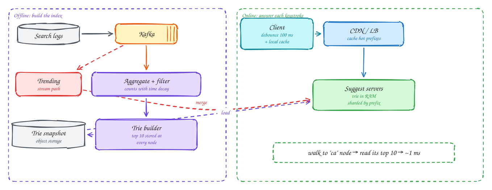

# Search autocomplete (typeahead)

<span class="lvl lvl-i">Intermediate</span>

**Difficulty:** Medium · **Patterns:** [Scaling reads](../patterns/scaling-reads.md) · [Scaling writes](../patterns/scaling-writes.md) · **DDIA:** [Ch 11](../ddia/11-batch-processing.md) batch-built indexes · [Ch 12](../ddia/12-stream-processing.md) trending counts

*Suggestions on every keystroke within 100 ms: the work has to be done before anyone types.*

> [!TIP]
> **One-page sketchnote:** [SEARCH AUTOCOMPLETE on a single page](../sketchnotes/problem-search-autocomplete.svg), for revision or printing.

## TL;DR

- A request per keystroke at ~100k/s with a 100 ms budget rules out querying a database: **precompute the top completions for every prefix**.
- Build a **trie offline** from aggregated search logs, storing the **top 10 at every node**, and serve it from memory on replicated suggest servers. A lookup is a walk to the prefix node: about a millisecond.
- Freshness comes from a separate **streaming path for trending queries**; the client cuts load with **debouncing and caching**.

## 1. Requirements

**Functional**

1. As the user types, show up to 10 suggested completions for the current prefix
2. Rank suggestions by popularity, favouring recent searches
3. Never suggest offensive or unsafe queries; support removing a query quickly

**Non-functional**

- Suggestions appear within ~100 ms of a keystroke (server time under 10 ms)
- ~100k suggestion requests/s at peak
- Highly available; slightly stale suggestions (minutes to an hour) are fine
- New trending queries show up within minutes

## 2. Back-of-envelope numbers

1B searches/day; after the client waits for a pause in typing, ~4 requests per search → **4B requests/day ≈ 46k/s average, ~100k/s peak**. Keep the top ~50M distinct queries; their prefixes share most nodes, giving on the order of 100M trie nodes. Each node stores its top 10 as query IDs (~80 B) plus ~40 B of overhead → **~10–15 GB**: fits in RAM on a few servers.

## 3. Core entities and API

```text
query_counts(query, window, count)          -- aggregated from search logs
trie node: prefix → [top 10 (query_id, score)]
```

```http
GET /suggest?q=cat&lang=en&region=US → ["cat food", "cat videos", "catalina", ...]
```

## 4. v1: the simplest design, and where it breaks


Log every search in a table. On each keystroke, run `SELECT query, COUNT(*) FROM searches WHERE query LIKE 'ca%' GROUP BY query ORDER BY 2 DESC LIMIT 10`.

**Where it breaks:** each keystroke scans and sorts every logged search starting with the prefix. Short prefixes like "c" match hundreds of millions of rows. At 100k requests a second there is no index or database that can group and sort that fast. And the work is identical for every user typing "ca": it should be done **once**, ahead of time.

## 5. Evolving to the final design



Each step fixes one specific problem with the step before it.

### Step 1: aggregate counts offline instead of per request

**Why:** counting raw searches on every request repeats the same work billions of times.

**How:** search events go into Kafka. A batch job (hourly or daily) counts each query over a sliding window, weighting recent days more (**time decay**), drops queries below a minimum count (which also removes most personal data, typos and junk), and applies a block list for offensive terms. The output is a table of `(query, score)` for the top ~50M queries.

### Step 2: precompute top-10 per prefix in a trie, served from memory

**Why:** even with counts, finding the best 10 completions of "ca" means scanning every query starting with "ca".

**How:** build a **trie** (prefix tree): each node is a prefix, children extend it by one character. At build time, store at **every node** its top 10 completions by score, so a lookup is just "walk to the node for `ca`, return its list", **O(length of prefix)** no matter how many queries share it. Limit prefix length (say 20 characters; longer prefixes are rare and can fall back to the deepest node). The builder writes the trie as a snapshot file to object storage; **suggest servers** load it into memory and swap in each new version atomically.

### Step 3: scale and protect the read path

**Why:** 100k requests a second is mostly the same short prefixes, and every keystroke costs a round trip.

**How:**

- **Client:** wait ~100 ms after the last keystroke before calling (**debounce**), cancel in-flight requests that are already outdated, and cache results locally: typing "cat" then deleting back to "ca" needs no request.
- **Edge:** cache responses for short prefixes at the CDN for a minute; they're identical for everyone in a language and region.
- **Servers:** replicate the trie to many stateless servers behind a load balancer. If it outgrows one machine, **shard by prefix range** ("a–f", "g–m", …), choosing ranges by traffic rather than alphabet so shards are balanced.

### Step 4: add a fast path for trending queries

**Why:** a trie rebuilt hourly can't show a breaking-news query that appeared five minutes ago.

**How:** a streaming job (Flink) counts queries over a short window (say 10 minutes) and flags those growing much faster than usual. Suggest servers keep a small in-memory overlay of trending queries per prefix and merge them into the precomputed list at request time. The next full rebuild absorbs them.

## 6. Deep dives

### How to rank?

**Why it matters:** raw counts favour old evergreen queries and are easy to manipulate.

**How:** score = decayed popularity (recent searches weigh more) adjusted by language and region (build separate tries or tag nodes). Personalisation, such as the user's own recent searches, is merged on the client or by a separate small service, rather than building a trie per user.

### Removing a bad suggestion now?

**Why it matters:** an offensive or legally problematic suggestion must disappear in minutes, not at the next rebuild.

**How:** keep a **block list** that suggest servers check at request time (filter it out of the returned list), and feed it to the builder so the next trie excludes it. Store 12 candidates per node instead of 10 so filtering still leaves a full list.

### Why not Elasticsearch?

**Why it matters:** "use a search engine" is a common answer.

**How:** a search engine's prefix queries work for moderate traffic and give fuzzy matching, but it still computes matches and ranks per request. At 100k/s with a sub-10 ms target, a precomputed in-memory structure is far cheaper. Many teams use a search engine for the full results page and a trie-like store for suggestions.

### Typos?

**Why it matters:** "recieve" should suggest "receive".

**How:** precompute a small map of common misspellings to corrections from logs (users who typed X then searched Y), or allow one-edit fuzzy matches on longer prefixes, which costs more and is usually reserved for when exact prefix matches are few.

## 7. Interview script (45 minutes)

| Time | What you do | Content |
|---|---|---|
| 0–5 | Functional requirements | Top 10 suggestions per prefix; ranked by popularity; filter offensive queries |
| 5–8 | Non-functional requirements | ~100 ms per keystroke; 100k req/s; slightly stale OK; trending within minutes |
| 8–10 | Numbers that drive the design | 4B requests/day ≈ 100k/s peak; trie ~10–15 GB fits in memory |
| 10–13 | Entities and API | `GET /suggest?q=`; query counts; trie node → top 10 |
| 13–25 | v1, then evolve it | SQL GROUP BY per keystroke → offline aggregation → trie with top 10 per node in RAM → client debounce, CDN, replicas → trending overlay |
| 25–40 | Deep dives | Ranking and decay · removing bad suggestions · why not a search engine · typos |
| 40–45 | Wrap-up | Monitor p99 latency, cache hit rate, freshness lag of the trie, and block-list hits. |

## Staff-level lens

| Question | Staff answer |
|---|---|
| **The real problem** | Move all ranking work off the request path: per-keystroke traffic can only afford a memory lookup. |
| **Deciding number** | ~100k req/s at < 10 ms server time; precomputed trie of ~10–15 GB fits in RAM. |
| **Staff call and trade-off** | Offline-built trie with top-k per node, replicated in memory; accept an hour of staleness, with a small streaming overlay for trends. |
| **Raise before you're asked** | Abuse and safety (block list at serve time), privacy (minimum-count threshold so rare personal queries never appear), per-language/region tries. |
| **Senior stops at** | Trie + cache. |
| **Staff goes on to** | Trust and safety workflow, ranking experiments with metrics (acceptance rate of suggestions), and cost of rebuild vs incremental updates. |
| **Run it** | Watch suggestion acceptance rate, p99, trie build age and size; alert if the build is late. |

All problems through this lens: [Staff-level answers](../playbook/staff-level.md).

## 8. Common mistakes

- Querying the database or search engine on every keystroke.
- Storing only counts in the trie and traversing all descendants at query time.
- Forgetting the client: no debounce, no cancellation of stale requests, no local cache.
- Ignoring offensive suggestions and privacy until asked.

## Self-check

Try to answer before you open each one.

<details class="question" markdown>
<summary>Why store the top 10 completions at every trie node instead of only counts at the leaves?</summary>

Then a lookup is a walk to the prefix node and a read of its list, regardless of how many queries share the prefix. Without it, short prefixes like "c" would require visiting millions of descendants per request.

</details>

<details class="question" markdown>
<summary>How do trending queries appear quickly if the trie is rebuilt hourly?</summary>

A streaming job detects fast-rising queries in short windows, and suggest servers merge that small overlay into the precomputed results at request time until the next rebuild includes them.

</details>

<details class="question" markdown>
<summary>Name three ways to cut request load before it reaches the servers.</summary>

Debounce keystrokes on the client, cancel outdated requests and cache results locally, and cache popular short-prefix responses at the CDN.

</details>

<details class="question" markdown>
<summary>How do you remove an offensive suggestion within minutes?</summary>

A block list checked at serve time filters it out of results immediately (keep a few spare candidates per node), and the builder excludes it from the next trie.

</details>

## Related

- **Patterns:** [Scaling reads](../patterns/scaling-reads.md) · [Scaling writes](../patterns/scaling-writes.md)
- **Concepts:** [Caching](../core-concepts/caching.md) · [Probabilistic data structures](../core-concepts/probabilistic-data-structures.md)
- **DDIA:** [Ch 11](../ddia/11-batch-processing.md) batch-built indexes · [Ch 12](../ddia/12-stream-processing.md) trending counts
- **Similar problems:** [Post search](post-search.md) · [Top-K videos](top-k-videos.md) · [News aggregator](news-aggregator.md)
