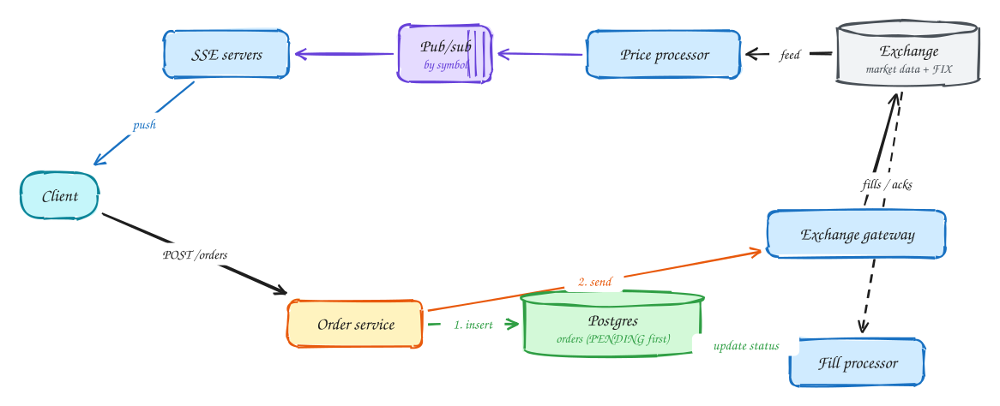

# Stock trading (Robinhood)

**Difficulty:** Hard · **Patterns:** [Real-time updates](../patterns/real-time-updates.md) · **DDIA:** [Ch 8](../ddia/08-trouble-with-distributed-systems.md) unknown outcomes · [Ch 12](../ddia/12-future-of-data-systems.md) idempotency · [Ch 11](../ddia/11-stream-processing.md) pub/sub

*Two separate problems: pushing live prices to millions, and never losing or duplicating an order.*

## TL;DR

- Prices: one consumer of the exchange feed publishes per symbol; push servers subscribe and stream to clients.
- Orders: persist the order as pending with your own ID before sending it to the exchange.
- Treat exchange calls as having unknown outcomes; reconcile by your order ID instead of resubmitting.

## 1. Requirements

**Functional**

1. See live stock prices for watched symbols
2. Place market and limit orders; cancel orders
3. See order status and fills

**Non-functional**

- Price updates < 200ms
- Orders never lost or duplicated
- Strong consistency on order state
- 20M users; market-open spikes

## 2. Back-of-envelope numbers

Exchange feed ~ thousands of updates/s for ~10k symbols. 20M users polling = millions of req/s, so push instead. Orders ~ thousands/s at peak.

## 3. Core entities and API

```text
orders(id, user_id, symbol, status PENDING|SUBMITTED|FILLED|CANCELLED, exchange_order_id) partitioned by user
```

```http
GET /prices/stream?symbols (SSE)
POST /orders {symbol, side, qty, type, limit?} + Idempotency-Key
DELETE /orders/{id}
```

## 4. v1: the simplest design, and where it breaks

Order and price paths are separate problems: one is real-time fan-out, the other is correctness.

## 5. Evolving to the final design



Each step fixes one specific problem with the step before it:

1. Order and price paths are separate problems: one is real-time fan-out, the other is correctness.
2. Prices: one consumer reads the exchange feed and publishes per symbol; SSE servers subscribe to the symbols their clients watch. Throttle to ~1 update/s per symbol for the app.
3. Orders: **persist PENDING first** with our own order ID, then send to the exchange using that ID as clientOrderId. If we crash in between, we can look it up and reconcile.
4. Fills and acks come back asynchronously and update order status; a reconciliation job compares against exchange reports daily.

## 6. Deep dives

### Write DB before or after the exchange call?

Before. Otherwise a crash after sending leaves a live order you don't know about. The exchange call has an unknown outcome on timeout (DDIA Ch 8).

### Duplicate submits?

Client Idempotency-Key with a unique index; the exchange also dedupes on clientOrderId.

### Cancel races with a fill?

Cancel is a request; status changes only on the exchange ack. Handle partial fills.

### Market-open spike?

Autoscale SSE servers; per-user rate limits on orders.

## 7. Interview script (45 minutes)

| Time | What you do | Content |
|---|---|---|
| 0–5 | Functional requirements | See live stock prices for watched symbols; Place market and limit orders; cancel orders; See order status and fills |
| 5–8 | Non-functional requirements | Price updates < 200ms; Orders never lost or duplicated; Strong consistency on order state; 20M users; market-open spikes |
| 8–10 | Numbers that drive the design | Exchange feed ~ thousands of updates/s for ~10k symbols. 20M users polling = millions of req/s, so push instead. Orders ~ thousands/s at peak. |
| 10–13 | Entities and API | Keep it short: the endpoints in §3, idempotency keys on writes. |
| 13–25 | v1, then evolve it | Draw v1 and show where it breaks. Then add, in order: Price processor → Pub/sub → SSE servers → Order service → Postgres → Exchange gateway → Fill processor. Justify each addition with a number. |
| 25–40 | Deep dives | Write DB before or after the exchange call? · Duplicate submits? · Cancel races with a fill? · Market-open spike? |
| 40–45 | Wrap-up | Remaining bottlenecks, failure modes, what you would monitor. |

## 8. Common mistakes

- Treating the exchange call as a local function call, so timeouts create ghost or duplicate orders.
- Adding components before showing which number makes them necessary.
- Skipping failure handling: what happens on timeouts, retries and crashes.

## Related

- **Patterns:** [Real-time updates](../patterns/real-time-updates.md)
- **DDIA:** [Ch 8](../ddia/08-trouble-with-distributed-systems.md) unknown outcomes · [Ch 12](../ddia/12-future-of-data-systems.md) idempotency · [Ch 11](../ddia/11-stream-processing.md) pub/sub
- **Similar problems:** [Ride sharing (Uber)](ride-sharing.md) · [Live comments (Facebook Live)](live-comments.md) · [Collaborative editor (Google Docs)](collaborative-editor.md) · [Online auction](online-auction.md)
