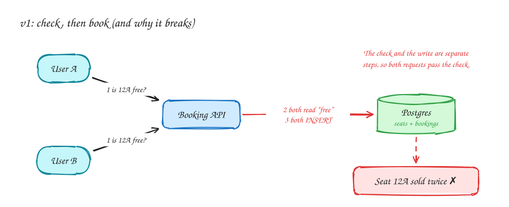
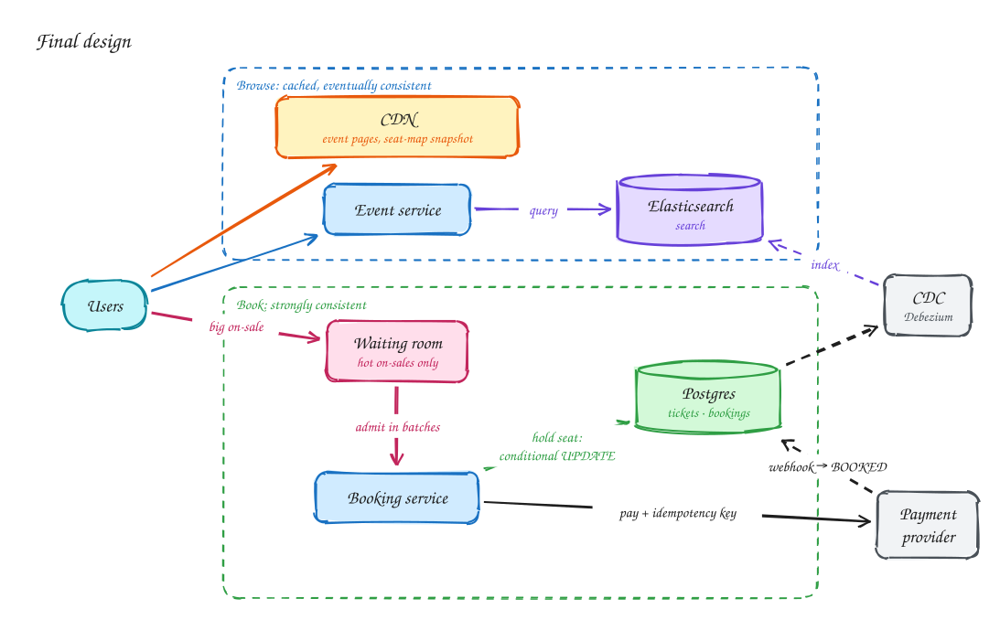
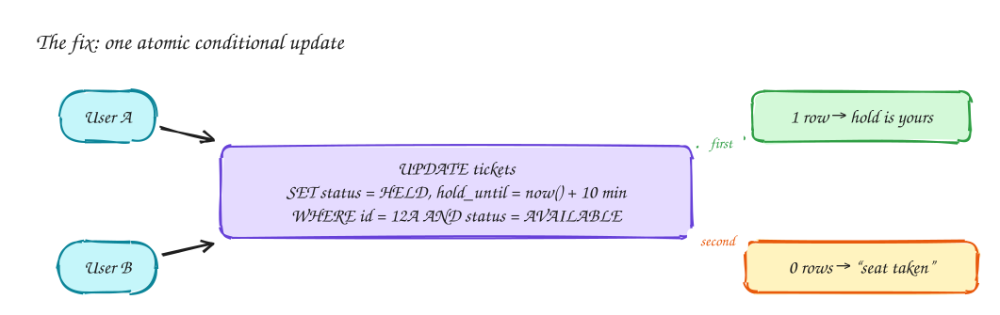

# Ticketmaster: selling seats without selling any seat twice

**Difficulty:** Medium · **Patterns:** [Dealing with contention](#related) · [Scaling reads](#related) · **Core concept:** [Caching](../core-concepts/caching.md) · **DDIA:** [Ch 5 Replication](../ddia/05-replication.md), Ch 7 Transactions

## TL;DR

- Two very different paths share one system. **Browsing** events is enormous, read-only traffic that can be slightly stale, so cache it hard. **Booking** is small but must be exactly right.
- The core bug is *check, then book*: two people both see seat 12A as free and both buy it. Fix it by making the check and the write **one atomic statement** in the database.
- For a huge on-sale, don't let 10 million people hit the booking path at once. A **virtual waiting room** admits them at the rate the system can actually handle.

## 1. Requirements

**Functional** (what users can do)

1. View an event and its seat map.
2. Search for events by name, date and location.
3. Book tickets: pick seats, hold them while paying, then confirm.

*Out of scope for this page:* resale, dynamic pricing, recommendations.

**Non-functional** (how well it must work; these drive the design)

| NFR | Target | Why it matters here |
|---|---|---|
| Consistency (booking) | A seat is never sold twice | This is the whole product. Choose **consistency over availability** on this path. |
| Availability (browse) | Event pages and search stay up during spikes | Choose **availability**; a seat map that's a few seconds stale is fine. |
| Latency | Event page p99 < 300 ms, search p99 < 500 ms | Fans refresh constantly during an on-sale. |
| Scale | ~10M users arrive for one popular on-sale | Traffic is extremely spiky, not steady. |
| Hold time | A held seat is reserved ~10 minutes during checkout | Long enough to pay, short enough not to block others. |

## 2. Back-of-envelope numbers

- A stadium has roughly **50k–100k seats**. That is the ceiling on successful bookings for one event, however many people show up.
- 10M fans refreshing every few seconds is **millions of reads/sec**, but nearly all of them are identical page views. That makes them ideal for a CDN or cache.
- So the read path needs to absorb millions of requests/sec, while the write path handles at most ~100k bookings spread over minutes.

> [!TIP]
> **Say this in the interview:** "Reads and writes differ by orders of magnitude here, so I'll design two paths: a cached, eventually consistent browse path and a small, strongly consistent booking path."

## 3. Core entities and API

| Entity | Key fields |
|---|---|
| `Event` | id, venue_id, name, date |
| `Ticket` | id, event_id, seat, price, **status** (`AVAILABLE` / `HELD` / `BOOKED`), **hold_until**, user_id |
| `Booking` | id, user_id, ticket_ids, payment_status |

```http
GET  /events/{id}                       → event details + seat map
GET  /search?q=&date=&location=         → events
POST /bookings/hold    {ticket_ids}     → booking_id, hold_until
POST /bookings/{id}/confirm             → called after payment succeeds
```

Every `POST` carries an `Idempotency-Key` header so a retry never creates a second booking. The user id comes from the auth token, never from the request body.

## 4. v1: the simplest design, and where it breaks



One API server and one Postgres database. To book, the API **reads** the seat, sees `AVAILABLE`, then **inserts** a booking.

**What breaks:** the read and the write are two separate steps. Two requests that arrive within milliseconds both read "free" before either has written, and both succeed. Adding more servers makes this *more* likely, not less.

This is a *write skew*: each transaction is fine on its own, but together they break the rule "one seat, one buyer". Most databases don't prevent it at their default isolation level. Postgres defaults to Read Committed.

## 5. Final design



| Component | Why it exists |
|---|---|
| **CDN** | Serves event pages and a seat-map snapshot from the edge, so millions of identical reads never reach your servers. |
| **Event service + Elasticsearch** | Search by text, date and location. Elasticsearch is a *derived copy*, kept in sync from Postgres by change data capture (CDC), never written to directly. |
| **Waiting room** | Only switched on for hot on-sales. Users join a queue and are admitted in batches, so the booking path sees steady, survivable load. |
| **Booking service** | Holds seats with one atomic conditional `UPDATE` (see the deep dive), then confirms after payment. |
| **Postgres** | The single source of truth for tickets and bookings. One primary is enough, because booking volume is capped by seat count. |
| **Payment provider** | Called with an idempotency key. Its webhook flips the booking from `HELD` to `BOOKED`. |

## 6. Deep dives

### 6.1 How exactly do we stop double booking?



Put the check *inside* the write:

```sql
UPDATE tickets
SET    status = 'HELD', user_id = :user, hold_until = now() + interval '10 minutes'
WHERE  id = :ticket
  AND (status = 'AVAILABLE' OR (status = 'HELD' AND hold_until < now()));
```

The database locks the row while it applies the update, so concurrent requests are serialized. **1 row updated** means you hold the seat. **0 rows** means someone else got there first.

Notice what we *didn't* need:

- **No background job to release abandoned holds.** An expired hold simply satisfies the `WHERE` clause again.
- **No long transaction while the user pays.** The hold is a row state, not an open lock, so the database never waits on a human.

Alternatives, and when they fit:

| Option | Good when | Watch out for |
|---|---|---|
| Conditional `UPDATE` (above) | Default. Single database. | None for this problem. |
| `SELECT … FOR UPDATE` | Multi-step logic on a few rows | Holding locks too long; deadlocks across several seats. Lock seats in a fixed order. |
| Redis `SET seat:12A user NX EX 600` | Holds shared across services; very hot seats | Redis is not the source of truth, so still write the final booking to Postgres. Locks need fencing if a process can pause. |

### 6.2 Ten million people at 10:00:00

Without protection, everyone hits *Book* in the same second. Even a correct database melts, and users see errors instead of "sold out".

**Virtual waiting room:**

1. Users who arrive before the on-sale get a queue position (Redis sorted set, score = arrival time).
2. Every few seconds, admit the next *N* users. *N* is chosen from what the booking path can sustain.
3. Push "it's your turn" over SSE. Admitted users get a short-lived token that the booking service checks.

The booking service only ever sees the load you planned for, and users get a fair, honest wait instead of errors.

### 6.3 The seat map is stale. Is that a bug?

No, as long as you're deliberate about it. The seat map is a snapshot served from cache or CDN and refreshed every few seconds. A user might click a seat that was taken a second ago, and the conditional update simply tells them so. **The browse path is allowed to be wrong; the booking path never is.**

### 6.4 What if payment times out?

The outcome is unknown: the card may or may not have been charged. Keep the booking `HELD` and retry with the **same idempotency key**, or ask the provider for the status of that key. Never start a second charge. The webhook is the source of truth for the final state, and it must be idempotent too, because providers deliver webhooks more than once.

## 7. Interview script (45 minutes)

| Time | What you do | What you say |
|---|---|---|
| 0–5 | Functional requirements | "Users can view events, search, and book seats with a short hold during checkout." |
| 5–8 | NFRs | "No seat sold twice: that path is CP. Browsing must survive huge spikes: that path is AP." |
| 8–10 | Numbers | "Bookings are capped by seat count (~100k); reads are millions per second and identical." |
| 10–13 | Entities + API | Ticket with status and hold_until; hold and confirm endpoints with idempotency keys. |
| 13–22 | v1 and its bug | Draw v1, then show the check-then-book race with two users. |
| 22–30 | Fix | Conditional `UPDATE`; why no cleanup job is needed; why no long transaction. |
| 30–40 | Scale | CDN + cache for browse; Elasticsearch via CDC for search; waiting room for on-sales. |
| 40–45 | Wrap-up | Payment timeouts and idempotency; what you'd monitor (hold success rate, queue length, p99). |

## 8. Common mistakes

- **Check, then insert** in application code. Correct-looking, wrong under concurrency.
- **Holding a database transaction open while the user pays.** Locks pile up and throughput collapses.
- **Using Redis as the only record of a booking.** Redis is a fine place for holds, but the booking must land in the durable database.
- **Treating browse and book the same.** Making browsing strongly consistent wastes money; making booking eventually consistent sells seats twice.
- **Sharding the bookings database "for scale".** Booking volume is capped by seat count; one primary handles it.

## Related

- **Patterns:** Dealing with contention · Scaling reads *(pattern pages coming next)*
- **Core concepts:** [Caching](../core-concepts/caching.md)
- **DDIA:** [Ch 5 Replication](../ddia/05-replication.md) for why replicas can serve a stale seat map; Ch 7 Transactions for write skew and why the default isolation level doesn't save you.
- **Similar problems:** Online auction (contention on one row), Local delivery inventory (decrement stock without overselling).
