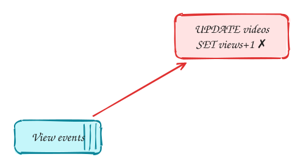
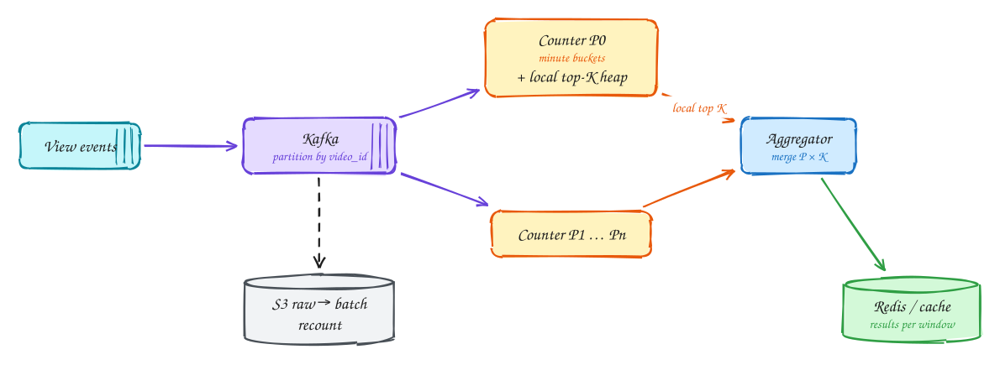

# Top-K videos (YouTube)

**Difficulty:** Hard · **Patterns:** [Scaling writes](../patterns/scaling-writes.md) · **DDIA:** [Ch 11](../ddia/11-stream-processing.md) windows, partitioned streams · [Ch 6](../ddia/06-partitioning.md) partition by key

*The design falls straight out of one number: hundreds of thousands of views per second.*

> [!TIP]
> **One-page sketchnote:** [TOP-K VIDEOS (YOUTUBE) on a single page](../sketchnotes/problem-top-k-videos.svg), for revision or printing.

## TL;DR

- A counter row per video in a database can't take ~800k updates per second.
- Stream views through Kafka partitioned by video ID; each consumer counts its videos in memory and keeps a local top-K.
- Merge the per-partition top-K lists; the result is exact because each video lives in exactly one partition.

## 1. Requirements

**Functional**

1. Top K most-viewed videos for the last hour, day, month, and all time

**Non-functional**

- Query latency < 100ms
- Freshness ~1 minute
- Accurate counts (billing-grade not required, but no big drift)
- Massive view volume

## 2. Back-of-envelope numbers

70B views/day ≈ **~800k views/s**. 4B videos × 8B counters ≈ 32GB of state, spread over partitions.

## 3. Core entities and API

```text
view events (video_id, ts) → per-minute counts per video → per-window top-K heap
```

```http
GET /topk?window=hour|day|month|all&k=100
```

## 4. v1: the simplest design, and where it breaks



Naive: increment a counter row per view and ORDER BY views. That is 800k UPDATEs/sec on hot rows, then a full sort.

## 5. Evolving to the final design



Each step fixes one specific problem with the step before it:

1. Naive: increment a counter row per view and ORDER BY views. That is 800k UPDATEs/sec on hot rows, then a full sort.
2. Stream views into Kafka partitioned by **video_id**, so every view of a video lands on the same consumer.
3. Each consumer counts in memory in per-minute buckets and keeps a local top-K heap. The aggregator merges P×K candidates, which is exact because each video lives in exactly one partition.
4. Windows: hour = sum of the last 60 minute-buckets (subtract the expiring one). Results are cached; raw events go to S3 for batch correction.

## 6. Deep dives

### Why is the merge exact?

A video's full count lives in one partition, so its global rank can only come from its local rank. The global top K ⊆ union of local top Ks.

### Sliding windows?

A ring buffer of minute counts per video; for months use hourly buckets. Rolling sums avoid rescanning.

### Very hot video?

Pre-aggregate on producers (send counts per second, not individual views).

### Approximate is OK?

Count-Min Sketch + heap uses fixed memory and is good for trending; exact needs partitioned counting.

## 7. Interview script (45 minutes)

| Time | What you do | Content |
|---|---|---|
| 0–5 | Functional requirements | Top K most-viewed videos for the last hour, day, month, and all time |
| 5–8 | Non-functional requirements | Query latency < 100ms; Freshness ~1 minute; Accurate counts (billing-grade not required, but no big drift); Massive view volume |
| 8–10 | Numbers that drive the design | 70B views/day ≈ **~800k views/s**. 4B videos × 8B counters ≈ 32GB of state, spread over partitions. |
| 10–13 | Entities and API | Keep it short: the endpoints in §3, idempotency keys on writes. |
| 13–25 | v1, then evolve it | Draw v1 and show where it breaks. Then add, in order: Kafka → Counter P0 → Counter P1 … Pn → Aggregator → Redis / cache → S3 raw → batch. Justify each addition with a number. |
| 25–40 | Deep dives | Why is the merge exact? · Sliding windows? · Very hot video? · Approximate is OK? |
| 40–45 | Wrap-up | Remaining bottlenecks, failure modes, what you would monitor. |


## Staff-level lens

| Question | Staff answer |
|---|---|
| **The real problem** | Count ~800k events/s and rank across hour, day, month and all time. |
| **Deciding number** | 70B views/day ≈ 800k/s; 4B videos × 8 B ≈ 32 GB of counters. |
| **Staff call and trade-off** | Kafka partitioned by video; in-memory counts and local heaps; merge. Accept ~1 min freshness, with a batch recount for exact totals. |
| **Raise before you're asked** | One viral video skewing a partition (pre-aggregate at producers); counts lost on restart (checkpoint); late events. |
| **Senior stops at** | Streaming counts. |
| **Staff goes on to** | Proves the merge is exact, chooses exact vs Count-Min per window, adds a reconciliation path. |
| **Run it** | Watch consumer lag, window freshness, stream vs batch difference. |

All 29 problems through this lens: [Staff-level answers](../playbook/staff-level.md).

## 8. Common mistakes

- A counter row per video in the DB: 800k writes/sec on hot rows.
- Adding components before showing which number makes them necessary.
- Skipping failure handling: what happens on timeouts, retries and crashes.

## Related

- **Patterns:** [Scaling writes](../patterns/scaling-writes.md)
- **DDIA:** [Ch 11](../ddia/11-stream-processing.md) windows, partitioned streams · [Ch 6](../ddia/06-partitioning.md) partition by key
- **Similar problems:** [Ad click aggregator](ad-click-aggregator.md) · [Web crawler](web-crawler.md) · [Metrics monitoring (Datadog)](metrics-monitoring.md) · [Fitness tracking (Strava)](fitness-tracking.md)
