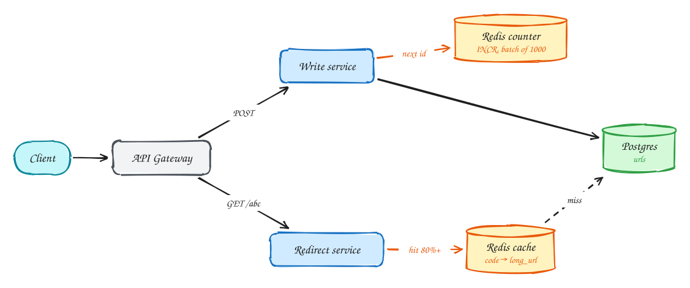

# URL shortener (Bitly)

<span class="lvl lvl-b">Beginner-friendly</span>

**Difficulty:** Easy · **Patterns:** [Scaling reads](../patterns/scaling-reads.md) · **DDIA:** [Ch 5](../ddia/05-replication.md) replicas · [Ch 6](../ddia/06-partitioning.md) hash sharding

*It sounds like a toy, but it is the cleanest example of a read-heavy system: almost every request is a redirect.*

> [!TIP]
> **One-page sketchnote:** [URL SHORTENER (BITLY) on a single page](../sketchnotes/problem-url-shortener.svg), for revision or printing.

## TL;DR

- Redirects outnumber new links about 100 to 1, so the design is mostly about serving reads fast.
- Generate short codes from a counter encoded in base62: unique by construction, no collision checks.
- Put a cache in front of the database; a small share of links gets most clicks, so the hit rate is high.

## 1. Requirements

**Functional**

1. Create a short URL for a long URL (optional custom alias, expiry)
2. Redirect short URL → original URL

**Non-functional**

- Redirect p99 < 100ms
- 99.99% available for redirects
- Short codes globally unique
- Read:write ≈ 100:1

## 2. Back-of-envelope numbers

100M DAU × 10 clicks = 1B redirects/day ≈ **12k/s avg, ~100k/s peak**. Writes ~1M/day ≈ 12/s. 1B URLs × 500B = **500GB**, which fits one Postgres.

## 3. Core entities and API

```text
urls(code PK, long_url, user_id, created_at, expires_at)
```

```http
POST /urls {long_url, alias?, expires_at?} → short_url
GET /{code} → 302 Location: long_url
```

## 4. v1: the simplest design, and where it breaks

Start with the smallest thing that meets the functional requirements: one service and one Postgres table.

- **Create:** `POST /urls` generates a short code, inserts `(code, long_url, …)` into `urls`, and returns `https://sho.rt/<code>`.
- **Redirect:** `GET /{code}` looks up the code by primary key and replies `302` with the long URL in the `Location` header.

**Where it breaks:** not on writes. About 12 new links a second is nothing for Postgres. It breaks on **reads**. Redirects run at about 12k a second on average and **~100k a second at peak**, and every one is a database query. One Postgres primary serving 100k primary-key lookups a second is at or past its limit, and the redirect p99 target of 100 ms suffers first during spikes. Code generation also needs a decision: how do we make codes unique without checking the database for collisions every time?

## 5. Evolving to the final design



Each step fixes one specific problem with the step before it.

### Step 1: put a cache in front of the database

**Why:** redirects outnumber writes 100 to 1, and the database can't serve 100k lookups a second by itself. But clicks are very uneven. A small share of links (a viral tweet, a campaign) gets most of the traffic. That pattern is perfect for a cache.

**How:** use cache-aside with Redis. On a redirect, look up `code → long_url` in Redis. On a hit (80%+ of the time, often far more), redirect in under a millisecond without touching Postgres. On a miss, read Postgres, store the result in Redis with a TTL, then redirect. Links almost never change, so stale data isn't a concern. If Postgres still sees too many misses, add read replicas.

### Step 2: generate codes from a counter, not a hash or random string

**Why:** random or hashed codes can **collide**, and each create would need "check if the code exists, retry if it does". That's an extra query, and a race if two creates pick the same code at once.

**How:** keep a global counter (Redis `INCR`, or a database sequence) and encode each number in **base62** (`0–9a–zA–Z`). Every number is different, so every code is different: unique by construction, with no checks needed. Seven base62 characters give 62⁷ ≈ **3.5 trillion** codes. To avoid a counter call per create, each app server **reserves a batch** of 1,000 numbers at once and hands them out locally.

## 6. Deep dives

### How do you guarantee unique codes?

**Why it's hard:** with many app servers creating links at once, two of them could pick the same code. With random or hashed codes, collisions become more likely as the table fills up.

**How:** the counter-plus-base62 approach makes collisions impossible, because each number is issued once. If you prefer hashing (say, the first 7 characters of an MD5 of the URL), put a **unique constraint** on `code` and retry with a salt on conflict. One catch with counters: consecutive codes are **guessable**, so anyone can walk through all links. If that matters, pass the number through a reversible shuffle (a small block cipher or a multiplicative permutation) before encoding. It stays unique but looks random.

### 301 or 302?

**Why it matters:** the status code decides whether browsers come back to you on the next click.

**How to choose:** a **301 (permanent)** redirect is cached by the browser, so later clicks go straight to the long URL without reaching you. That's less load, but you lose click analytics and can't change or expire the link. A **302 (temporary)** redirect isn't cached, so every click reaches your service and can be counted, expired or edited. Most shorteners use **302** because analytics is part of the product. The cache in step 1 keeps the extra load cheap.

### What if the counter node dies?

**Why it matters:** if the counter is a single Redis instance and it is lost, a new one might start again from an old value and **reissue codes** that already exist.

**How:** make the counter durable: Redis with append-only persistence plus a replica, or use a Postgres sequence, which is durable by design. Combined with batching, servers **lease ranges** ("give me the next 1,000"), so the counter is touched rarely. If a server crashes holding an unused range, those numbers are simply skipped. **Gaps are harmless**; duplicates are the only real danger.

### Custom aliases?

**Why it's tricky:** users want readable codes like `sho.rt/summer-sale`, which must not clash with generated codes or with each other.

**How:** store aliases in the same table, protected by the same **unique constraint** on `code`. If the insert fails, the alias is taken, so tell the user. To make sure an alias can never collide with a future generated code, **separate the namespaces**: for example, generated codes are exactly 7 characters and aliases must be 8 or more, or contain a character the generator never uses.

## 7. Interview script (45 minutes)

| Time | What you do | Content |
|---|---|---|
| 0–5 | Functional requirements | Create a short URL for a long URL (optional custom alias, expiry); Redirect short URL → original URL |
| 5–8 | Non-functional requirements | Redirect p99 < 100ms; 99.99% available for redirects; Short codes globally unique; Read:write ≈ 100:1 |
| 8–10 | Numbers that drive the design | 100M DAU × 10 clicks = 1B redirects/day ≈ **12k/s avg, ~100k/s peak**. Writes ~1M/day ≈ 12/s. 1B URLs × 500B = **500GB**, which fits one Postgres. |
| 10–13 | Entities and API | Keep it short: the endpoints in §3, idempotency keys on writes. |
| 13–25 | v1, then evolve it | Draw v1 and show where it breaks. Then add, in order: Redirect service → Redis cache → Redis counter. Justify each addition with a number. |
| 25–40 | Deep dives | How do you guarantee unique codes? · 301 or 302? · What if the counter node dies? · Custom aliases? |
| 40–45 | Wrap-up | Remaining bottlenecks, failure modes, what you would monitor. |


## Staff-level lens

| Question | Staff answer |
|---|---|
| **The real problem** | Serve redirects fast at 100:1 read-heavy, and make codes unique without coordination. |
| **Deciding number** | ~100k redirects/s peak vs ~12 writes/s; 1B links × 500 B ≈ 500 GB, one Postgres. |
| **Staff call and trade-off** | Cache-aside Redis plus replicas; counter + base62 with servers leasing ID ranges. Accept guessable codes, or add a reversible shuffle. |
| **Raise before you're asked** | A viral link expiring from cache (stampede); losing the counter node (leased ranges make gaps harmless); phishing links. |
| **Senior stops at** | Cache in front of the DB. |
| **Staff goes on to** | Treats 301 vs 302 as a product decision (analytics vs load), adds abuse scanning, serves redirects from the edge for global latency. |
| **Run it** | SLO: p99 redirect < 100 ms. Watch hit ratio and DB miss QPS. Next step at 10×: edge key-value store at the CDN. |

All 29 problems through this lens: [Staff-level answers](../playbook/staff-level.md).

## 8. Common mistakes

- Sharding 500GB at 12 writes/sec. It fits one machine; scale reads with cache and replicas.
- Adding components before showing which number makes them necessary.
- Skipping failure handling: what happens on timeouts, retries and crashes.

## Self-check

Try to answer before you open each one.

<details class="question" markdown>
<summary>Why use a counter encoded in base62 instead of hashing the long URL?</summary>

A counter is unique by construction, so there are no collisions to check. Hashing needs a collision check and retry on every insert.

</details>

<details class="question" markdown>
<summary>Should the redirect be 301 or 302, and why?</summary>

302 (temporary) if you need click analytics, because browsers don't cache it and every click reaches you. 301 is cached by browsers and saves load but hides repeat clicks.

</details>

<details class="question" markdown>
<summary>Why does a cache work so well here?</summary>

Redirects outnumber writes about 100:1 and a small share of links get most clicks, so the hit rate is high and links rarely change.

</details>

## Related

- **Patterns:** [Scaling reads](../patterns/scaling-reads.md)
- **DDIA:** [Ch 5](../ddia/05-replication.md) replicas · [Ch 6](../ddia/06-partitioning.md) hash sharding
- **Similar problems:** [Rate limiter](rate-limiter.md) · [Business discovery (Yelp)](business-discovery.md) · [News feed (Facebook)](news-feed.md) · [News aggregator (Google News)](news-aggregator.md)
