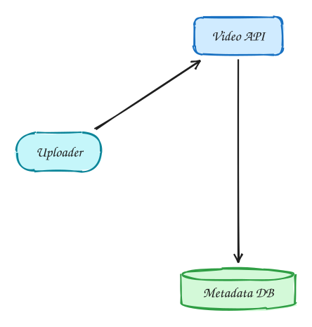
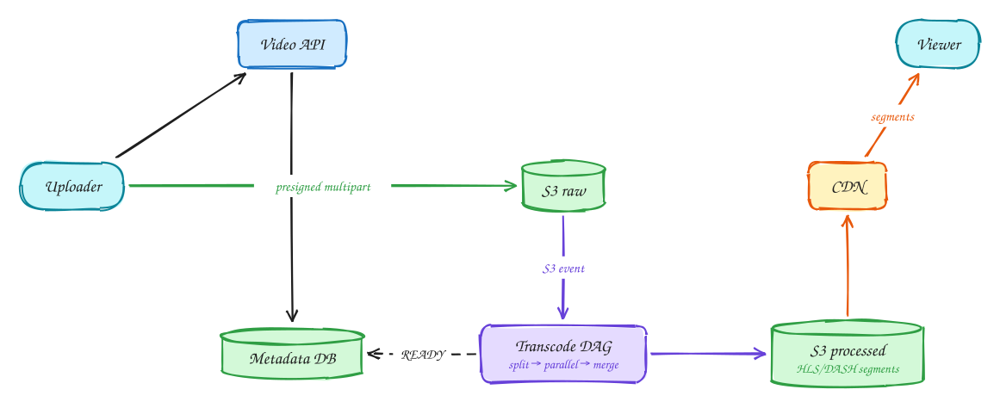

# Video platform (YouTube)

<span class="lvl lvl-a">Advanced</span>

**Difficulty:** Hard · **Patterns:** [Handling large blobs](../patterns/large-blobs.md) · [Scaling reads](../patterns/scaling-reads.md) · **DDIA:** [Ch 10](../ddia/10-batch-processing.md) batch DAGs · [Ch 1](../ddia/01-reliability-scalability-maintainability.md) bandwidth math

*Two hard problems: getting gigabyte uploads in reliably, and streaming smoothly on any connection.*

> [!TIP]
> **One-page sketchnote:** [VIDEO PLATFORM (YOUTUBE) on a single page](../sketchnotes/problem-video-platform.svg), for revision or printing.

## TL;DR

- Upload directly to object storage with presigned, multipart, resumable URLs; bytes never touch your servers.
- Split videos into segments and transcode them in parallel into several resolutions.
- Serve segments from a CDN and let the player switch quality per segment (adaptive bitrate).

## 1. Requirements

**Functional**

1. Upload videos (up to many GB)
2. Watch videos with smooth playback on any network

**Non-functional**

- Resumable uploads
- Fast start, adaptive quality
- ~1M uploads/day; billions of views
- Metadata availability over consistency

## 2. Back-of-envelope numbers

1M uploads/day × 1GB raw ≈ **1PB/day** raw, plus several renditions. Views are mostly served from the **CDN**, not origin.

## 3. Core entities and API

```text
videos(id, uploader, title, status UPLOADING|PROCESSING|READY, manifest_url)
S3 raw/ + processed/{rendition}/{segment}
```

```http
POST /videos → {video_id, presigned multipart URLs}
GET /videos/{id} → manifest URL
PUT parts directly to S3
```

## 4. v1: the simplest design, and where it breaks



Users upload a video file through the API, which saves it to storage. Viewers download the same file through the API and play it.

**Where it breaks:**

- **Uploads:** a 1 GB+ file through the API servers ties up a connection, memory and bandwidth for minutes. A dropped connection at 90% means starting over. About 1M uploads a day is roughly **1 PB a day** flowing through your servers.
- **Playback:** one big file at one quality is a terrible experience. On a slow phone connection it buffers constantly; on a fast one, a low-quality file looks bad. The player has to download a large chunk before playing.
- **Views:** billions of views a day served from your origin servers would need enormous bandwidth.

## 5. Evolving to the final design



Each step fixes one specific problem with the step before it.

### Step 1: upload directly to object storage, in parts

**Why:** your API servers should never carry video bytes, and uploads must survive bad connections.

**How:** `POST /videos` creates a `videos` row with status **UPLOADING** and returns **presigned multipart upload URLs**. The client splits the file into parts (say 10 MB each) and uploads them **in parallel, directly to S3**. If a part fails, only that part is retried. If the app is closed, the upload **resumes** later from the missing parts. Your servers handle only small metadata calls (see [Handling large blobs](../patterns/large-blobs.md)).

### Step 2: transcode in parallel into segments and renditions

**Why:** viewers need many versions: different resolutions (240p to 4K) for different devices and network speeds, and **short segments**, so playback can start quickly and quality can change mid-video. Transcoding a 2-hour 4K video in one piece takes hours.

**How:** when the upload completes, an **S3 event** starts a processing pipeline, a **DAG** of tasks:

1. **Split** the video into short segments (a few seconds each).
2. **Transcode** every segment into every resolution, **in parallel** across many workers.
3. Write **HLS/DASH manifests**: index files listing each rendition and its segments.
4. Mark the video **READY**.

Hundreds of workers each handling a small segment turn hours of transcoding into minutes.

### Step 3: serve from a CDN with adaptive bitrate

**Why:** billions of views need to be served from close to viewers, and each viewer's bandwidth changes from moment to moment.

**How:** the player fetches the **manifest** and then the segments from a **CDN**, so your origin rarely serves a byte. The player measures how fast segments arrive and picks the **quality for each next segment**. On a fast connection it moves up to 1080p; if the train enters a tunnel, it drops to 360p rather than stalling. This is **adaptive bitrate streaming**.

## 6. Deep dives

### Why presigned URLs?

**Why not proxy through the API:** every byte through your servers costs bandwidth, memory and time, and multi-GB uploads make servers fragile and expensive to scale.

**How it works:** a presigned URL is an S3 URL with a **signature** that grants permission to upload one specific object for a short time, without giving the client credentials. The client talks **directly to S3**, which is built for massive parallel uploads. **Multipart** upload adds parallel parts and resumability. Your API only issues URLs and records metadata.

### Fast transcoding?

**Why it's slow by default:** transcoding is CPU-heavy, and a long video processed start-to-finish on one machine takes far longer than the video itself.

**How:** **parallelize at the segment level**. Split the video into segments of a few seconds, and transcode each segment into each rendition as an **independent task** on a large worker pool. A 2-hour video might become thousands of small tasks running at once. An orchestrator tracks the DAG, so it knows when every task for a rendition is done, retries failures, and writes the manifest when everything's ready.

### Adaptive bitrate?

**Why it's needed:** network speed varies between viewers and over time for the same viewer. A fixed quality either buffers or looks unnecessarily bad.

**How:** the **manifest** lists the available renditions (240p, 480p, 720p, 1080p…), each split into the **same time-aligned segments**. Because segments line up, the player can switch rendition at any segment boundary. It measures download throughput and buffer level, and chooses the highest quality it can fetch faster than it plays.

### Cost?

**Why it matters:** transcoding every upload into every format and storing all of it is expensive, and most videos get very few views.

**How:** transcode **eagerly** only the common renditions that nearly every video needs. Generate rarer ones (4K, extra codecs) **lazily**, only when a video becomes popular enough to justify them. Move rarely-watched videos' files to cheaper storage tiers over time. The CDN already keeps popular content close to viewers, so origin bandwidth stays low.

## 7. Interview script (45 minutes)

| Time | What you do | Content |
|---|---|---|
| 0–5 | Functional requirements | Upload videos (up to many GB); Watch videos with smooth playback on any network |
| 5–8 | Non-functional requirements | Resumable uploads; Fast start, adaptive quality; ~1M uploads/day; billions of views; Metadata availability over consistency |
| 8–10 | Numbers that drive the design | 1M uploads/day × 1GB raw ≈ **1PB/day** raw, plus several renditions. Views are mostly served from the **CDN**, not origin. |
| 10–13 | Entities and API | Keep it short: the endpoints in §3, idempotency keys on writes. |
| 13–25 | v1, then evolve it | Draw v1 and show where it breaks. Then add, in order: S3 raw → Transcode DAG → S3 processed → CDN → Viewer. Justify each addition with a number. |
| 25–40 | Deep dives | Why presigned URLs? · Fast transcoding? · Adaptive bitrate? · Cost? |
| 40–45 | Wrap-up | Remaining bottlenecks, failure modes, what you would monitor. |


## Staff-level lens

| Question | Staff answer |
|---|---|
| **The real problem** | Reliable huge uploads and smooth playback anywhere. |
| **Deciding number** | ~1 PB/day raw uploads. |
| **Staff call and trade-off** | Presigned multipart uploads, a segment-parallel transcoding DAG, CDN delivery. Accept encoding long-tail formats lazily. |
| **Raise before you're asked** | Transcode failures and retries; storage cost; popularity spikes. |
| **Senior stops at** | S3 + CDN. |
| **Staff goes on to** | A cost model (storage tiers, lazy encoding), DAG retries, CDN strategy. |
| **Run it** | Watch upload success, time to playable, CDN hit ratio, rebuffer rate. |

All 29 problems through this lens: [Staff-level answers](../playbook/staff-level.md).

## 8. Common mistakes

- Serving or uploading whole files through app servers.
- Adding components before showing which number makes them necessary.
- Skipping failure handling: what happens on timeouts, retries and crashes.

## Self-check

Try to answer before you open each one.

<details class="question" markdown>
<summary>Why upload with presigned, multipart URLs?</summary>

Bytes go straight to object storage, never through your servers, and large uploads can resume part by part.

</details>

<details class="question" markdown>
<summary>How do you transcode a long video quickly?</summary>

Split it into segments and transcode them in parallel into several resolutions.

</details>

<details class="question" markdown>
<summary>What is adaptive bitrate streaming?</summary>

The player switches quality per segment based on current bandwidth, with segments served from a CDN.

</details>

## Related

- **Patterns:** [Handling large blobs](../patterns/large-blobs.md) · [Scaling reads](../patterns/scaling-reads.md)
- **DDIA:** [Ch 10](../ddia/10-batch-processing.md) batch DAGs · [Ch 1](../ddia/01-reliability-scalability-maintainability.md) bandwidth math
- **Similar problems:** [File storage and sync (Dropbox)](file-sync.md) · [Photo sharing (Instagram)](photo-sharing.md)
