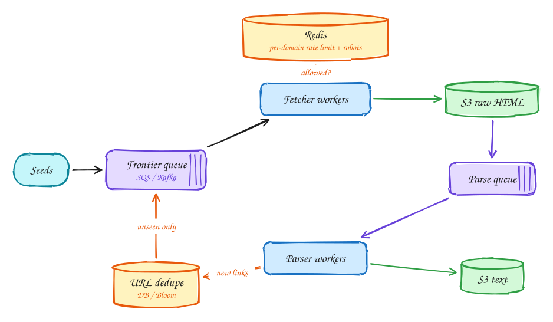

# Web crawler

<span class="lvl lvl-a">Advanced</span>

**Difficulty:** Hard · **Patterns:** [Scaling writes](../patterns/scaling-writes.md) · **DDIA:** [Ch 10](../ddia/10-batch-processing.md) batch pipelines · [Ch 3](../ddia/03-storage-and-retrieval.md) Bloom filters · [Ch 11](../ddia/11-stream-processing.md) queues

*Ten billion pages in five days is a pipeline problem, constrained by politeness and network bandwidth.*

> [!TIP]
> **One-page sketchnote:** [WEB CRAWLER on a single page](../sketchnotes/problem-web-crawler.svg), for revision or printing.

## TL;DR

- About 23k pages per second; size the fleet by network bandwidth, not CPU.
- Split fetching and parsing into separate stages with queues and stored raw pages, so each scales and retries on its own.
- Respect per-domain rate limits and robots.txt, and skip already-seen URLs and duplicate content.

## 1. Requirements

**Functional**

1. Crawl from seed URLs, fetch pages, extract text, follow links
2. Store text for LLM training: 10B pages in 5 days

**Non-functional**

- Politeness: robots.txt, per-domain rate limits
- Fault tolerant: resume without losing progress
- No duplicate URLs or content
- Efficient (network-bound)

## 2. Back-of-envelope numbers

10B ÷ 5 days ≈ **23k pages/s**. × ~2MB ≈ 46GB/s, so size the fleet by **network bandwidth**, not CPU. Raw storage ~20PB → S3.

## 3. Core entities and API

```text
urls(url_hash PK, url, status, last_crawled)
domains(domain, robots, crawl_delay, next_allowed_at)
```

```http
internal: frontier queue messages {url, depth}
S3: raw/{url_hash}, text/{url_hash}
```

## 4. v1: the simplest design, and where it breaks

Start with a frontier queue of URLs and fetcher workers pulling from it.

## 5. Evolving to the final design



Each step fixes one specific problem with the step before it:

1. Start with a frontier queue of URLs and fetcher workers pulling from it.
2. Split **fetch** (network-bound) from **parse** (CPU-bound) with S3 + a second queue. Each scales independently, and parsing can be re-run from stored HTML.
3. Politeness: per-domain token buckets and cached robots.txt in Redis. Not allowed yet? Re-queue with a delay (visibility timeout).
4. Extracted links pass a dedupe check (URL hash in DB or Bloom filter) before entering the frontier. Content hashes catch mirrored pages.

## 6. Deep dives

### Why separate stages?

Different bottlenecks, independent scaling and retries, and you can re-parse 20PB without re-crawling.

### Crash mid-crawl?

A message is acked only after the raw page is in S3: at-least-once, idempotent by URL hash.

### Crawler traps?

Max depth per domain, URL normalization, content-hash dedupe.

### DNS bottleneck?

Cache DNS per worker; multiple resolvers.

## 7. Interview script (45 minutes)

| Time | What you do | Content |
|---|---|---|
| 0–5 | Functional requirements | Crawl from seed URLs, fetch pages, extract text, follow links; Store text for LLM training: 10B pages in 5 days |
| 5–8 | Non-functional requirements | Politeness: robots.txt, per-domain rate limits; Fault tolerant: resume without losing progress; No duplicate URLs or content; Efficient (network-bound) |
| 8–10 | Numbers that drive the design | 10B ÷ 5 days ≈ **23k pages/s**. × ~2MB ≈ 46GB/s, so size the fleet by **network bandwidth**, not CPU. Raw storage ~20PB → S3. |
| 10–13 | Entities and API | Keep it short: the endpoints in §3, idempotency keys on writes. |
| 13–25 | v1, then evolve it | Draw v1 and show where it breaks. Then add, in order: S3 raw HTML → Parse queue → Parser workers → S3 text → Redis → URL dedupe. Justify each addition with a number. |
| 25–40 | Deep dives | Why separate stages? · Crash mid-crawl? · Crawler traps? · DNS bottleneck? |
| 40–45 | Wrap-up | Remaining bottlenecks, failure modes, what you would monitor. |


## Staff-level lens

| Question | Staff answer |
|---|---|
| **The real problem** | A politeness-limited pipeline that must finish 10B pages in 5 days. |
| **Deciding number** | ~23k pages/s; ~46 GB/s of bandwidth; ~20 PB raw. |
| **Staff call and trade-off** | Separate fetch and parse stages with queues and raw pages in S3. Accept storage cost to make each stage independently retryable. |
| **Raise before you're asked** | Crawler traps; breaking per-domain rate limits; DNS as a bottleneck; duplicate content. |
| **Senior stops at** | Queue + workers. |
| **Staff goes on to** | Sizes the fleet by bandwidth not CPU, prices the storage, prioritises the frontier, treats robots.txt as a hard rule. |
| **Run it** | Watch pages/s, per-domain errors, frontier size, dedupe ratio. |

All 29 problems through this lens: [Staff-level answers](../playbook/staff-level.md).

## 8. Common mistakes

- One monolithic fetch→parse loop: a slow parser stalls fetching and a crash loses in-flight work.
- Adding components before showing which number makes them necessary.
- Skipping failure handling: what happens on timeouts, retries and crashes.

## Related

- **Patterns:** [Scaling writes](../patterns/scaling-writes.md)
- **DDIA:** [Ch 10](../ddia/10-batch-processing.md) batch pipelines · [Ch 3](../ddia/03-storage-and-retrieval.md) Bloom filters · [Ch 11](../ddia/11-stream-processing.md) queues
- **Similar problems:** [Top-K videos (YouTube)](top-k-videos.md) · [Ad click aggregator](ad-click-aggregator.md) · [Metrics monitoring (Datadog)](metrics-monitoring.md) · [Fitness tracking (Strava)](fitness-tracking.md)
